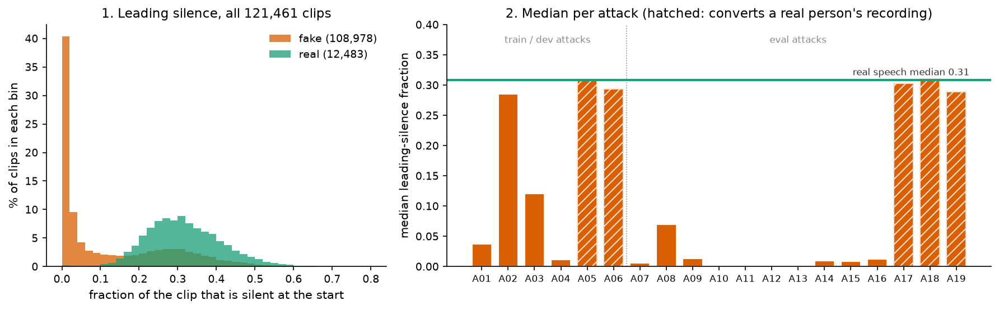
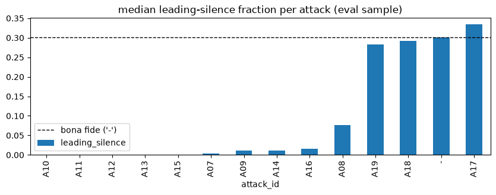

# Chapter 3 · Before building anything: can something stupid already "detect" fakes?

## One number per clip

In chapter 0 the real clip waited about 0.8 s before speaking, the fake about 0.35 s. One pair
proves nothing, so measure it on every clip.

For each clip we compute **the fraction of the clip that is silent before the first sound**.
The clip is cut into frames of 2,048 samples (128 milliseconds), one every 512 samples; a frame
is silent if its energy is more than 30 decibels (dB) below the clip's loudest frame
([`silence_ratio`](../../../SystemCode/src/audio_df/features/audio.py#L156), following the `librosa` audio library).
So "silent" means "much quieter than this clip's speech", not "digital zero": room hiss counts.

Here it is for all 121,461 clips of ASVspoof 2019 LA (the Automatic Speaker Verification
Spoofing and Countermeasures Challenge, logical access part):

*Source: [notebook 20](../../../SystemCode/notebooks/20_report_figures.ipynb), cell 11, from the per-clip output of `leakage.extract_nuisance_features`,
[`data/metadata/nuisance_features.csv`](../../../SystemCode/data/metadata/nuisance_features.csv); nothing is
recomputed from audio. [Notebook 01](../../../SystemCode/notebooks/01_dataset_audit.ipynb), cell 18 draws the
same quantity from raw audio.*

In the left panel, 29.5 % of fakes have less than 1 % leading silence, against only 0.2 % of
real clips; the medians are 0.31 for real and 0.04 for fake (printed in cell 11). You could almost
draw a threshold by eye, but a low orange hump sits under the green one: some fakes start just
like real clips. The right panel shows which; we come back to it below.

## A deliberately stupid detector

To be honest about it, we fit a **probe**: a classifier so small it can only answer "is
there information about real versus fake in this one number?" One probe is a **logistic
regression** (one threshold with a soft edge), the other a **decision tree of depth 2** (at most
three yes/no cut-offs); whichever ranks better is kept
([`_fit_and_score`](../../../SystemCode/src/audio_df/evaluation/leakage.py#L217),
[`audit_single_feature`](../../../SystemCode/src/audio_df/evaluation/leakage.py#L299)). The probes are not our detectors;
they only measure how much a shortcut gives away.

### Scoring the probe honestly: cross-validation

A probe tested on the clips it was fitted on would look better than it is. So we use **5-fold
cross-validation**: split the clips into 5 parts with the same real/fake mix, fit on 4, score the
unseen 5th, and rotate. Every clip gets an "out-of-fold" score from a probe that never saw it
([`_cross_val_oof_scores`](../../../SystemCode/src/audio_df/evaluation/leakage.py#L234)). We score those with the area
under the curve (AUC) and the equal error rate (EER) from chapter 2 (AUC 0.5: no information;
1.0: perfect separation).

### How sure are we? The bootstrap

Is the AUC a stable fact or luck of this set of clips? Pretend we had drawn another dataset:
draw 121,461 out-of-fold scores at random **with replacement** (some twice, some not at all),
recompute the AUC, and repeat 1,000 times. The middle 95 % is the **95 % confidence interval
(CI)**. Only the clips are resampled, not the probes
([`_bootstrap_ci`](../../../SystemCode/src/audio_df/evaluation/leakage.py#L271)). A narrow interval means the number would
barely move on another sample.

## The result

The audit ran every **nuisance feature** (a property unrelated to how the voice was made:
length, loudness, silence, speaker, file format) this way. The numbers below come from its output table
[`reports/tables/leakage_audit.csv`](../../../SystemCode/reports/tables/leakage_audit.csv), written by
[`scripts/audit_leakage.py`](../../../SystemCode/scripts/audit_leakage.py). They match
[notebook 01](../../../SystemCode/notebooks/01_dataset_audit.ipynb), cell 15 and
[technical reference §3.5](../technical-reference.md).

| one number per clip | AUC [95 % CI] | EER |
|---|---|---|
| leading silence | **0.837** [0.835, 0.840] | 24.7 % |
| loudness (root-mean-square level) | 0.664 [0.660, 0.669] | 38.3 % |
| sample rate, codec or source corpus | 0.500 | n/a (same value for every clip) |
| all features combined | 0.876 [0.873, 0.878] | 22.9 % |

The first row: about 84 times in 100, the probe ranks a random real clip above a random fake,
using nothing but leading silence. A 24.7 % EER from a detector that knows nothing about voices.

The rest of the audit: total silence is almost as strong (AUC 0.825), speaker
identity is borderline (0.649), duration (0.624) and trailing silence (0.611) are weaker, and
the file-format details carry nothing because every clip shares them. A feature is **flagged**
when its AUC is above 0.65. That cut-off is a project convention, not a value from the
literature ([`DEFAULT_LEAKAGE_THRESHOLD`](../../../SystemCode/src/audio_df/evaluation/leakage.py#L82)). Flagged:
leading silence, total silence, loudness, and all combined.

Throwing in **every** feature only lifts AUC from 0.837 to 0.876: leading silence carries most
of the shortcut on its own.

## Why would fakes start sooner?

Not because synthesis is detectable, but because of how the dataset was assembled.

- The real clips are VCTK (Voice Cloning Toolkit) studio recordings, with the usual quiet lead-in.
- Text-to-speech (TTS) systems "are usually designed such that there is no leading or trailing
  silence in the output", and "silences are usually trimmed from TTS training data" (from paper
  [27, §2, p.2]).

Müller et al. reported this in 2021: a small neural network given **only** leading-silence
duration reached a 15.12 % EER on the 2019 evaluation set, against 50 % for random
guessing (from paper [27, §4.2, §5.1 and Table 1, p.3]). Their set-up differs (seconds, a 40 dB
rule, the evaluation split; we use a fraction, a 30 dB rule and cross-validation over all clips),
so the numbers are not directly comparable. Both say silence alone gets a detector a long way.

## Not every attack is silent: the per-attack view

The right panel of the figure above gives each attack's median. A10, A11, A12 and A13 sit at
exactly 0. **A17, A18 and A19 sit level with real speech** (0.30, 0.31 and 0.29, against 0.31).
The hatched bars, A05, A06, A17, A18 and A19, are exactly the attacks whose input is "Speech
(human)" (from paper [14, Table 1, p.6]): voice conversion (VC) systems that change the voice in a
real recording, so its lead-in survives.

A second view, from the audio of a 650-clip eval sample, shows the same split: A17, A18 and A19 near the bona fide
line, A10–A13 (and A15) at zero.

*Source: [notebook 09](../../../SystemCode/notebooks/09_a1_playground.ipynb), cell 16 (needs the raw audio). Default notebook colours; the dashed line is the bona fide median.*

One bar does not fit: **A02**, a text-to-speech attack, also has a long lead-in (median
0.285). The database paper gives no hint why; we don't know.

This is why chapter 2 insisted on per-attack EER: a detector leaning on silence would find
A10–A13 easy and A17–A19 hard, and a pooled number would hide that.

## What we did about it

The audit's verdict ([notebook 01](../../../SystemCode/notebooks/01_dataset_audit.ipynb), cell 21, a local
run) is that the data "should NOT be modelled on as-is until the flagged feature(s) are
investigated". We did not rebuild the dataset; every result is reported on **raw** audio and on
**trimmed** audio, with leading and trailing silence removed
([`trim_silence`](../../../SystemCode/src/audio_df/features/audio.py#L243), same 30 dB rule; inner pauses kept).

When a detector needs fixed-length input (A2, chapter 7), short clips are padded by
**repeating** them, never with zeros, which would add back the silence
([`preprocess`](../../../SystemCode/src/audio_df/features/audio.py#L304)).

Chapter 8 measures what trimming does to our detectors, next to what [27] saw. What we do
**not** know yet: our detectors were trained on raw audio only, so a drop when we
trim at test time could mean "it relied on silence" or just "the test audio no longer looks like
training". A detector trained on trimmed audio would tell them apart; that run has not been
done.

> **Checkpoint**
>
> - Fake clips start much sooner than real ones: median leading-silence fraction 0.04 against
>   0.31 over all 121,461 clips ([notebook 20](../../../SystemCode/notebooks/20_report_figures.ipynb), cell 11;
>   [nuisance_features.csv](../../../SystemCode/data/metadata/nuisance_features.csv)).
> - A one-number probe on leading silence ranks real above fake with AUC 0.837 [0.835, 0.840]
>   and 24.7 % EER, under 5-fold cross-validation and a 1,000-resample bootstrap
>   ([leakage_audit.csv](../../../SystemCode/reports/tables/leakage_audit.csv);
>   [`leakage.py`](../../../SystemCode/src/audio_df/evaluation/leakage.py#L299)).
> - All nuisance features together reach only 0.876, so silence carries most of the shortcut
>   (same table).
> - The cause is how the dataset was built: TTS output has no lead-in (from paper [27, §2, p.2]),
>   while the five attacks that convert human recordings keep it
>   ([notebook 20](../../../SystemCode/notebooks/20_report_figures.ipynb), cell 11; from paper [14, Table 1, p.6]).
> - We report every result on raw and trimmed audio; separating "uses silence" from "train/test
>   mismatch" needs a trimmed-training run we have not done.
>
> **The question this leaves us with:** silence is not the voice. If we look at the sound itself,
> how different are real and fake, and how much of that difference is silence in disguise?

## References used in this chapter

- [14] Wang et al. *ASVspoof 2019: A Large-Scale Public Database of Synthesized, Converted and
  Replayed Speech.* Computer Speech & Language 64, 2020.
  [arXiv:1911.01601](https://arxiv.org/abs/1911.01601)
- [27] Müller, Dieckmann, Czempin, Canals, Böttinger and Williams. *Speech is Silver, Silence is
  Golden: What do ASVspoof-trained Models Really Learn?* ASVspoof 2021 Workshop.
  [arXiv:2106.12914](https://arxiv.org/abs/2106.12914)
