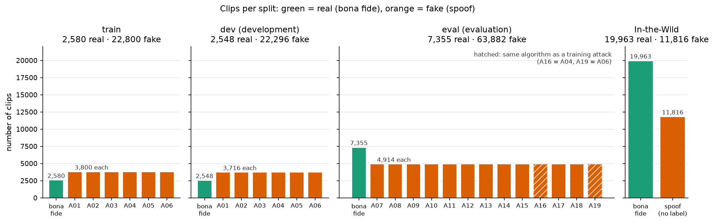
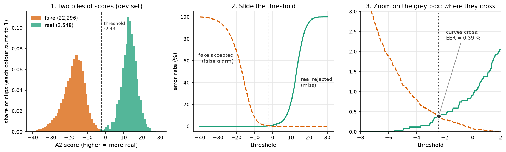

# Chapter 2 · Where does our data come from, and how do you score fairly when 9 of 10 clips are fake?

## A detector that is 90 % accurate and useless

Here is a detector you can write in one line: **always answer "fake"**.

On our development set it is right 89.7 % of the time. That set has 2,548 real clips and
22,296 fake ones, and 22,296 ÷ 24,844 = 89.7 % (counts from
`metrics.json` of run `E-20261001-e1-a2-raw`, `testsets.dev`). It has
learned nothing; we need to know what is in the data, and a score this detector cannot fool.

## Where the clips come from

Our main dataset is the 2019 edition of the Automatic Speaker Verification Spoofing and
Countermeasures Challenge (ASVspoof), its "logical access" (LA) part, where fakes are fed in
digitally rather than played through a loudspeaker. "Real" means **bona fide** (genuine human
speech) and "fake" means **spoof**.

- **Real clips** all come from one source, the Voice Cloning Toolkit (VCTK) corpus: 107 English
  speakers recorded in a hemi-anechoic (almost echo-free) chamber at 96 kilohertz (kHz, thousands of samples per
  second), then downsampled to 16 kHz (from paper [14, §2, p.3]).
- **Fake clips** come from text-to-speech (TTS) and voice conversion (VC) systems (chapter 1),
  trained mainly on 200 separate utterances per VCTK speaker (from paper [14, §2.2, p.5]); a few
  also used other data, such as proprietary voice data for A09 and a commercial TTS voice for A14
  (from paper [14, §3, p.8]).

*Source: [notebook 20](../../SystemCode/notebooks/20_report_figures.ipynb), cells 5–6, from the local
manifests checked against committed checksums.*

**Train** (2,580 real, 22,800 fake, attacks A01–A06) fits the detectors; **dev**, the
development split (2,548 real, 22,296 fake, same attacks), chooses settings and the threshold;
**eval**, the evaluation split (7,355 real, 63,882 fake, A07–A19), is the final test.

The counts come from our manifests (the lists of clips), checked against the tracked
checksums in `data/manifests/SHA256SUMS` and the dev and eval totals in `metrics.json`. They
agree with the database paper (from paper [14, Fig. 2, p.4]).

Three things to notice:

1. **About 9 fakes for every real clip** in every split (in train, 22,800 ÷ 2,580 = 8.8).
2. **The eval attacks never appear in training**, so the official test already uses unseen
   generators. That is why the
   project uses it as-is rather than building its own split
   (architecture decision record [ADR-001](../../Miscellaneous/research/decisions/ADR-001-generalization-data-strategy.md)).
3. **Two of those "new" attacks are old algorithms in disguise.** The paper states that "A04
   and A16 use same waveform concatenation TTS algorithm, and A06 and A19 use same VC algorithm"
   (from paper [14, Table 1 caption, p.6]), and that A07–A19 "(apart from A16 and A19) are the
   eleven unknown spoofing systems" (from paper [14, §3, p.6]). So eval has 11 truly unseen
   generators and 2 known ones (hatched) on new speakers.

No speaker appears in both train and dev
([`assert_no_speaker_overlap`](../../SystemCode/src/audio_df/data.py#L252), run in
[notebook 01](../../SystemCode/notebooks/01_dataset_audit.ipynb), cell 10).

### The second dataset: In-the-Wild

The right-hand panel is In-the-Wild (ITW), built by Müller et al.: real clips of celebrities
and politicians from podcasts and speeches, and fakes cut from online videos that advertise
themselves as deepfakes (from paper [13, §3, p.2]). It has **31,779 clips: 19,963 real and 11,816
fake** (our manifest, cross-checked against
`metrics.json` of run `E-20261001-e3-a2-raw`), so mostly
real, and **no attack labels**, so we cannot break results down by generator. The paper reports 58 speakers (from paper [13, §3, p.2]); the
dataset's own list names 54. We have not resolved this.

We never train on In-the-Wild. It is chapter 0's "new world" test: new speakers, microphones
and generators at once.

## Two kinds of mistake

Every detector here (A1 and A2 from chapter 0) outputs a **score** per clip, **higher means
more real**, the official ASVspoof convention
([eer-and-metrics.md](../../Miscellaneous/research/knowledge/methods/eer-and-metrics.md)). A **threshold**
turns scores into decisions: above it, real; below it, fake.

Any threshold makes two kinds of mistake: a **miss** (a real clip below it, so a genuine
person is rejected) and a **false alarm** (a fake above it, so a fake is accepted).

The key move: measure each mistake **as a rate within its own class** (misses as a share of
real clips, false alarms as a share of fakes). The 1 : 9 ratio drops out, and "always fake" is
caught at once with a 100 % miss rate.

## Sliding the threshold

*Source: [notebook 20](../../SystemCode/notebooks/20_report_figures.ipynb), cells 8–9, from the A2 dev scores
(`scores/dev.csv` of run `E-20261001-e1-a2-raw`).*

The scores are **measured**; only the curves are drawn.

1. **Left.** Two piles that barely overlap: fakes around −17, real around +13 (medians −16.87
   and +13.09, printed in cell 8).
2. **Middle.** Slide the threshold right: misses (green) climb from 0, false alarms (orange) fall
   from 100 %. Lowering one raises the other.
3. **Right.** Zoomed in, the curves cross at a threshold of about −2.43, where both are about
   0.39 %.

That crossing point is the **equal error rate (EER)**:

$$
\text{EER} = P_\text{miss}(\theta^*) = P_\text{fa}(\theta^*), \quad \text{where } \theta^* \text{ is the threshold at which the two are equal}.
$$

In words: slide the threshold until the share of real clips rejected equals the share of fakes
accepted, and read off that share. Lower is better; 50 % is a coin flip.

For A2 on dev, the EER is **0.39 %** at threshold **−2.43**
(`metrics.json` of run `E-20261001-e1-a2-raw`, `testsets.dev.eer` and
`eer_threshold`; cell 8 checks both).

With real data the curves move in steps and rarely meet exactly. We use the official rule:
take the threshold where the two rates are *closest* and average them, with no interpolation.
Our [`compute_eer`](../../SystemCode/src/audio_df/metrics.py#L217) reproduces the official scoring code.

## One number for every threshold: the area under the curve

EER looks at one threshold. To know how well the scores **rank** the clips, whatever the
threshold, pick one real clip and one fake clip at random. What is the chance the real one gets the higher
score? That probability is the **area under the curve (AUC)** (the receiver operating
characteristic (ROC) curve; we only need the probability).

AUC 1.0 is perfect ranking; 0.5 is a coin flip; below 0.5 the ranking is backwards (chapter 9,
for some random seeds).

AUC is also computed within classes, so it ignores the 1 : 9 ratio; the "always fake" detector gives every
clip the same score and gets 0.5.

On dev, A2's AUC is 0.99995 and A1's is 0.9958
(`metrics.json` of run `E-20261001-e1-a2-raw`,
`metrics.json` of run `E-20261001-e1-a1-raw`, `roc_auc`; the
function is [`roc_auc`](../../SystemCode/src/audio_df/metrics.py#L302)).

## Where the threshold comes from

EER picks its own best threshold on each test set. That is fair for comparing how well
detectors *separate* real from fake, but a deployed detector must commit in advance. So we also
fix the EER threshold **on the dev set** and reuse it unchanged on
eval and on In-the-Wild ([`_dev_threshold`](../../SystemCode/src/audio_df/scoring.py#L139)). For A2 that
is −2.43 (the `threshold_source` field in
`metrics.json` of run `E-20261001-e3-a2-raw` shows In-the-Wild
reuses it). Two questions, two kinds of number:

- **Can the detector tell real from fake here at all?** EER and AUC answer this.
- **Does the threshold we chose at home still work here?** The error rates at the fixed dev
  threshold answer this.

Chapter 9 shows that these two questions can have very different answers.

Finally, we report EER **per attack**: each attack's fakes against the whole pool of real clips
([`per_attack_eer`](../../SystemCode/src/audio_df/metrics.py#L460)), because a pooled number can hide one
generator the detector gets badly wrong.

> **Checkpoint**
>
> - Our main data is ASVspoof 2019 LA: real clips are VCTK studio recordings, fakes come from TTS
>   and VC systems, about 9 fakes per real clip in every split
>   ([notebook 20](../../SystemCode/notebooks/20_report_figures.ipynb), cell 6; from paper [14, Fig. 2, p.4]).
> - Eval uses attacks A07–A19, never seen in training; 11 are new generators and 2 (A16, A19)
>   reuse training algorithms (from paper [14, Table 1 caption and §3, p.6]).
> - In-the-Wild adds 31,779 real-world clips, mostly real, with no attack labels
>   (`metrics.json` of run `E-20261001-e3-a2-raw`; from paper [13, §3, p.2]).
> - Accuracy is useless at 1 : 9 ("always fake" scores 89.7 %); within-class miss and
>   false-alarm rates are not. EER is where they are equal: 0.39 % for A2 on dev
>   ([notebook 20](../../SystemCode/notebooks/20_report_figures.ipynb), cells 8–9;
>   `metrics.json` of run `E-20261001-e1-a2-raw`).
> - AUC measures ranking over all thresholds; a fixed dev threshold tests whether a decision rule
>   transfers ([`_dev_threshold`](../../SystemCode/src/audio_df/scoring.py#L139)).
>
> **The question this leaves us with:** we can now score a detector fairly. But before building
> one, could something stupid, with no idea what a voice is, already score well?

## References used in this chapter

- [13] Müller et al. *Does Audio Deepfake Detection Generalize?* Interspeech 2022.
  [arXiv:2203.16263](https://arxiv.org/abs/2203.16263)
- [14] Wang et al. *ASVspoof 2019: A Large-Scale Public Database of Synthesized, Converted and
  Replayed Speech.* Computer Speech & Language 64, 2020.
  [arXiv:1911.01601](https://arxiv.org/abs/1911.01601)
