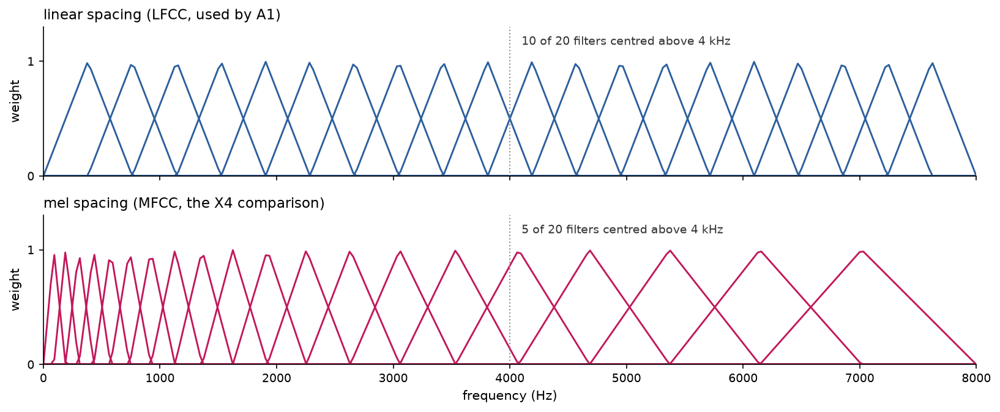
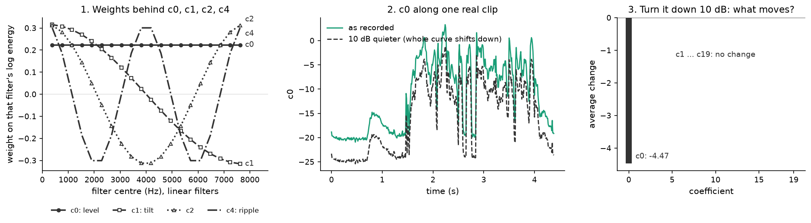

# Chapter 5 · How do you turn a sound into a few numbers?

## The goal

Chapter 4's single summaries throw away almost everything. Chapter 1 told us what to keep: the
**shape of the spectrum** (the filter part of the voice), frame by frame.

This chapter builds A1's recipe: the official 2019 challenge baseline (B02), transcribed line
by line from the official code into
[`lfcc_b02.py`](../../SystemCode/src/audio_df/lfcc_b02.py). Its output is **linear-frequency
cepstral coefficients (LFCC)**.

[Notebook 09](../../SystemCode/notebooks/09_a1_playground.ipynb), cell 9 rebuilds the recipe by hand on one
real clip and checks it is "identical to the library: True"; cell 10 draws it.

*Source: [notebook 09](../../SystemCode/notebooks/09_a1_playground.ipynb), cell 10. Default notebook colours.*

## Step 1: cut the sound into short frames

Over about 20 milliseconds (ms) speech is roughly steady. So cut 20 ms frames every 10 ms, and
taper each frame's edges (a "Hamming window") so the cut adds no false frequencies.

Before cutting, the recipe applies **pre-emphasis**: each sample minus 0.97 times the previous
one. This boosts high frequencies relative to low ones (top-left panel above: the low end drops, the top lifts).

## Step 2: a spectrum for every frame

For each frame, a fast Fourier transform (FFT) measures how much energy sits at each frequency:
257 frequency "bins" from 0 to 8,000 Hz (hertz). Square it to get power. Frame after frame,
this is the short-time Fourier transform (STFT); stacked, it is chapter 0's spectrogram
(bottom-left panel).

## Step 3: 257 bins into 20 bands

257 numbers is too many, and neighbours carry nearly the same information. So sum them in 20
overlapping triangular **filters**, each giving the energy in its band.

*Source: [notebook 20](../../SystemCode/notebooks/20_report_figures.ipynb), cell 13 (geometry from our filterbank code, no data).*

The B02 recipe spaces the filters **evenly in Hz** from 0 to 8,000 Hz: the "linear" in LFCC.
The top row shows twenty identical triangles, each 762 Hz wide at the base, half of them above
4 kHz (kilohertz). Hold on to the bottom row for later.

## Step 4: take the logarithm

Take log10 of each band energy, for two reasons:

- differences of thousands of times become a few units;
- chapter 1's trick: "source × filter" and "signal × gain" become sums, so any overall gain
  (louder speaker, hotter microphone) becomes **the same constant added to all 20 numbers**.

## Step 5: describe the shape of those 20 numbers

The 20 log energies per frame are very redundant: if one band is loud, its neighbours usually
are too. Across 45 real clips, the average absolute correlation (strength, ignoring sign) between
two different bands is 0.85 (left panel below, redrawn from
[notebook 03](../../SystemCode/notebooks/03_cepstral_eda.ipynb), cell 11).

*Source: [notebook 20](../../SystemCode/notebooks/20_report_figures.ipynb), cell 17, recomputed on notebook 03's exact 45-clip sample (it reproduces notebook 03 cell 11's printed 0.851 and 0.166).*

So describe their **shape** instead:

- **How high is the curve?** Add all 20 with equal weights: **c0**.
- **Does it slope?** Weigh low bands positively, high bands negatively, and add: **c1**, the
  **tilt**.
- **Does it wiggle?** Weigh the bands with a wave going up and down *q* times: **cq**,
  the **ripple**. Small *q* captures broad bumps such as formants (chapter 1); large *q*, finer
  detail.

Panel 1 below draws those weights: flat for c0, a slope from +0.32 to −0.32 for c1, waves for
c2 and c4.

*Source: [notebook 20](../../SystemCode/notebooks/20_report_figures.ipynb), cell 15. Panel 1 has no data; panels 2–3 are recomputed on one real eval clip (LA_E_5849185).*

These weighted sums are the **discrete cosine transform (DCT)**. With *L*[r] the log energy of
band *r* and *J* = 20 bands:

$$
c_q = \sqrt{\tfrac{2}{J}} \sum_{r=0}^{J-1} L[r]\,\cos\!\Big(\frac{\pi q\,(r+\tfrac12)}{J}\Big), \qquad c_0 = \sqrt{\tfrac{1}{J}}\sum_{r=0}^{J-1} L[r].
$$

In words: each coefficient is the 20 log energies, weighted by a cosine wave with *q* half-waves
across the bands, and added up (the square roots keep the scale). The 20 outputs are the **cepstral coefficients**; on linear filters, they are the LFCCs.

Two good things happen:

1. **The outputs are much less correlated:** 0.85 falls to 0.17 (right panel of the correlation
   figure). Chapter 6 needs this.
2. **Each number has a meaning.** With bands 381 Hz apart, cq is ripple with a period
   of about 15,238/*q* Hz at every frequency: c4 about 3.8 kHz, c10 about 1.5 kHz ([technical reference §5.1.2](../technical-reference.md)).

### The level test

The payoff of the logarithm: turn a clip down by 10 decibels (dB) and all 20 log energies drop
by exactly 1 (a factor of 10 in power is 1 in log10). A constant shift has no tilt or wiggle, so only c0 moves: by 20 × (−1) × √(1/20) =
−√20 ≈ −4.47.

Panels 2 and 3 check this on a real eval clip, **recomputed in notebook 20**: c0 shifts by
−4.472 in every frame; no other coefficient changes by more than about 0.00001.

So **loudness, recording gain and silence all live in c0** (a silent frame is a very low c0).
B02 keeps c0 and does not subtract each recording's average (no cepstral mean and variance
normalisation, CMVN; absent from the official code, per the
[`lfcc_b02.py`](../../SystemCode/src/audio_df/lfcc_b02.py) docstring). So A1 sees level and silence
directly. Remember chapter 3.

## Step 6: add movement

Finally, add each coefficient's frame-to-frame change (the "delta", Δ: next frame minus previous)
and the change of that change (ΔΔ), following the official code ([`official_deltas`](../../SystemCode/src/audio_df/lfcc_b02.py#L136)).
20 static + 20 Δ + 20 ΔΔ = **60 numbers per 10 ms frame**. That is A1's input.

## What this recipe cannot see

- **Phase.** Squaring the FFT drops the timing of each wave. Some vocoder errors may live in
  phase (our guess); LFCC is blind to those.
- **Pitch harmonics,** typically about 100–250 Hz apart (a textbook range, not from our reading
  list), much finer than one 762 Hz filter, so chapter 1's stripes blur together.

## The fork in the road: linear or mel?

Most speech systems use a different filter placement: the **mel scale**, designed to mimic the
ear for speech recognition: narrow filters at low frequencies, wide at high ones (bottom row of
the filter figure). Mel filters give **mel-frequency cepstral coefficients (MFCC)**: same
recipe, only the filter edges move ([`lfcc_b02_filterbank`](../../SystemCode/src/audio_df/lfcc_b02.py#L194),
`spacing="mel"`). With 20 filters on 0–8 kHz, from our own filterbank code:

| | linear (LFCC) | mel (MFCC) |
|---|---|---|
| filters centred above 4 kHz | 10 | 5 |
| filters centred below 1 kHz | 2 | 7 |
| average width above 4 kHz | 762 Hz | 1,481 Hz |

In the top half, LFCC has twice the filters at about half the width, and on a mel axis cq no
longer has one fixed ripple period in Hz: it is fine at low frequency and coarse at high frequency.

Does this matter for fakes? The literature points both ways.

- **For linear.** Sahidullah et al. compared filter placements with a Gaussian mixture model
  detector (A1's kind, chapter 6) on the 2015 challenge's development set. With static
  coefficients only, the average equal error rate (EER, chapter 2) was: MFCC 3.46 %, LFCC 2.46 %, and IMFCC (mel turned upside down, finest at high frequency) 1.33 %
  (from paper [28, Table 3, p.4]). Their untested intuition: speech synthesis techniques "mostly focus on producing identical overall envelope of the speech
  spectrum" (from paper [28, p.2]), so the fine detail is where fakes slip.
- **For linear, again.** The WaveFake study found "subtle differences between the
  architectures, specifically among the higher frequencies" (from paper [24, abstract, p.1]),
  differences that are "generally inaudible when listening" (from paper [24, p.6]). That is
  exactly the band a perceptual, ear-like scale compresses (our reading, not a test in [24]).
- **Against.** On a different dataset, a 26-filter linear bank scored 8.91 % EER against 6.89 %
  for mel (from paper [25, Table 1, p.4]). Which bands are useful depends on the generators.

These are other papers' numbers on other data: context, not a prediction. They set up a clean
question: **with everything else identical, does filter placement matter for A1?** The less
obvious half: more high-frequency filters see more synthesis detail, but also more of the
**recording chain** (microphone, room, compression). Chapter 6 answers on our benchmark; chapter 9
asks again on real-world audio.

> **Checkpoint**
>
> - The recipe: frames of 20 ms → FFT power → 20 filters → log → DCT → add Δ and ΔΔ = 60 numbers
>   per frame ([notebook 09](../../SystemCode/notebooks/09_a1_playground.ipynb), cells 9–10;
>   [`extract_lfcc_b02`](../../SystemCode/src/audio_df/lfcc_b02.py#L239)).
> - The DCT cuts the average absolute correlation from 0.85 to 0.17 ([notebook 20](../../SystemCode/notebooks/20_report_figures.ipynb),
>   cell 17, redrawing notebook 03, cell 11).
> - c0 is level, c1 is tilt, higher cq are ripple; a 10 dB gain change moves only c0, by
>   −4.47 (notebook 20, cell 15, recomputed on one clip). A1 keeps c0 and has no CMVN, so it sees
>   loudness and silence.
> - Linear filters put 10 of 20 above 4 kHz, mel only 5 (notebook 20, cell 13); other papers
>   mostly favour linear (from papers [28, Table 3], [24]), not always (from paper [25, Table 1]).
>
> **The question this leaves us with:** we have 60 numbers per frame for a real clip and for a
> fake. How do you turn a cloud of frames into a decision, and do linear filters really beat mel
> when everything else is held fixed?

## References used in this chapter

- [24] Frank and Schönherr. *WaveFake: A Data Set to Facilitate Audio Deepfake Detection.* NeurIPS
  2021 Datasets and Benchmarks. [arXiv:2111.02813](https://arxiv.org/abs/2111.02813)
- [25] Sriskandaraja et al. *Investigation of Sub-Band Discriminative Information Between Spoofed
  and Genuine Speech.* Interspeech 2016.
  [paper](https://www.isca-archive.org/interspeech_2016/sriskandaraja16_interspeech.pdf)
- [28] Sahidullah, Kinnunen and Hanilçi. *A Comparison of Features for Synthetic Speech
  Detection.* Interspeech 2015.
  [paper](https://www.isca-archive.org/interspeech_2015/sahidullah15_interspeech.pdf)
