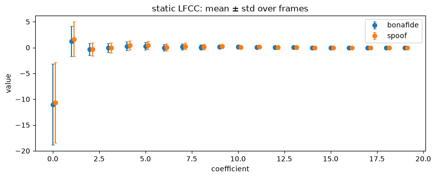
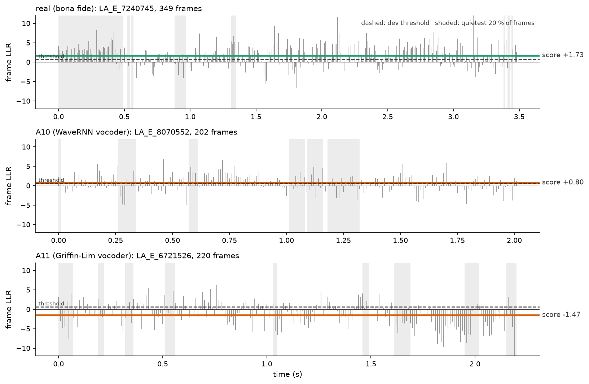
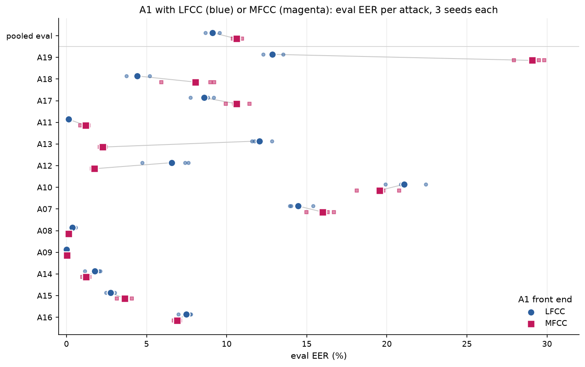

# Chapter 6 · A1: can two clouds of frames tell real from fake?

## No single number does it

Chapter 5 turned every 10 milliseconds (ms) of audio into 60 numbers, the linear-frequency cepstral
coefficients (LFCC) plus their changes over time. Do real and fake frames differ?

For 150 real and 150 fake training clips, [notebook 09](../../SystemCode/notebooks/09_a1_playground.ipynb),
cell 13 plots each static coefficient's average and spread. The bars overlap almost completely:
"no single coefficient separates the classes" (cell 14).

*Source: [notebook 09](../../SystemCode/notebooks/09_a1_playground.ipynb), cell 13. Blue = bona fide, orange = spoof here (default colours).*

So look at all 60 at once: each class is a **cloud** of points in 60 dimensions, one per frame.
Do the clouds differ in shape?

## Describing a cloud: the Gaussian mixture model

A single bell curve (a **Gaussian**) describes one round-ish blob: a centre and a spread per
direction. Real clouds are lumpy (silence here, vowels there, hissy consonants elsewhere), so add
up several bells, each with its own centre, spread and weight: a **Gaussian mixture model (GMM)**.

The toy below has two dimensions and made-up points:

- **Left:** each cloud gets its own 3-component GMM. The ellipses are always aligned with the
  axes: that is what **diagonal** means (a spread per direction, not how directions lean
  together), and why chapter 5's decorrelating discrete cosine transform (DCT) matters. One green
  component (weight 0.55) stretches over two clumps; a mixture need not find the "true" clusters.
- **Right:** how much better the green model explains each point than the orange one; the black
  line is where both are equal. The deep-green corners have no data at all: there the ratio is
  decided by whichever bell curve falls off more slowly, and means nothing. Our reading is that
  A1 has the same blind spot: unfamiliar audio still gets a score in the familiar range, with
  nothing to flag it (chapter 9 shows A1 on such audio).

*Source: [notebook 20](../../SystemCode/notebooks/20_report_figures.ipynb), cell 19 (toy, made-up data; fitted with the project's own DiagGMM).*

### Fitting it: expectation-maximisation

Start the ellipses at random frames, then repeat: **expectation**, work out each component's
soft share of every point; **maximisation**, move each component to the weighted average of its
points and reset its spread and weight. This is **expectation-maximisation (EM)**. Each round can only improve the fit or leave it
unchanged ([notebook 09](../../SystemCode/notebooks/09_a1_playground.ipynb), cell 19).

*Source: [notebook 09](../../SystemCode/notebooks/09_a1_playground.ipynb), cell 19; a small 32-component version, not the real A1.*

Our [`DiagGMM.fit_em`](../../SystemCode/src/audio_df/models/gmm.py#L136) keeps a floor under every spread,
so a component cannot shrink onto a single point.

## Scoring a clip: the log-likelihood ratio

For each frame of a new clip, ask both models how likely it is and take the difference of the
logarithms: the **log-likelihood ratio (LLR)**, positive when the real model explains it better.
The clip's score is the average:

$$
s(\text{clip}) = \frac{1}{T}\sum_{t=1}^{T}\Big[\log p(\text{frame}_t \mid \text{real}) - \log p(\text{frame}_t \mid \text{fake})\Big]
$$

In words: the average, over the clip's *T* frames, of how much better the real model explains
each frame. Averaging makes the score independent of clip length
([`score_llr`](../../SystemCode/src/audio_df/models/gmm.py#L245)).

The figure below does this frame by frame for three eval clips, using A1's two trained models.
Each grey tick is a frame; the thick line is the clip's average, which the cell checks equals the
clip's score in the run's score file.

*Source: [notebook 20](../../SystemCode/notebooks/20_report_figures.ipynb), cell 21, recomputed with A1's trained GMMs; each clip's mean equals its score in run `E-20261001-e1-a1-raw`.*

The real clip scores +1.73 (75 % of frames lean "real"); the A10 clip (WaveRNN vocoder) +0.80
(65 %), above A1's dev threshold of 0.687, so A1 accepts this fake; the A11 clip (Griffin-Lim)
−1.47 (35 %), rejected.

The real clip's opening half-second is silence (shaded, its quietest fifth of frames), and
almost all of it leans "real": A1 sees silence through c0 (chapter 5). Chapter 8 measures how
much that matters.

## The real A1

The same idea, larger: two GMMs of **512 components each** over **60-dimensional** frames, 10
rounds of EM, trained on **873,016 real and 7,809,362 fake frames**
(`notes.md` of run `E-20261001-e1-a1-raw`). That is 2 × 512 × (60 + 60 + 1) =
**123,904 numbers** (centre and spread per dimension, plus a weight, per component). It took
**20.6 minutes** to train and score, peak memory 3.8 gigabytes (GB), on a 16 GB laptop
([REGISTRY.md](../../SystemCode/runs/REGISTRY.md), row `E-20261001-e1-a1-raw`), streaming frames from
disk.

## How well does it work?

The left panel below shows A1's scores for all 71,237 eval clips (from the `scores/eval.csv` of run `E-20261001-e1-a1-raw`): real mostly right of
the dashed dev threshold, fakes mostly left, with a long overlap.

*Source: [notebook 20](../../SystemCode/notebooks/20_report_figures.ipynb), cell 23, from the A1 eval scores.*

- **Equal error rate (EER, chapter 2) on dev: 2.62 %; on eval: 9.56 %.** Area under the curve
  (AUC) on eval: 0.968 (`metrics.json` of run `E-20261001-e1-a1-raw`).
- **This reproduces the official baseline** (8.09 % for the official LFCC-GMM baseline, B02, same eval set; from paper
  [15, Table 1, p.3]). Our reading of the 1.5-point gap: random starts and the original toolkit's
  uninspectable initialisation and variance floor ([technical reference §10.1](../technical-reference.md)), not the 10 EM rounds, which
  the official recipe also uses
  ([b02-lfcc-gmm.md](../../Miscellaneous/research/knowledge/methods/b02-lfcc-gmm.md)).
- **Seeds.** Two other random starts give 8.67 % and 9.12 %; over 3 seeds, 9.12 ± 0.44 % (mean ±
  standard deviation, from the three LFCC runs' metrics.json; cell 25 prints it).
- **Dev is much easier than eval** because dev holds the training attacks A01–A06, eval only new
  ones (chapter 2).

## A natural experiment: A10 against A11

A10 and A11 are the same text-to-speech system up to the vocoder (WaveRNN against Griffin-Lim;
chapter 1, from paper [14, Table 1, p.6]), and both have a median leading-silence fraction of
exactly 0 (chapter 3; [notebook 20](../../SystemCode/notebooks/20_report_figures.ipynb), cell 11). The silence
shortcut is off for both; only the vocoder differs.

A1's per-attack EER (`metrics.json` of run `E-20261001-e1-a1-raw`,
`testsets.eval.per_attack_eer`) is **22.4 % for A10** (its hardest attack) against **0.1 % for A11**. In the right panel, A11's scores
sit left of almost every real clip (median −1.19; none above the threshold), while A10's sit on top of
them (median +0.93; 74.5 % above the threshold).

**The vocoder alone moves A1's error by about 22 points**: measured, and the project's cleanest
evidence that A1 detects how the waveform was generated. The
database authors saw the same with their baselines (from paper [14, §6.1.2, p.17]). *Which*
artefact gives Griffin-Lim away is our guess: its iterative rebuild from a magnitude spectrogram
may leave smearing in the frame-to-frame spectra that the Δ and ΔΔ see. Untested.

## Linear or mel? The controlled comparison (X4)

Chapter 5's question, run as analysis "X4": the A1 pipeline with only the filter edges moved
to mel, giving mel-frequency cepstral coefficients (MFCC)
([configs/a1_mfcc_b02.yaml](../../SystemCode/configs/a1_mfcc_b02.yaml)), **3 random seeds per arm**. Six
runs (`E-20261001-e1-a1-raw` and `E-20261004-e2-a1-raw-{lfcc,mfcc}-s*337`). Mean ±
standard deviation over 3 seeds ([notebook 20](../../SystemCode/notebooks/20_report_figures.ipynb), cell 25):

| | LFCC (linear) | MFCC (mel) |
|---|---|---|
| dev EER (A01–A06) | **2.89 ± 0.25 %** | 6.66 ± 0.30 % |
| eval EER (A07–A19) | **9.12 ± 0.44 %** | 10.61 ± 0.30 % |

**At home, linear wins**, as chapter 5's literature suggested; the 1.5-point eval gap is more
than three seed standard deviations, so it is not seed noise. Our pre-registered expectation ([technical reference §5.1.4](../technical-reference.md)) was an eval
gap under 4 points, likely in LFCC's favour; that held. Its other half, both arms near chance on
real-world audio, did not (chapter 9).

*Source: [notebook 20](../../SystemCode/notebooks/20_report_figures.ipynb), cell 25, from the six X4 runs' metrics.json files.*

The winner depends on the attack (means over 3 seeds, LFCC against MFCC; in the figure, small
markers are single seeds, large ones the mean): LFCC wins A19 (12.8 against 29.1 %),
A18 (4.4 against 8.0 %), A17 (8.6 against 10.6 %) and A11 (0.1 against 1.2 %); MFCC wins A13
(12.0 against 2.3 %) and A12 (6.6 against 1.7 %); A10 is about equal (21.1 against 19.6 %). This
fits the literature: useful bands depend on the generator (from paper [25, Table 1], chapter 5).
**Our guesses:** A19's big LFCC win (its training twin A06 agrees on dev, 4.9 against 16.8 %)
puts its tell at high frequency, where mel is coarse; and A18's vocoder rebuilds sound from MFCCs
(from paper [14, Table 1, p.6]), so a linear front end also sees the high-band detail the vocoder
had to invent.

So **LFCC beats MFCC on the benchmark**; chapter 9 finds otherwise on real-world audio.

**Why is A1 so far behind** A2's 0.96 % (next chapter)? Our guess is the GMM rather than LFCC: it
must describe *everything* about real frames (speaker, room, level), not just what separates real
from fake. From paper [17, Tables 2 and 4] (different protocol, best settings chosen on eval,
LFCC settings not stated), a discriminative network on LFCC reaches 2.19 %, and 1.47 % with extra
training tasks, on the same 2019 eval split. A discriminative model on our LFCC frames would test it; not run.

> **Checkpoint**
>
> - A1 models each class's cloud of frames with a 512-component diagonal GMM and scores a clip
>   by its average frame log-likelihood ratio ([notebook 09](../../SystemCode/notebooks/09_a1_playground.ipynb), cell 13;
>   [notebook 20](../../SystemCode/notebooks/20_report_figures.ipynb), cells 19 and 21;
>   [`gmm.py`](../../SystemCode/src/audio_df/models/gmm.py#L245)).
> - A1 gets 2.62 % EER on dev and 9.56 % on eval, against 8.09 % published for the official
>   baseline (from paper [15, Table 1]); 9.12 ± 0.44 % over 3 seeds
>   (`metrics.json` of run `E-20261001-e1-a1-raw`; notebook 20, cell 25).
> - A10 and A11 differ only in their vocoder and both lack silence, yet A1's EER is 22.4 % against
>   0.1 %: A1 detects waveform generation, not only silence (metrics.json; notebook 20, cell 23).
> - With everything else fixed, linear filters beat mel on the benchmark: eval 9.12 ± 0.44 %
>   against 10.61 ± 0.30 %; the winner varies by attack (X4, notebook 20, cell 25).
>
> **The question this leaves us with:** A1 learns everything from 25,380 clips. What if a model
> had already heard tens of thousands of hours of real speech before it ever saw a fake?

## References used in this chapter

- [14] Wang et al. *ASVspoof 2019: A Large-Scale Public Database of Synthesized, Converted and
  Replayed Speech.* Computer Speech & Language 64, 2020.
  [arXiv:1911.01601](https://arxiv.org/abs/1911.01601)
- [15] Todisco et al. *ASVspoof 2019: Future Horizons in Spoofed and Fake Audio Detection.*
  Interspeech 2019. [arXiv:1904.05441](https://arxiv.org/abs/1904.05441)
- [17] Mo and Wang. *Multi-task Learning Improves Synthetic Speech Detection.* ICASSP 2022.
  [doi:10.1109/ICASSP43922.2022.9746059](https://doi.org/10.1109/ICASSP43922.2022.9746059)
- [25] Sriskandaraja et al. *Investigation of Sub-Band Discriminative Information Between Spoofed
  and Genuine Speech.* Interspeech 2016.
  [paper](https://www.isca-archive.org/interspeech_2016/sriskandaraja16_interspeech.pdf)
