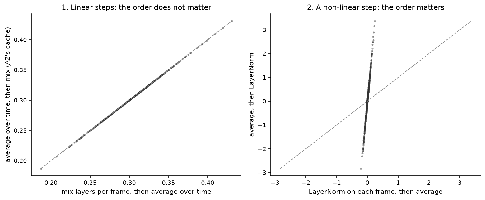
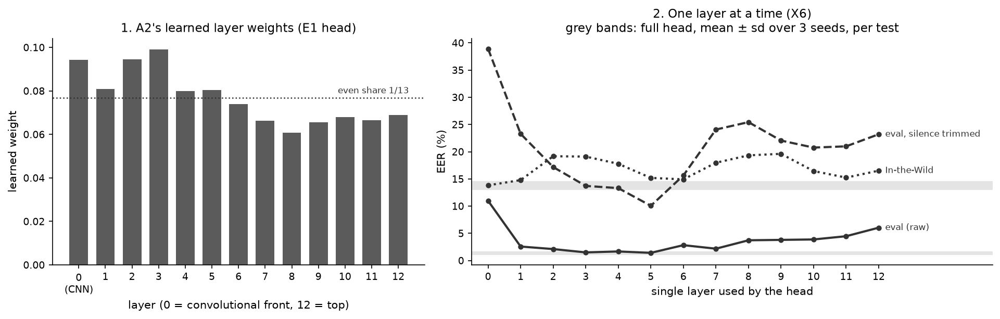

# Chapter 7 · A2: borrow a model that has already heard 94,000 hours of speech?

## A different bet

A1 learned from scratch, from 25,380 training clips, what real speech frames look like.

A2 makes a different bet. Somebody has already trained a large network on an enormous amount of
real speech with no labels, by predicting hidden parts of the audio from the parts around them:
**self-supervised learning (SSL)**. Such a network must build an internal picture of natural
speech. Perhaps a fake looks "off" against it.

We use **WavLM Base+**, pre-trained on 94,000 hours of speech: 60,000 hours of
Libri-Light (audiobooks), 10,000 hours of GigaSpeech (podcasts and YouTube) and 24,000 hours of
VoxPopuli (European Parliament recordings) (from paper [26, §I, p.2, and §IV.C, p.5]). It has a
convolutional front end and 12 transformer layers, each producing 768 numbers per frame
([configs/a2_wavlm_base_plus.yaml](../../SystemCode/configs/a2_wavlm_base_plus.yaml)).

We **freeze** it (its weights never change) and train only a small decision layer on top. That
makes A2 possible on a laptop with 16 gigabytes (GB) of memory.

## What comes out of the network

Every clip is cut or padded (by repetition, chapter 3) to **4 seconds** from its centre (64,000
samples). The front end turns that into **199 frames**, about 50 per second, and the network
hands back **13 versions** of them: the front end's output (layer 0) and each transformer layer's,
each 199 × 768 numbers
([ssl-hidden-states.md](../../Miscellaneous/research/knowledge/methods/ssl-hidden-states.md)).

Which of the 13 should a detector read? For other tasks, WavLM's authors found "the bottom
layers contribute more to speaker-related tasks", while words and meaning lean on the top layers (from paper [26, §V, p.6, and Fig. 2, p.7]). Fake detection was not one
of their tasks. Rather than guess a layer, A2 learns **one weight per layer** and mixes all 13.

## The trick that makes it cheap: pool, then mix

A2 needs one 768-number summary per clip. The obvious recipe mixes the 13 layers per frame with
the learned weights, then averages over time. But the weights change during training, so this
needs all 13 × 199 × 768 numbers per clip on
disk: about 4 MB (megabytes) per clip at 2 bytes per number, roughly 0.1 TB (terabytes) for the
25,380 training clips alone (our arithmetic). For the larger XLS-R (25 × 199 × 1,024 per clip,
not yet run) over all 121,461 clips of ASVspoof (the Automatic Speaker Verification Spoofing and
Countermeasures Challenge 2019 dataset, chapter 2), it would be about 1.24 TB
([technical reference §7.2](../technical-reference.md)). So A2 averages each layer over time once, stores just 13 × 768 numbers per
clip, and mixes those averages. Same answer? Mixing with fixed weights and averaging over time both only add and scale, so
their order does not matter, just as weighing coins then averaging equals averaging then weighing.

The figure below checks this with A2's actual head code
([`SSLHead.weighted_sum`](../../SystemCode/src/audio_df/models/ssl_head.py#L62)) on random numbers of A2's
exact shape: the two orders agree to about 0.0000001 (rounding). Insert LayerNorm (which rescales
each vector by its own spread) *before* averaging, and they disagree. That is why A2 applies
LayerNorm only *after* pooling; `tests/test_ssl_head.py` checks the same identity.

*Source: [notebook 20](../../SystemCode/notebooks/20_report_figures.ipynb), cell 27 (random numbers, A2's real head code).*

So the time-averaged cache is **exact**. The price: the head only sees the *average* frame, so a
momentary click or glitch is diluted.

## The head

On the 13 cached averages, A2 trains ([`SSLHead`](../../SystemCode/src/audio_df/models/ssl_head.py#L62))
13 layer weights (a softmax, so positive and summing to 1, starting at 1/13), then LayerNorm, a
projection from 768 to 256, a small two-layer network down to 128, and one output score (higher
means more real).

That is about **231,000 trainable numbers**, against 94 million frozen ones in WavLM
([technical reference §5](../technical-reference.md)). The loss weights real clips 8.837 times more, because fakes outnumber them 22,800
to 2,580 in training
(`training_curve.json` of run `E-20261001-e1-a2-raw`, `pos_weight`).
The lowest dev loss came at epoch 8 (counting from 0); training and scoring took **16.9 seconds**
([REGISTRY.md](../../SystemCode/runs/REGISTRY.md), row `E-20261001-e1-a2-raw`).

## How well does it work?

**Equal error rate (EER, chapter 2): 0.39 % on dev, 0.96 % on eval**, against A1's 2.62 % and
9.56 %; area under the curve (AUC) on eval 0.9995; hardest eval attacks A10 (2.0 %) and A19
(1.9 %), against A1's 22.4 % and 12.7 %
(`metrics.json` of run `E-20261001-e1-a2-raw`). About ten times fewer
errors than A1 on attacks neither saw in training. For orientation only
(other backbone, head and augmentation): frozen wav2vec 2.0 models with heads
trained on the same 2019 training data report 0.74 % and 1.93 % on the same eval set (from paper
[22, Table II, p.3]). Our 0.96 % is in that range.

Caveat: one run. Three retrains on an ordinary processor (CPU) for the analysis below gave
1.32 ± 0.23 %, with scores correlating at 0.99 with the original
(`summary.md` of run `E-20261004-e2-a2-raw-layers`,
`reproduction_check.json` of run `E-20261004-e2-a2-raw-layers`).

## What do the layer weights say?

Left panel below: the 13 learned weights
(`layer_weights.json` of run `E-20261001-e1-a2-raw`).

*Source: [notebook 20](../../SystemCode/notebooks/20_report_figures.ipynb), cell 29, from the layer_weights.json and X6 summary.csv.*

They barely move from the even 1/13 ≈ 0.077 (dotted line), tilting toward the bottom: layer 3
gets the most (0.099), layers 7–12 get 0.061–0.069 (largest over smallest: 1.63). But a weight
is not an importance: layers differ in scale, are strongly related, and LayerNorm rescales the
mix. So we asked the layers directly.

## Asking each layer on its own (X6)

Analysis "X6" reused the cached averages. It trained the head on **one layer at a time** (13
heads), removed one layer at a time from the trained head (13 more), retrained the full head with
3 seeds, and fitted two logistic-regression probes (layers 0 and 12): 31 variants in about 2
minutes on a CPU, each with its own dev threshold
(`summary.md` of run `E-20261004-e2-a2-raw-layers`).
Each single-layer head is one seed, so small differences between neighbours mean little.

**No layer is essential:** removing any one leaves eval EER between 0.91 % and 1.22 % (rows
`loo00`–`loo12`). **The best layer is not the most-weighted one** (right panel, solid line): the
front end (layer 0) alone gets 11.0 %, layers 1–7 get 1.4–2.8 % (best layer 5 at 1.41 %, layer 3
at 1.50 %), and the top layer 6.0 %. Most of A2's skill comes from the transformer layers.

### Different layers catch different attacks

The X6 heatmap (left half: raw eval; one column per single-layer head, one row per attack;
darker is better). Look at A17–A19, which convert a real person's recording (chapter 1), and at
A10, a text-to-speech attack:

*Source: `per_attack_heatmap.png` of run `E-20261004-e2-a2-raw-layers`, drawn by the X6 run and shown unchanged ([notebook 20](../../SystemCode/notebooks/20_report_figures.ipynb), cell 31).*

| attack | layer 1 | layer 7 | layer 12 |
|---|---|---|---|
| A19 (converts a real recording) | **2.5 %** | 6.8 % | 24.3 % |
| A18 (converts a real recording) | **1.3 %** | 2.9 % | 9.3 % |
| A17 (converts a real recording) | 4.5 % | **2.5 %** | 6.7 % |
| A10 (text-to-speech, WaveRNN) | 4.8 % | **1.2 %** | 2.1 % |

(`per_attack_eval.csv` of run `E-20261004-e2-a2-raw-layers`;
measured.)

The lower transformer layers (1–5) catch A19 and A18; the top layers miss much of them. A17 is
caught best by the middle layers (about 1 % at layers 4–6). Layer 0 is poor for all three
(13–26 %). For A10 the order reverses: upper layers do better. **Our guess**, fitting the WavLM
picture of bottom = sound of the voice, top = content (from paper [26, Fig. 2, p.7]): voice
conversion keeps a real person's words and phrasing, so content layers are fooled and only
"sound" layers notice; a fully synthetic attack may get phrasing wrong too. A17 suggests the
split is not sharp.

### A first look at silence

The dashed line in the layer figure tests the same heads on eval with leading and trailing
silence trimmed (chapter 3). Layers 3–6 suffer least (10–16 % EER; layer 5 alone, 10.1 %, beats the
full head's 13.7 ± 0.6 % over 3 seeds); layers 0–1 and 7–12 rise to about 21–39 % (20.8 % at layer
10). Our guess: the silence shortcut lives mostly in the bottom and top layers. The direct test,
predicting each clip's silence from each layer (analysis X8), has not been run. (The dotted
line, In-the-Wild, belongs to chapter 9.)

Another group froze the same WavLM Base+ and did much worse on real-world audio. Our first guess
was that they read a different layer; X6 ruled that out. Chapter 9 shows the numbers.

> **Checkpoint**
>
> - A2 freezes WavLM Base+, pre-trained on 94,000 hours of real speech (from paper [26, p.5]), and
>   trains only a ~231,000-number head on time-averaged layer outputs, which is exact because
>   pooling and mixing only add and scale ([`SSLHead`](../../SystemCode/src/audio_df/models/ssl_head.py#L62);
>   [notebook 20](../../SystemCode/notebooks/20_report_figures.ipynb), cell 27; `tests/test_ssl_head.py`).
> - A2 gets 0.39 % EER on dev and 0.96 % on eval, against A1's 9.56 %
>   (`metrics.json` of run `E-20261001-e1-a2-raw`); 1.32 ± 0.23 % over 3 CPU
>   retrains (X6 summary).
> - The learned layer weights are near-even; no single layer is essential (leave-one-out eval EER
>   0.91–1.22 %) (notebook 20, cell 29; X6 summary).
> - The lower transformer layers catch two of the three conversions of real recordings (A19: 2.5 %
>   at layer 1 against 24.3 % at layer 12; A18 likewise); A17 is caught best by middle layers
>   (notebook 20, cell 31; per_attack_eval.csv; single seed per layer).
>
> **The question this leaves us with:** both detectors look strong on the benchmark. How much of
> that strength is chapter 3's silence, and what is left when we take it away?

## References used in this chapter

- [22] Wang Z. et al. *Mixture of Experts Fusion for Fake Audio Detection Using Frozen wav2vec
  2.0.* arXiv preprint, 2024. [arXiv:2409.11909](https://arxiv.org/abs/2409.11909)
- [26] Chen S. et al. *WavLM: Large-Scale Self-Supervised Pre-Training for Full Stack Speech
  Processing.* IEEE JSTSP 16(6), 2022. [arXiv:2110.13900](https://arxiv.org/abs/2110.13900)
