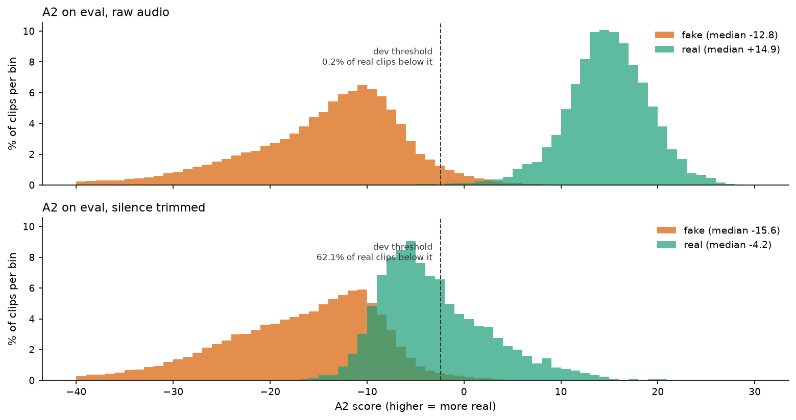
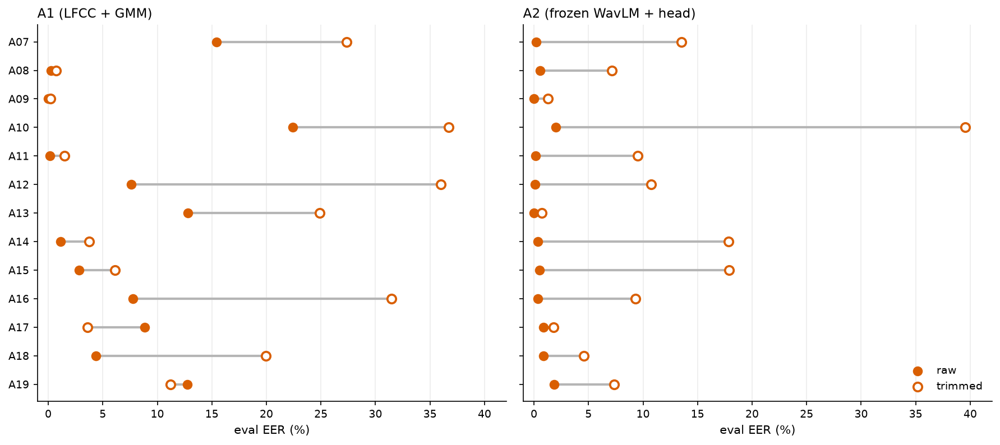

# Chapter 8 · Trim the silence: what is left of each detector?

## The experiment

Chapter 3's silence-only probe ranks real above fake about 84 times in 100. Chapters 6 and 7
built A1 (9.56 % equal error rate (EER, chapter 2) on eval) and A2 (0.96 %), both trained on raw
audio, silence and all.

The stress test: same trained detectors, same eval clips, with leading and trailing silence cut
([`trim_silence`](../../SystemCode/src/audio_df/audio.py#L228), chapter 3's 30 decibel (dB) rule; inner
pauses stay). Nothing is retrained; the threshold stays the raw-dev one.

| detector | eval EER, raw | eval EER, trimmed |
|---|---|---|
| A1 | 9.56 % | **19.84 %** (about ×2) |
| A2 | 0.96 % | **13.27 %** (about ×14) |

(From the `metrics.json` of `E-20261001-e1-a1-raw`, `-a1-trimmed`, `-a2-raw` and
`-a2-trimmed`.)

The better detector lost far more.

## A2: the real clips move, the fakes do not

*Source: [notebook 20](../../SystemCode/notebooks/20_report_figures.ipynb), cell 33, from the A2 raw and trimmed eval scores.*

On raw audio, real clips score around **+14.90** (median) and fakes **−12.83**; 0.2 % of real
clips fall below the dev threshold. Trimmed, the real median drops to **−4.18** (about 19
points), the fakes' to −15.60 (under 3), and **62.1 %** of real clips fall below the threshold
(printed in cell 33). Much of A2's evidence for "real" is the lead-in; the fakes had little to
lose.

Why so sensitive? Our reading (not measured): A2 sees the **average** of each layer
over 199 frames (chapter 7). In a short real clip, silence can be a large share of them, and padding
by repetition repeats it.

## Attack by attack

*Source: [notebook 20](../../SystemCode/notebooks/20_report_figures.ipynb), cell 35, from the per-attack EER in the four `metrics.json` files.*

**A2 (right).** Almost every attack gets harder. Chapter 3's silence map explains much, not all:
no-silence attacks collapse once the real clips lose theirs (A10 2.0 → **39.5 %**, A15 0.5 →
17.9 %, A14 0.4 → 17.8 %, A07 0.2 → 13.5 %), except A13 (0.0 → 0.7 %); attacks with real-looking
lead-ins still get somewhat worse (A18 0.9 → 4.6 %, A19 1.9 → 7.4 %), except A17 (0.9 → 1.8 %).

**A1 (left).** Most attacks get harder, but A17 (8.8 → 3.6 %) and A19 (12.7 → 11.2 %) get
*easier*, and A12 and A16 jump the most (7.6 → 36.0 % and 7.8 → 31.5 %).

## A1: three things happen at once

Per-attack EER compares each attack's fakes with the **same** real pool
([`per_attack_eer`](../../SystemCode/src/audio_df/metrics.py#L460)), so it can change because the real clips
moved, the fakes moved, or both. Each group's median score before and after tells which.

*Source: [notebook 20](../../SystemCode/notebooks/20_report_figures.ipynb), cell 37, from the A1 raw and trimmed eval scores, joined on clip id.*

The shifts are **measured**. The three mechanisms below are **our guesses** that fit them
([technical reference §10.3](../technical-reference.md)); none has been tested directly.

- **M1, the real clips move.** Real clips drop by 0.31 (their silent frames leaned "real",
  chapter 6). Attacks whose scores barely move (A07, A10, A13, shifts of 0.08 or less) lose
  separation as the real pool comes down to meet them: EER ×1.6 to 2 (A10 22.4 → 36.7 %, A07
  15.4 → 27.3 %, A13 12.8 → 24.9 %).
- **M2, unnaturally quiet frames were evidence of "fake".** A09, A12 and A16 move the *other* way:
  their fakes start looking **more** real (+4.20, +1.62, +1.49). They have the deepest
  quiet frames, some pure digital zero, and A1's fake model saw two such training attacks, A03
  and A04 (A16 is A04's algorithm, chapter 2). Plausibly A1 learned "very quiet frame = fake".
  The depth numbers were recomputed on 100–150 clips per attack in a methods note
  ([lfcc-vs-mfcc-explained.md](../../Miscellaneous/research/knowledge/methods/lfcc-vs-mfcc-explained.md) §5),
  not a registered run. Counterexample: A08 is as deep as A16 yet barely moves (−0.19), so depth alone is not the rule.
- **M3, fakes with real-looking silence get easier.** A17 and A19 keep real lead-ins (chapter 3)
  that leaned "real"; once gone, only fake-looking speech remains. Scores fall (−0.92, −0.52).

**A18 does not fit.** M3 predicts it gets easier; instead its median rises slightly (+0.15) and
its EER goes from 4.4 % to **20.0 %**. We don't know why. A1's frame-by-frame score at the edges
of A18 clips (analysis X3) is the place to start.

## The caveat that matters most: shortcut or mismatch?

We cannot yet say "A2 relies on silence for most of its accuracy". Both detectors were
**trained on raw audio**, so trimming at test time removes the shortcut *and* shows audio unlike
training (clips that start mid-breath), as chapter 3 warned. The separating test, one A2 head
trained and tested on trimmed audio, needs trimmed train and dev caches (about 50,000 clips,
roughly 45 minutes of extraction, seconds of training; [technical reference §12, item 3](../technical-reference.md)). Not run. Until then, the honest wording is
"**removing silence at test time costs** A1 about 10 points of EER and A2 about 12", not "the
detector relies on silence for X %".

## What other papers saw (context, not comparable)

- **[27]**, the paper that measured this shortcut, did train on trimmed audio: RawNet2, a
  standard neural detector, went from 3.61 % to 15.50 % EER on the 2019 evaluation set (from
  paper [27, Table 4, p.4]), and their stronger models never did better than 19.05 % EER once their access to the silence was removed,
  either by trimming or by training on random 2.4-second cuts (from paper [27, Table 2, p.4]; the
  best trimmed-training result there is 25.47 %). Training on trimmed audio sidesteps our mismatch problem, so theirs is cleaner evidence.
- **[22]** trained a frozen wav2vec 2.0 system on untrimmed 2019 data. On 2021 "hidden" tracks
  with non-speech removed, its EER rose from 2.96 to 10.86 % (logical access) and from 2.54 to
  7.32 % (deepfake) (from paper [22, Table II, p.3]); those tracks also change codecs and
  channels.
- **[18]** tested a handcrafted-feature model, trained on another corpus, zero-shot on PartialSpoof.
  When they trimmed those test clips to speech with voice-activity detection, its ranking got worse
  (area under the curve, AUC, 0.55 → 0.29) (from paper [18, p.13]). The authors call it unexplained
  and suspect channel mismatch; as in ours, the trimmed audio was not what the model was trained
  on. [18] is a preprint with AI-assisted writing disclosed.

All three point our way; none is like-for-like.

One curious exception: trimmed, A2 gets slightly *better* on In-the-Wild audio, 14.70 % →
13.89 % EER (`metrics.json` of run `E-20261001-e3-a2-trimmed`).
Chapter 9 offers a guess why.

> **Checkpoint**
>
> - Trimming silence at test time doubles A1's eval EER (9.56 → 19.84 %) and multiplies A2's by
>   about 14 (0.96 → 13.27 %) (`metrics.json`, E1 raw and trimmed runs).
> - For A2, real clips' median falls from +14.90 to −4.18 while fakes move under 3 points; 62.1 %
>   of real clips then fall below the dev threshold, against 0.2 %
>   ([notebook 20](../../SystemCode/notebooks/20_report_figures.ipynb), cell 33). No-silence attacks collapse
>   (A10 2.0 → 39.5 %; notebook 20, cell 35).
> - A1 shows three patterns: the real pool drops (−0.31), very quiet fakes start looking real
>   (A09, A12, A16), and fakes with real-looking silence get easier (A17, A19); the mechanisms are
>   our guesses and A18 is unexplained (notebook 20, cell 37).
> - Because both detectors were trained on raw audio, "shortcut" and "train/test mismatch" are not
>   separated; a trimmed-training run would separate them and has not been done.
>
> **The question this leaves us with:** silence is one way the benchmark differs from the world.
> What happens when the detectors meet real-world audio, where everything differs at once?

## References used in this chapter

- [18] Sutharya and Sasi. *Half-Truth Audio Detection and Localisation: A Lightweight
  Cross-Attentive Architecture and a Cross-Corpus Diagnostic Study.* arXiv preprint, 2026.
  [arXiv:2605.29531](https://arxiv.org/abs/2605.29531)
- [22] Wang Z. et al. *Mixture of Experts Fusion for Fake Audio Detection Using Frozen wav2vec
  2.0.* arXiv preprint, 2024. [arXiv:2409.11909](https://arxiv.org/abs/2409.11909)
- [27] Müller, Dieckmann, Czempin, Canals, Böttinger and Williams. *Speech is Silver, Silence is
  Golden: What do ASVspoof-trained Models Really Learn?* ASVspoof 2021 Workshop.
  [arXiv:2106.12914](https://arxiv.org/abs/2106.12914)
