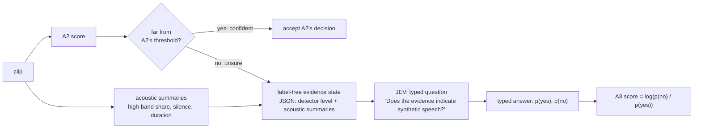

# Chapter 10 · Where does JEV fit?

**Status: this chapter describes a design and a scaffold. A3 has produced no results.**

## The idea: a second opinion for the hard cases

Chapter 9 left A2 ranking well but not knowing where to draw the line. A clip far from the
threshold is probably what it looks like; the trouble is the crowded middle.

So A3 follows a simple rule: **accept when confident, escalate when unsure**, the idea of [10]
(titled "JEV-as-a-Judge: Accept When Confident, Escalate When Unsure"). A2 handles the clips it is
sure about; uncertain ones get a second opinion from a small set of human-readable evidence. As
configured today, A3 cannot yet fix chapter 9's calibration problem ("What would have to change"
below).

## What JEV is, and what it is not

JEV is an external **generalised classifier API** (application programming interface: a
service other programs call). You send typed text or JSON (JavaScript Object Notation, a
plain-text format for structured data) and a fixed question; it returns **typed probabilities**,
for example p(yes) and p(no) ([client.py](../../SystemCode/src/audio_df/models/jev/client.py) module docstring;
[9]–[12]). It is **text only**, never hearing the audio ([11]), and it is **not a large language
model** doing open-ended reasoning.

**This description rests on sources [9]–[12], which have not yet been checked against official
API documentation**; [9] is a community summary. Treat this section as provisional.

## What A3 sends: a label-free evidence state

For each clip, A3 builds a small JSON "evidence state" with
[`build_state`](../../SystemCode/src/audio_df/models/jev/state.py#L114):

- **detector:** A2's verdict as one of five level words (strongly fake to strongly real, by
  distance from A2's dev threshold) and its confidence;
- **acoustic:** share of energy above 4 kHz (kilohertz), leading, trailing and total silence,
  and duration.

The "numbers" version passes raw values; "words" passes fixed buckets (silence "little / some /
a lot"), with cut-offs in [configs/a3_jev.yaml](../../SystemCode/configs/a3_jev.yaml), never learned.

Deliberately **not** in the state: label, attack, speaker, file path, clip id
([`tests/test_jev_state.py`](../../SystemCode/tests/test_jev_state.py), `test_no_label_leakage`). Two more
rules ([technical reference §5.4](../technical-reference.md)):

- no generator or attack attributes, because attributing fakes to generators does not transfer
  well across datasets (from paper [19, Table 5]; local note);
- leading silence is a **caution flag**, not evidence of "fake": it is the shortcut we measure.

## What A3 asks

Three fixed, versioned questions
([questions.py](../../SystemCode/src/audio_df/models/jev/questions.py)):

1. yes/no: "Does the evidence indicate synthetic speech?"
2. a three-way choice: bona fide, spoof, or insufficient evidence;
3. a 0–3 score: how consistent the evidence is with genuine speech.

A3's score is log(p(no) / p(yes)) from the yes/no answer
([`noul_to_a3_score`](../../SystemCode/src/audio_df/models/jev/questions.py#L90)); higher means more real.

*The intended flow (our sketch of [technical reference §5.4](../technical-reference.md)). The current runner sends every clip of the
subset; the accept/escalate split is applied at analysis.*

## The experiment it is built for (E5)

Experiment E5 would compare A2 and A3 on a stratified 500-clip dev subset
([configs/a3_jev.yaml](../../SystemCode/configs/a3_jev.yaml): `subset.n: 500`): does a typed classifier over
interpretable evidence improve the uncertain middle? The runner
([pipelines/a3.py](../../SystemCode/src/audio_df/pipelines/a3.py)) writes both scores, every answer and a cost
summary; answers are cached by a hash of config and clip ([cache.py](../../SystemCode/src/audio_df/models/jev/cache.py)),
so a rerun never pays twice.

## Where it stands

- **The real client is not implemented.** `TypesafeJevClient.ask` raises `NotImplementedError`
  until the JEV API documentation arrives (request format, authentication, response schema and
  pricing are unknown; [client.py](../../SystemCode/src/audio_df/models/jev/client.py#L189)).
- **Only a dry-run client exists**, answering as a fixed function of A2's level word, labelled
  "DRY RUN stub answer, not a real JEV result".
- **Notebook 12 runs end to end on synthetic scores and the dry-run client**
  ([notebook 12](../../SystemCode/notebooks/12_a3_jev.ipynb), setup in cells 3–6, dry run in cells 12–14).
  Nothing in it is a result.
- The configuration points at the A2 run (`a2_experiment: runs/E-20261001-e1-a2-raw`),
  so the dry run builds its evidence from real A2 scores; only JEV's answers are stand-ins.
  Notebook 12 also prints the exact inputs to try in the JEV web playground by hand.
- A budget guard refuses real runs of more than 20 clips until the cost per call is known
  (`pipelines/a3.py` docstring); the first real step is measuring latency and cost within that.

## What would have to change

**A3 as configured today cannot address chapter 9's calibration problem.** Two reasons:

1. **The "uncertain middle" is almost empty.** The level words come from fixed margins of 0.05 and
   0.2 around A2's dev threshold ([configs/a3_jev.yaml](../../SystemCode/configs/a3_jev.yaml),
   `thresholds.detector.margins`), in A2's score units. But A2's scores span roughly −40 to +30
   (chapter 2). Recomputed from the A2 scores
   ([notebook 20](../../SystemCode/notebooks/20_report_figures.ipynb), cell 43, which also shows that only 0.02 %
   fall within ±0.05): only **0.1 % of dev clips**
   fall within ±0.2 of the threshold, so almost every clip gets a "strong" level; and on
   In-the-Wild, **47.9 % of real clips** would be labelled "strongly spoof". The margins are
   placeholders not yet set on A2's scale, so the five levels are effectively two, and the
   "confident" side inherits chapter 9's calibration failure.
2. **E5 runs on ASVspoof dev** (the development split of the Automatic Speaker Verification
   Spoofing and Countermeasures Challenge 2019 dataset, chapter 2), drawn from
   `data/manifests/dev.csv`, so it can only test whether a second opinion helps in domain.

So the margins would need setting on A2's actual scale (or replacing by an uncertainty rule), and
an In-the-Wild subset adding. Both are open decisions; the configuration is unchanged.
Beyond that, we don't know whether a text-only classifier over a few summaries can add anything
A2's own score does not already contain.

> **Checkpoint**
>
> - A3 = A2 plus a second opinion on uncertain clips (idea of [10]). JEV is a typed classifier
>   API (text or JSON in, typed probabilities out), text only, not a large language model
>   ([client.py](../../SystemCode/src/audio_df/models/jev/client.py); sources [9]–[12] still to be checked).
> - A3 sends a label-free evidence state (A2's level and confidence plus acoustic summaries) and
>   asks three fixed questions; its score is log(p(no) / p(yes))
>   ([state.py](../../SystemCode/src/audio_df/models/jev/state.py#L114), [questions.py](../../SystemCode/src/audio_df/models/jev/questions.py#L90)).
> - As configured, A3 cannot address chapter 9's calibration problem: its level margins are
>   placeholders (0.1 % of dev clips fall in the uncertain band; 47.9 % of real In-the-Wild clips
>   would read "strongly spoof"; notebook 20, cell 43), and E5 is planned on ASVspoof dev only.
> - Status: scaffold only; the real client raises `NotImplementedError`, notebook 12 runs on a
>   dry-run client and synthetic scores; there are no A3 results.
>
> **The question this leaves us with:** we have three systems, two of them measured. What do we
> now know, what don't we, and what would tell us?

## References used in this chapter

[9]–[12] are still to be checked against official documentation.

- [9] TypeSafe. *Jev — Project Knowledge Resource.* Community summary, 16 Sep 2026. To be checked
  against official documentation.
- [10] *JEV-as-a-Judge: Accept When Confident, Escalate When Unsure.*
- [11] Jev AI. *Model page.*
- [12] Jev AI. *About Jev AI* and evaluation and quality use cases.
- [19] Stan et al. *TADA: Training-free Attribution and Out-of-Domain Detection of Audio
  Deepfakes.* Interspeech 2025. [arXiv:2506.05802](https://arxiv.org/abs/2506.05802)
