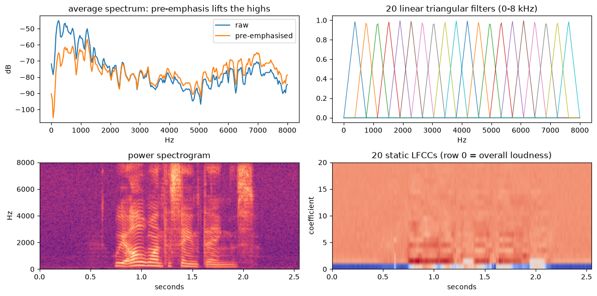

### [ Practice Module ] Project Submission Template: Github Repository & Zip File

**[ Naming Convention ]** `CourseCode-StartDate-BatchCode-TeamName-ProjectName.zip`  
* **[ MTech / Graduate Certificate Group Project Naming Example ]** `ISY5002-FT26-Group4-EchoJEV.zip`

---

## SECTION 1 : PROJECT TITLE
## EchoJEV: Comparative Analysis & Evaluation of Deepfake Audio Detection Methodologies and Evidence-Based Decision Classifiers (JEV & LAYA)

<p align="center">
  
</p>
<p align="center"><i>Visualizing authentic vs. synthetic speech spectrograms and acoustic artifact representations in EchoJEV</i></p>

---

## SECTION 2 : EXECUTIVE SUMMARY / PAPER ABSTRACT

Recent advances in neural speech synthesis—particularly diffusion vocoders, neural codec language models, and zero-shot voice conversion (VC)—have dramatically reduced the acoustic naturalness gap between authentic human speech and synthetic deepfakes. This poses severe security threats to voice biometrics, authentication systems, and disinformation defense. While modern deepfake audio detection increasingly relies on large pre-trained Self-Supervised Learning (SSL) representations, critical questions remain regarding out-of-domain generalization, acoustic interpretability, vulnerability to non-speech shortcuts (such as leading/trailing silence), and whether new-age "System 1" decision policy engines can improve reliability and calibration over raw detector thresholds.

**EchoJEV** conducts a rigorous, multi-generation comparative evaluation of deepfake audio detection methodologies, benchmarked across the **ASVspoof 2019 Logical Access (LA)** benchmark, **In-the-Wild (ITW)** real-world audio, **ASVspoof 2021 LA/DF**, and controlled acoustic degradations (telephony codecs, Opus/MP3 compression, and MUSAN additive noise). The study investigates two primary research questions:
1. **RQ1 (Representation & Fusion):** *Can explainable acoustic representations (LFCC) complement pre-trained SSL encoders (WavLM Base+), especially under distribution shifts, and what fusion mechanism effectively binds them?*
2. **RQ2 (Decision Support & Policy Classification):** *Can new-age decision policy classifiers—specifically cloud-based typed reasoning (**JEV** via TypeSafe) and local open-source reasoning (**LAYA** via Convai)—enhance reliability, reduce borderline decision errors, and support selective abstention on top of frozen detector architectures?*

### Key Architectures Evaluated:
- **A1 (Classical Signal Processing Baseline):** 60-dimensional Linear Frequency Cepstral Coefficients (LFCC with static, $\Delta$, and $\Delta\Delta$) modeled with two 512-component diagonal Gaussian Mixture Models (GMMs), faithfully reproducing the official ASVspoof 2019 B02 reference baseline.
- **A2 (Pre-trained SSL Baseline):** Frozen pre-trained WavLM Base+ (94.7M parameters) with a learned representation pooling and task-trained classification head.
- **A4 (Neural Acoustic Control):** Mean-pooled LFCC passed through a neural MLP classification head, isolating classifier architecture differences from acoustic feature representations.
- **D1 (Simple Feature Concatenation):** Joint concatenation of mean-pooled LFCC and mean-pooled WavLM features feeding a dense fusion classification head.
- **D2 (Unidirectional Cross-Attention Fusion):** 32-token temporal LFCC sequence cross-attending to 32-token temporal WavLM representations prior to sequence pooling and binary classification.
- **D3 (Bidirectional Cross-Attention Fusion):** Reciprocal cross-attention ($\text{LFCC} \leftrightarrow \text{WavLM}$) with residual connections, testing mutual information exchange across acoustic and self-supervised tokens.
- **P1 · JEV (Cloud Decision Policy):** Non-autoregressive decision adapter querying structured Choice (bona fide / spoof / uncertain), Score (evidence quality), and Noul (ambiguity) rubrics over label-free confidence margins.
- **P2 · LAYA (Local Open-Source Decision Policy):** Zero-cost, local execution decision engine based on `convaiinnovations/laya`, executing identical question criteria without external API costs or latency overhead.

### Major Empirical Findings:
1. **The Silence Shortcut Trap:** In ASVspoof 2019 LA, bona fide clips start with much longer silence than spoofs (median 0.96 s vs 0.03 s on eval). Leading silence alone reaches AUC **0.84** (leakage audit). Trimming silence at test time moves A1 EER from **9.56% to 19.84%** and raw-trained A2 from **0.96% to 13.27%**, so all final models train and test on trimmed audio.
2. **Generalization Collapse on Real-World Speech:** On In-the-Wild (ITW), raw-trained A1 falls to chance (**58.04% EER**). Raw-trained A2 still ranks well (**14.70% EER, 0.93 AUC**), but its 2019 dev threshold rejects about half (48.9%) of real-world bona fide clips: ranking survives the shift, calibration does not. The final D2 is the same: 19.9% EER, yet its dev threshold rejects 63.9% of real ITW clips.
3. **WavLM Layer 6, not 12:** Fusion on WavLM's last layer (12) lost to A2 (2019 eval EER: A2 7.6%, D2 11.8%, D3 12.6%). A per-layer probe shows middle layers (4–6) separate spoofs best and the last layers worst (why is not tested). With **layer 6**, mean EER over 10 test sets drops to **11.0% (D2)** and **11.5% (D3)**, below A2 (12.5%); D2 is the final model.
4. **Decision layer:** JEV or LAYA on one detector's score added nothing (FP1: JEV repeated D2 on all 180 sampled clips). Phase 2 therefore tests **arbitration**: several detectors score a clip and a judge (LAYA or JEV) decides when they disagree. On 200 balanced In-the-Wild clips where the six detectors disagree, neither judge beats A2 alone (73.5% accuracy): JEV's best request gets 64.8%, LAYA 62.0% (notebook 06).

---

## SECTION 3 : CREDITS / PROJECT CONTRIBUTION

| Official Full Name | Student ID (MTech Applicable) | Work Items (Who Did What) | Email |
| :----------------- | :---------------------------: | :------------------------ | :---- |
| **Chakit Kalra** | A0352070R | Designed and implemented the **LAYA** and **JEV** decision policy module (`audio_df.modules.laya`), local agent integration (`DryRunLayaClient` / `convaiinnovations/laya`), comparative policy evaluation suite (`evaluate_laya_on_scores.py`, `compare_policies.py`), policy pipeline orchestrations (`a3_laya.py`, `fp2.py`), offline unit test suites (`test_laya_pipeline.py`, `test_laya_config.py`), and decision layer comparative analysis. | chakitkalra@u.nus.edu |
| **Nathan Kittichaikoonkij** | A0352270M | Core repository architect; implemented base detector modules (A1, A2, A4, D1–D3), feature extraction and caching pipelines (LFCC, WavLM pooling/temporal caches), cross-attention heads, Round 3 Layer-6 ablation study, CLI experiment runtime (`runtime.py`), FastAPI backend (`app.py`), and research notebooks (01–07). | nathan.kit@u.nus.edu |

---

## SECTION 4 : VIDEO OF SYSTEM MODELLING & USE CASE DEMO

[]

> **Demo Walkthrough Highlights:**
> 1. Overview of acoustic vs. self-supervised feature extraction and cross-attention fusion architecture.
> 2. Live audio verification through the FastAPI web interface (`Upload` & `Record voice`).
> 3. Comparative evaluation of base detectors vs. JEV and LAYA decision policy classifications on out-of-domain and degraded clips.
> 
> *Note: Full video recording link and presentation slides are cataloged in `ProjectReport/`.*

---

## SECTION 5 : USER GUIDE

The entire codebase is managed using modern Python tooling with [`uv`](https://docs.astral.sh/uv/) under `SystemCode/`. Python 3.11 is required.

### [ 1 ] Environment Installation & Verification

From the `SystemCode/` directory:

```bash
cd SystemCode

# 1. Synchronize virtual environment and install exact locked dependencies
uv sync

# 2. Run unit tests (runs offline without requiring full datasets)
uv run pytest -q

# 3. Verify static typing and compilation
uv run python -m compileall -q src/audio_df src/backend
uv run ruff check src tests
```

### [ 2 ] Data Preparation & Verification

Follow [`SystemCode/data/README.md`](SystemCode/data/README.md) for official download links for **ASVspoof 2019 LA**, **In-the-Wild (ITW)**, **ASVspoof 2021 LA/DF**, and **MUSAN**.

```bash
# Verify downloaded dataset layout and path integrity
uv run data-check --paths --verify

# Generate standardized train/dev/eval CSV manifests
uv run data-prepare --workers 4

# Generate controlled acoustic degradations (noise, MP3/Opus codecs, 8kHz resampling)
uv run data-degrade --conditions all --workers 4
```

### [ 3 ] Training & Evaluating Base Detection Architectures

Every architecture exposes unified `train`, `evaluate`, and `run` (train + evaluate) CLI commands:

| Architecture CLI | Detector Structure | Trained Components | Target Feature |
| :---: | :--- | :--- | :--- |
| `uv run a1` | LFCC → Two Gaussian Mixture Models | 512-component GMMs | 60-dim LFCC ($+\Delta+\Delta\Delta$) |
| `uv run a2` | Frozen WavLM Base+ → layer-weighted MLP head | Layer weights + MLP head | 768-dim pooled SSL features |
| `uv run a4` | Mean-pooled LFCC → MLP Head | Neural Head | 60-dim pooled LFCC |
| `uv run d1` | Concatenated LFCC + WavLM → MLP head | MLP fusion head | Concatenated feature vector |
| `uv run d2` | Temporal LFCC → WavLM Cross-Attention | Attention + Projections + Head | 32-token sequences (Layer 6) |
| `uv run d3` | Bidirectional LFCC $\leftrightarrow$ WavLM Attention | Bi-attention + Residuals + Head| 32-token sequences (Layer 6) |

**Example Execution Commands:**
```bash
# Train classical GMM baseline (A1) and evaluate on 2019 LA eval
uv run a1 train --i 2019LA
uv run a1 evaluate --i 2019LA --testsets eval,itw

# Train and benchmark the best cross-attention model (D2)
uv run d2 run --i 2019LA --testsets eval,itw,asvspoof2021_eval

# Evaluate an existing model checkpoint across multiple test sets
uv run d2 evaluate --model-from artifacts/d2/<timestamp> --testsets eval,itw,eval_noise_10db,eval_mp3_32k
```
- Model artifacts are saved to `SystemCode/artifacts/<architecture>/<timestamp>/`.
- Evaluation metrics, score CSVs, and logs are output to `SystemCode/runs/E-<timestamp>-<architecture>/`.

### [ 4 ] Running Decision Layer Policies (JEV & LAYA)

Decision policies evaluate frozen detector predictions by packaging scores, calibrated thresholds, and signed confidence margins into structured evidence.

#### A. Cloud Policy: JEV (TypeSafe API)
Configure `TYPESAFE_API_KEY` in `SystemCode/.env`:
```bash
# Run A3 (A2 + JEV Cloud Policy)
uv run a3 --testsets eval --limit 50

# Run FP1 (Best Fusion D2 + JEV Cloud Policy)
uv run fp1 --testsets eval --limit 50
```

#### B. Local Open-Source Policy: LAYA (Convai LAYA)
Runs locally on GPU/CPU with **zero API costs**:
```bash
# Run A3-LAYA (A2 + Local LAYA)
uv run a3-laya --testsets eval --limit 100

# Run FP2 (Best Fusion D2 + Local LAYA)
uv run fp2 --testsets eval --limit 100

# Run LAYA directly on pre-computed detector score CSVs (without loading raw audio)
uv run evaluate-laya --arch d2 --limit 200

# Compile policy metrics, coverage, and error transitions across all runs
uv run compare --runs-dir runs
```

#### C. Arbitration between detectors (current Phase 2)
The judge (`laya` or `jev`) and the request it receives are set in `configs/arbitrator.yaml`:
```bash
# Fixed test: 200 In-the-Wild clips (100 bona fide, 100 spoof) where the six detectors disagree,
# each asked in two detector orders -> judge answers in runs/E-*-arbitration/
uv run arbitration
```
Results and the prompt playground: notebook 06, section 2.

### [ 5 ] Starting the Interactive Web Application & API Backend

The system includes a production-ready **FastAPI** backend that performs audio ingestion, silence trimming, inference, and threshold comparison, connected to an interactive frontend for audio upload and live microphone recording.

```bash
# Start with D2; the UI lists every detector with weights on this machine
ADF_SYSTEM=d2 uv run uvicorn backend.app:app --reload --port 8000

# Weights in another folder (e.g. a mounted volume)
ADF_ARTIFACTS=/models ADF_SYSTEM=d2 uv run uvicorn backend.app:app --port 8000
```
Each detector's threshold is read from `SystemCode/artifacts/<system>/threshold.json` (dev EER, updated by every
evaluation); `ADF_THRESHOLD` overrides it for the start-up system only. Pages: single detector, compare & arbitrate
(two detectors + a LAYA/JEV judge; JEV needs a TypeSafe API key, from `TYPESAFE_API_KEY` or entered with the 🔑 button), rankings. The rankings page reads
`SystemCode/artifacts/rankings.json`, built from `runs/` by `uv run make-rankings` (not tracked; copy it into the
deployed volume after new evaluations).
Open **`http://127.0.0.1:8000`** in any modern web browser to access the **Voice Spoof Check** interface.

**Docker** (web app only, no training pipelines; the image holds the newest trained detectors):
```bash
cd SystemCode
docker compose up          # pulls ghcr.io/qwenty228/echojev:latest; add --build to build it here
```
WavLM and LAYA load from this computer's Hugging Face cache (mounted at `/hf_cache`) or download on first use.
Use `http://localhost:8000`: browsers allow the microphone only on localhost or HTTPS.

---

## SECTION 6 : PROJECT REPORT / PAPER

`Refer to our final project report documentation in Github Folder: ProjectReport. The following is our project's preliminary documentation.`

### Comprehensive Documentation Index:
1. **Interactive Evaluation & Architecture Portals:**
   - [`docs/index.html`](docs/index.html): Full research plan, primary evaluation matrices, research questions (RQ1, RQ2), and literature map.
   - [`docs/architecture.html`](docs/architecture.html): Comprehensive developer reference, dataset pipelines, module organization, and deployment guide.
   - [`docs/eval_finding.html`](docs/eval_finding.html): Detailed analysis of the cross-attention layer diagnostic and the Round 3 WavLM Layer-6 breakthrough.
2. **12-Chapter Project Report (`ProjectReport/preliminary/report/`):**
   - [Chapter 0: The Problem — What Would a Detector Even Look For?](ProjectReport/preliminary/report/00_the_problem.md)
   - [Chapter 1: What is a Voice Made Of, and What Must a Fake Imitate?](ProjectReport/preliminary/report/01_what_is_a_voice.md)
   - [Chapter 2: Data & Fair Scoring Protocols](ProjectReport/preliminary/report/02_data_and_fair_scoring.md)
   - [Chapter 3: The Silence Shortcut in ASVspoof 2019](ProjectReport/preliminary/report/03_the_silence_shortcut.md)
   - [Chapter 4: Acoustic Feature Distance & Separability](ProjectReport/preliminary/report/04_looking_at_the_sound.md)
   - [Chapter 5: Transforming Speech into Numbers: LFCC vs MFCC](ProjectReport/preliminary/report/05_sound_into_numbers.md)
   - [Chapter 6: A1 Baseline: Two GMM Clouds and Vocoder Detection](ProjectReport/preliminary/report/06_a1_two_clouds.md)
   - [Chapter 7: A2 Baseline: Pre-trained WavLM Self-Supervised Speech Representations](ProjectReport/preliminary/report/07_a2_borrowed_ears.md)
   - [Chapter 8: Trimming Silence: Benchmarking Real Degradation](ProjectReport/preliminary/report/08_trim_the_silence.md)
   - [Chapter 9: Leaving Home: Real-World In-the-Wild Audio Evaluation](ProjectReport/preliminary/report/09_leaving_home.md)
   - [Chapter 10: Where JEV & LAYA Fit: Decision Layer Reasoning](ProjectReport/preliminary/report/10_where_jev_fits.md)
   - [Chapter 11: Summary of Knowns, Unknowns, and Recommendations](ProjectReport/preliminary/report/11_what_we_know.md)
3. **Engineering Reference:**
   - [`ProjectReport/preliminary/technical-reference.md`](ProjectReport/preliminary/technical-reference.md): In-depth mathematical formulations, loss functions, and full result logs.

### Key Benchmark Results Summary:

EER (%) of the final trimmed-trained detectors (`uv run make-rankings`; D2/D3 read WavLM layer 6). Lower is better.

| Architecture | Representation / Classifier | 2019 LA eval | In-the-Wild | 2021 LA eval | 2021 DF eval | MP3 32 kbps | Mean (10 test sets) |
| :--- | :--- | :---: | :---: | :---: | :---: | :---: | :---: |
| **A1** | LFCC + two 512-component GMMs | 20.49 | 58.25 | 34.08 | 29.12 | 39.25 | 35.94 |
| **A4** | Mean-pooled LFCC + MLP head | 37.04 | 71.99 | 40.59 | 35.25 | 47.39 | 43.29 |
| **A2** | Frozen WavLM Base+ + layer-weighted MLP head | 7.64 | **19.17** | 14.28 | 10.74 | **8.42** | 12.52 |
| **D1** | Pooled LFCC + WavLM, concatenated | 7.79 | 33.21 | 16.80 | 22.62 | 21.91 | 19.05 |
| **D2** (final) | LFCC → WavLM layer 6, one-way cross-attention | 7.19 | 19.93 | **10.09** | **10.02** | 8.45 | **10.99** |
| **D3** | LFCC ↔ WavLM layer 6, two-way cross-attention | **6.55** | 22.68 | **10.09** | 11.18 | 9.19 | 11.53 |

Raw-trained models looked far better in-domain (A1 9.56%, A2 0.96% on 2019 eval) because of the silence shortcut; trimming the test audio raised them to 19.84% and 13.27%.

---

## SECTION 7 : MISCELLANEOUS

`Refer to Github Folders: Miscellaneous & SystemCode`

### [ 1 ] Research Knowledge Base & Fact-Checking (`Miscellaneous/research/`)
Maintained under strict evidentiary discipline:
- `knowledge/`: Literature summaries, official dataset protocols, and published baselines.
- `fact-checks/`: Verification logs (`FC-###`) confirming or refuting specific implementation claims against code and source literature.
- `decisions/`: Architectural Decision Records (`ADR-###`) recording technical trade-offs, evidence, and reversal criteria.

### [ 2 ] Research Notebooks (`SystemCode/notebooks/`)
- `01_dataset_audit.ipynb`: Comprehensive distribution and integrity audit across ASVspoof splits.
- `02_asvspoof2019_audit.ipynb`: Splits, leakage on raw vs trimmed audio, and why the first run looked so good (leading silence).
- `03_a1_explained.ipynb`: A1 results, which frames decide, and what is left after trimming (LFCC band and delta ablations).
- `04_a2_explained.ipynb`: A2's learned layer weights and a per-layer probe of all 13 WavLM layers on every test set.
- `05_test_results.ipynb`: EER, minDCF and F1 per test set for every detector; builds the arbitration test clips.
- `06_jev.ipynb`: JEV and LAYA as judges: on one detector's evidence (FP1), then arbitrating between detectors.
- `07_results_summary.ipynb`: Raw- vs trimmed-trained results, round 2 → round 3 (WavLM layer 12 → 6), all test sets.

### [ 3 ] Experiment Runs (`SystemCode/runs/`)
Each evaluation writes `runs/E-<timestamp>-<system>/` with its config, dev calibration, metrics per test set and per-clip scores (layout: `SystemCode/runs/README.md`). `REGISTRY.md` logs the first experiments (to 2026-10-12) with Git SHA, seed, hardware, wall-clock time and memory.

---

**This project is submitted in partial fulfillment of the requirements for the Graduate Certificate in [Pattern Recognition Systems (PRS)](https://www.iss.nus.edu.sg/executive-education/course/detail/practice-module-for-pattern-recognition-systems "Pattern Recognition Systems") offered by [NUS-ISS](https://www.iss.nus.edu.sg "Institute of Systems Science, National University of Singapore").**

