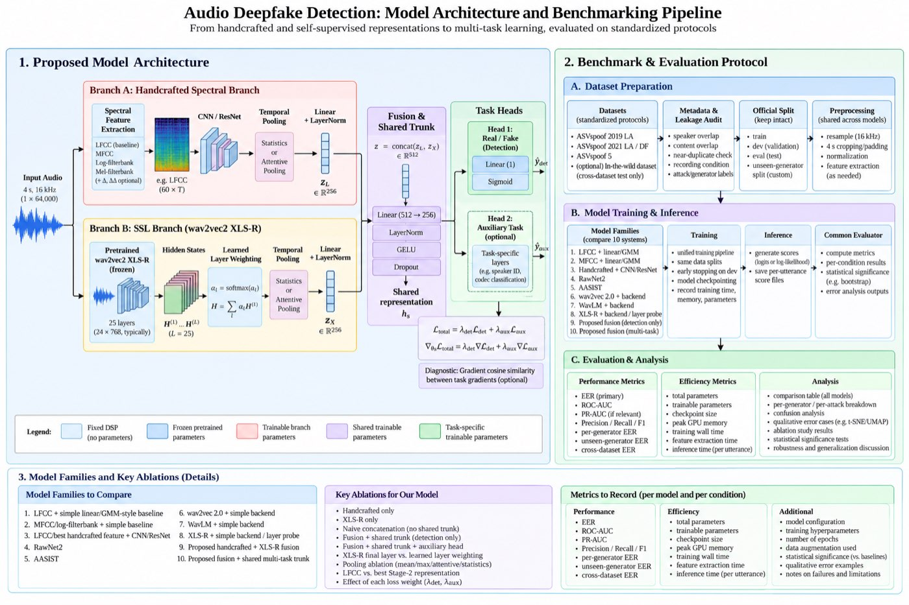

# Audio Deepfake Detection — GC2

A reproducible, implementation-first research workshop: from spectral EDA through
hand-engineered cepstral features to CNN/ResNet backends, self-supervised speech
representations, and a fusion + multi-task architecture — benchmarked on standardized
ASVspoof protocols.

## The plan, in one picture

[](docs/assets/architecture.jpg)

*Full-resolution PNG: `docs/assets/architecture-full.png` (gitignored — 1.8 MB; the 272 KB
JPEG above is the committed version).*

This diagram is the project's structural plan, and the panels map onto the repo directly:

| Panel | What it fixes | Where it lives |
|---|---|---|
| **1. Proposed model architecture** — handcrafted branch, frozen XLS-R branch, fusion + shared trunk, two heads | the target architecture and its 256-d branch interfaces | [`configs/fusion_multitask.yaml`](configs/fusion_multitask.yaml), `src/audio_df/models/` |
| **2A. Dataset preparation** — metadata and leakage audit, official splits kept intact | Stage 0, which runs *before* any modelling | [`configs/data.yaml`](configs/data.yaml), tasks T05 + T09 |
| **2B. Training & inference** — unified pipeline, same splits, shared evaluator | why ten systems stay comparable | task T11, [`reports/experiment_registry.csv`](reports/experiment_registry.csv) |
| **2C. Evaluation & analysis** — EER first, per-generator breakdown, efficiency, error analysis | what every run must record | task T04, [`tasks/CONVENTIONS.md`](tasks/CONVENTIONS.md) |
| **3. Model families and key ablations** — 10 systems, 9 ablations | the benchmark table's rows | [`tasks/BACKLOG.md`](tasks/BACKLOG.md) |

The legend matters as much as the boxes: fixed DSP, frozen pretrained, trainable branch,
shared trunk and task-specific parameters are four different things, and the efficiency
columns in the final table only make sense if they are counted separately.

## The research question

Given an utterance *x* and label *y* ∈ {bonafide, spoof}, can we learn a detector that
captures **synthesis-related evidence** rather than dataset or generator shortcuts?

The working assumption is that for some observable representation *Z*,
`P(Z | real) ≠ P(Z | fake)`. The project investigates **where** that difference is visible
and **whether it survives unseen attacks and domains**. This is distributional classification
with overlapping classes and weak evidence spread across spectrum, temporal dynamics,
excitation behaviour, learned representations and recording conditions — not a hunt for one
magic artifact.

Full brief: [`docs/handoff.md`](docs/handoff.md).
## Quickstart (uv)

```bash
uv sync                                   # locked env, Python 3.11
uv run pytest                             # runs with no dataset present
uv run ruff check src tests
uv run python scripts/prepare_data.py --config configs/data.yaml
uv run python scripts/audit_leakage.py    # Stage 0: before any modelling
```

Everything runs through `uv run`. No `pip`, no manual venv activation. Target device is
Apple Silicon **MPS** or CPU; `device: auto` resolves cuda → mps → cpu.

## Layout

```text
configs/      data.yaml, features.yaml, lfcc_resnet.yaml, ssl_probe.yaml, fusion_multitask.yaml
data/         raw/ (gitignored) · metadata/ · manifests/ · cache/
notebooks/    01 dataset audit → 07 fusion error analysis — questions and interpretation only
src/audio_df/ all reusable logic: audio, features, stats, metrics, training, models/, experiments/
tests/        run without any dataset; real-data tests marked needs_data
reports/      figures/ · tables/ · experiment_registry.csv · final_report.md
scripts/      prepare_data.py · extract_features.py · audit_leakage.py · evaluate.py
research/     the researcher agent's knowledge base — see below
tasks/        TASKS.md (orchestration) · CONVENTIONS.md (binding rules) · BACKLOG.md
docs/         handoff.md (the brief) · assets/architecture.jpg · superpowers/specs/
```

**Notebook rule:** notebooks hold questions, plots and interpretation. If a function is used
twice it moves to `src/audio_df/`. Feature extraction, splitting, metrics, model definitions
and training loops never live in a notebook.

## `research/` — fact-checking the implementation

[`research/`](research/README.md) is a first-class part of the project, not documentation
afterthought. A dedicated **researcher agent** owns it and does three things:

- **`knowledge/`** — notes written from primary sources (ASVspoof protocols, RawNet2,
  wav2vec 2.0 anti-spoofing, WavLM ensembles, AASIST, the 2023 survey). Cite or delete.
- **`fact-checks/`** — every implementation agent ends its work with a *claim block*; the
  researcher returns a verdict of `confirmed` / `contradicted` / `unsupported` /
  `out-of-scope` against the code and the source. A task is not done until it is `confirmed`.
- **`decisions/`** — ADRs recording which way we went, the run IDs that justify it, and the
  result that would reverse it.

The researcher also **explains performance**: for each benchmarked model it records the
number, the protocol that produced it, the efficiency it cost, and a mechanistic account of
why that model's inductive bias would behave that way — written before seeing our result
where possible, so a surprise stays visible as a surprise.

## How the work is orchestrated

[`tasks/TASKS.md`](tasks/TASKS.md) splits scaffold + Stages 0–4 into 14 tasks across 5 waves.
Each task is a complete brief for one Sonnet `implementer` subagent with non-overlapping file
ownership, so a whole wave runs in parallel. Between waves the `researcher` agent fact-checks
the wave's claims. Agent definitions live in [`.claude/agents/`](.claude/agents/).

Stages 5–10 (RawNet2, SSL probing, XLS-R, fusion, multi-task) sit in
[`tasks/BACKLOG.md`](tasks/BACKLOG.md), gated on Stage 0–4 evidence — the point of the
workshop is that each architectural choice is motivated by an observed limitation.

## Scientific ground rules

- Thresholds are chosen on dev, **never** on eval.
- Unseen-attack tests hold out whole generator families, never random utterances.
- Per-attack EER is reported alongside pooled EER — a cue that reverses across generators
  must stay visible.
- t-SNE/UMAP are exploratory pictures, never evidence of separability.
- Literature EERs are labelled as literature and never compared directly with our runs.
- Every run appends a row to `reports/experiment_registry.csv` with git commit, config hash,
  split hash, seed, device, params, timing and metrics.

## Status

Scaffolding complete. No experiments run yet — `reports/experiment_registry.csv` holds only
its header, and the results section below stays empty until Wave 4 lands.

### Results
_Not yet run._
