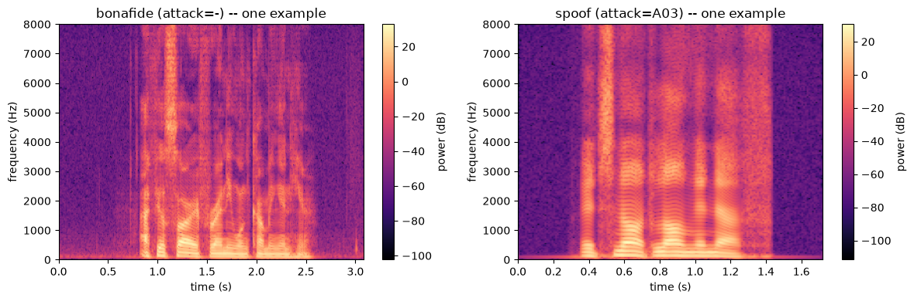
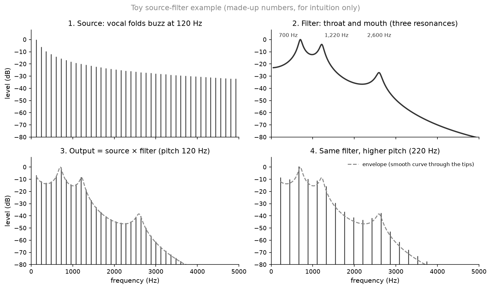

# Chapter 1 · What is a voice made of, and what must a fake imitate?

*Notebook cell numbers count the first cell of a notebook as cell 0.*

## Look at the stripes

Go back to the two spectrograms from chapter 0.

*Source: [notebook 02](../../notebooks/02_spectral_eda.ipynb), cell 27, rendered locally.*

Inside each spoken word you can see two kinds of pattern:

- **thin horizontal stripes**, stacked evenly, most visible below about 3,000 Hz (hertz);
- **broad bright bands**, where several stripes are lit up together and the ones in between are
  dimmer.

The stripes move up and down together as the voice rises and falls in pitch. The bright bands
shift when the speaker moves from one vowel to another. Two different things are being drawn on
top of each other. Separating them is the key idea of this chapter.

## A voice is a buzz shaped by a tube

Here is the classic picture of how speech is produced. It is described in standard
speech-science textbooks; it is **not** in our reading list, so treat this section as
background rather than a cited result.

1. **The source.** Your vocal folds open and close many times a second, letting out puffs of
   air. A train of puffs at, say, 120 per second makes a buzz whose energy sits at 120 Hz and
   at every whole multiple of it: 240, 360, 480 Hz and so on. Those multiples are called
   **harmonics**. The spacing between them is the **pitch**, also called the fundamental
   frequency (F0).
2. **The filter.** The buzz then travels through your throat, mouth and lips. That tube
   resonates at some frequencies and damps others, the way a bottle rings at its own note when
   you blow across it. The resonant peaks are called **formants**. Moving your tongue and lips
   moves the formants, and that is how an "ee" differs from an "ah".

Here is a toy with made-up numbers, built only for intuition:

*Source: [notebook 20](../../notebooks/20_story_figures.ipynb), cell 3 (toy, no data).*

- top left: the source, a comb of harmonics every 120 Hz;
- top right: the filter, a smooth curve with three bumps (at 700, 1,220 and 2,600 Hz);
- bottom left: the sound that comes out, each tooth of the comb scaled by the curve;
- bottom right: the **same filter** with the pitch raised to 220 Hz. The teeth spread apart,
  but the smooth curve through their tips keeps its shape.

So the stripes in the real spectrogram are the source's harmonics, and the bright bands are the
filter's formants. Pitch and vocal-tract shape can change independently.

Once you can see that, the arithmetic is easy to guess. The output at each frequency is the
source's strength times the filter's gain. On a decibel (dB) scale, which is a logarithm,
multiplying becomes adding:

$$
\text{level}_\text{out}(f) = \text{level}_\text{source}(f) + \text{gain}_\text{filter}(f) \quad\text{(in dB)}
$$

In words: the loudness you hear at a frequency is how loud the buzz is there, plus how much the
mouth boosts or cuts it there. Keep the "multiply becomes add" trick in mind. Chapter 5 uses it
to pull the filter out of a recording.

## What a speech generator has to rebuild

A fake voice has to produce both parts convincingly. The dataset's own description of its
attacks shows that the generators are built in exactly two stages (from paper [14, §3, p.6]).

Take attack A01 as a concrete case. In the database paper's words, "an NN-based [NN: neural network] acoustic model
predicts a sequence of acoustic features, including the Mel-cepstral coefficients (MCCs) of 60
dimensions, interpolated F0, and voicing flags. Finally, the WaveNet vocoder is used to convert
the MCCs and F0 into a waveform" (from paper [14, §3, p.6]). MCCs are a short list of numbers
describing the smooth shape of the spectrum, the filter part; chapter 5 builds a close cousin of
them. WaveNet, like WaveRNN and Vocaine below, is simply the name of a vocoder.

That splits neatly onto the picture above:

| stage | what it produces | in source-filter terms |
|---|---|---|
| **acoustic model** (NN = neural network) | a frame-by-frame description: F0 (pitch), voicing on/off, and a compact spectral description (here MCCs) | the source's pitch plus the filter's shape |
| **vocoder** (waveform generator) | the actual audio samples | turns that description back into sound |

The mapping in the right-hand column is our reading, using the textbook idea above. The paper
itself only names the stages and their outputs.

The paper's Table 1 lists every attack this way, with an "Outputs" column (what the acoustic
model hands over) and a "Waveform generator" column (the vocoder) (from paper [14, Table 1,
p.6]). Two rows of that table are worth memorising, because we will keep coming back to them:

- **A10 and A11 are identical up to the vocoder.** Both turn text into mel-spectrograms (spectrograms
  on a frequency scale that mimics the ear) with the same architecture. A10 then uses WaveRNN, a neural vocoder; A11 uses Griffin-Lim, an
  algorithm that needs no training (from paper [14, Table 1, p.6, and §3, p.8]). So any difference
  a detector sees between A10 and A11 is, by design, a difference in the vocoder.
- **A17, A18 and A19 start from a real person's recording.** Their input column says "Speech
  (human)": they are voice conversion (VC) systems that change who seems to be speaking in an
  existing recording, rather than generating speech from text (from paper [14, Table 1, p.6]).
  Whatever surrounds the speech in that recording may survive the conversion. Chapter 3 shows
  why that matters.

## Where can a fake go wrong?

The two stages give three places to look for evidence:

1. **The filter description.** Is the envelope right? Are the formants in natural places, with
   natural detail?
2. **The waveform.** Even with a perfect description, the vocoder has to fill in fine detail
   that the frame-by-frame description leaves open (our reading). Some vocoders manage this
   worse than others: the database authors report that attacks whose vocoder is the neural source-filter
   (NSF) model (a vocoder named after the idea above, attack A08), Vocaine or Griffin-Lim "were not able to produce audio that shows more similarity to
   genuine speech under the current settings" (from paper [14, §6.1.2, p.17]).
3. **Everything that is not the voice.** Silence before and after speech, background hiss,
   the microphone and room. A generator can get these "wrong" too, but that has nothing to do
   with how good the voice is.

Which of the first two matters more? The database authors' own analysis, using their two
baseline detectors, concludes that "the acoustic model seemed to have less of an impact than
the waveform generation method", and adds that this "was also confirmed by the comparison of
performance obtained with A10 and A11 where the only difference was in the waveform generation
method" (from paper [14, §6.1.2, p.17]). Chapter 6 repeats that comparison with our own detector.

Point 3 is the dangerous one. A detector does not know which differences we consider "fair".
If silence separates real from fake in the training data, it will use silence.

> **Checkpoint**
>
> - A voice can be pictured as a buzz (the source: pitch and its harmonics) shaped by the throat
>   and mouth (the filter: formants). Pitch and filter shape can change independently
>   ([notebook 20](../../notebooks/20_story_figures.ipynb), cell 3; a toy, and a textbook idea
>   that is not in our reading list).
> - On a decibel scale, source times filter becomes source plus filter, which later lets us
>   separate them (same figure).
> - Speech generators work in two stages: an acoustic model predicts pitch and a spectral
>   description; a vocoder turns that into audio (from paper [14, §3, p.6], attack A01).
> - A10 and A11 differ only in their vocoder; A17–A19 convert recordings of real people (from
>   paper [14, Table 1, p.6]).
> - The database authors found the vocoder mattered more than the acoustic model for their
>   baseline detectors (from paper [14, §6.1.2, p.17]).
>
> **The question this leaves us with:** we now know what to look for. Where do our real and fake
> clips actually come from, and how do we score a detector fairly when most of them are fake?

## References used in this chapter

- Source-filter model: standard speech-science textbook material, not in our reading list and
  not checked against a specific source.
- [14] Wang et al. *ASVspoof 2019: A Large-Scale Public Database of Synthesized, Converted and
  Replayed Speech.* Computer Speech & Language 64, 2020.
  [arXiv:1911.01601](https://arxiv.org/abs/1911.01601)
