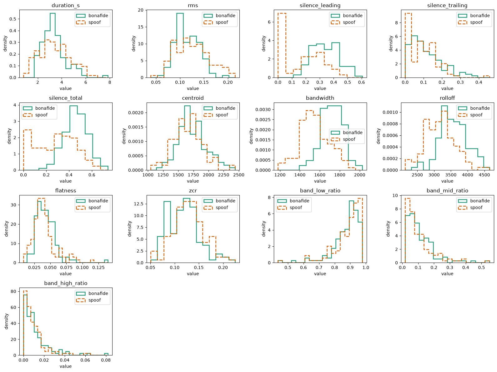
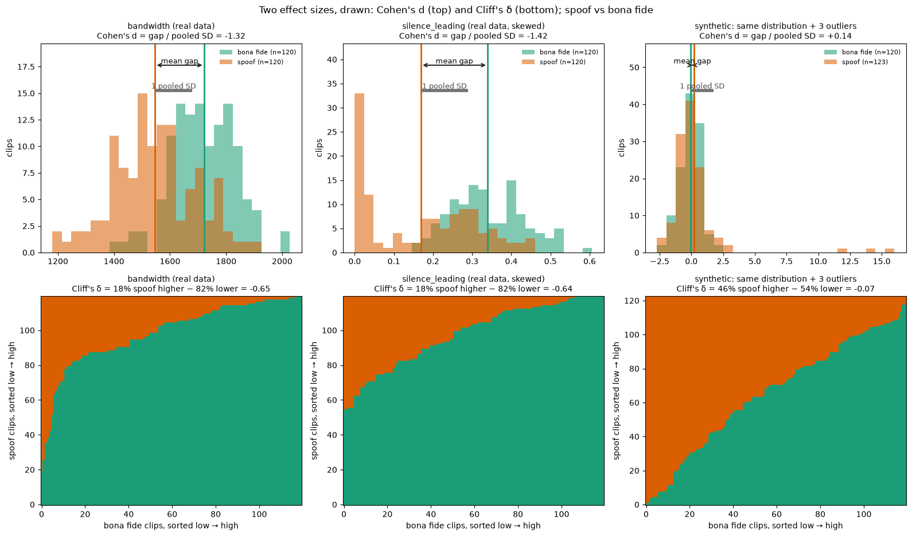
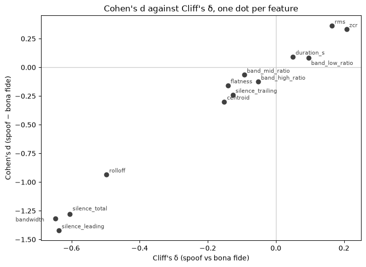

# Chapter 4 · Looking at the sound: how different are real and fake?

## A few numbers per clip, two piles each

Chapter 3 looked at properties that *should not* matter. Now look at the sound itself.

[Notebook 02](../../notebooks/02_spectral_eda.ipynb) takes a small sample of the ASVspoof 2019
LA dataset (the Automatic Speaker Verification Spoofing and Countermeasures Challenge, logical
access part): 240 clips, 40 real and 40 fake from each of train, dev and eval (cell 4). For
each clip it computes one-number summaries of the spectrum (energy against frequency). Three
matter below:

- **spectral bandwidth**: how widely the energy is spread around its centre frequency;
- **spectral rolloff**: the frequency below which 85 % of the energy sits;
- **spectral centroid**: the "centre of mass" of the frequencies; higher sounds brighter.

In the figure below, look at **bandwidth**: the orange pile sits clearly left of the green one.
In **band_high_ratio** (the share of energy above 4 kHz, kilohertz) the piles lie on top of each
other.

*Source: [notebook 02](../../notebooks/02_spectral_eda.ipynb), cell 7, rendered locally (the committed notebook has no saved output); 240-clip sample.*

We need an honest number for "how far apart are two piles?".

## Two ways to measure "how far apart"

### Cohen's *d*: the gap between the averages, in units of spread

The obvious measure is the distance between the averages. But "300 hertz (Hz) apart" means a
lot if each pile is 50 Hz wide and little if each is 2,000 Hz wide. So divide the gap by the
typical width:

$$
d = \frac{\text{average(fake)} - \text{average(real)}}{\text{pooled standard deviation}}
$$

In words: how many "typical spreads" (pooled over both groups) apart the averages are. A rough
scale often quoted, from Cohen's 1988 textbook (not in
our reading list): 0.2 small, 0.5 medium, 0.8 large. The code is [`cohens_d`](../../src/audio_df/stats.py#L78).

### Cliff's δ: who wins, pair by pair

Averages can be dragged around by a few extreme clips; this measure cannot. Take all 120 × 120
fake–real pairs and ask: does the fake have the higher value or the lower? Then

- δ = (share of pairs where the fake is higher) − (share where it is lower).

δ runs from −1 (every fake is lower than every real clip) through 0 (no tendency) to +1. The
code is [`cliffs_delta`](../../src/audio_df/stats.py#L105).

The figure below draws *d* (top: the gap between means, with a grey ruler one pooled standard
deviation long) and δ (bottom: every pair, orange where the fake wins, green where the real clip wins):

1. **Bandwidth.** Both say "fake is clearly lower": d = −1.32, δ = −0.65.
2. **Leading silence.** About a quarter of the fakes sit at or near zero, which stretches the
   gap between averages: *d* is bigger (−1.42), δ about the same as bandwidth (−0.64).
3. **A made-up example.** Two identical piles plus 3 extreme outliers in the fakes. *d* says
   "fake higher" (+0.14); δ, where 3 clips of 123 barely matter, says "very slightly lower"
   (−0.07). They disagree even on the sign.

*Source: [notebook 02](../../notebooks/02_spectral_eda.ipynb), cell 13, rendered locally (the committed notebook has no saved output).*

The rule of thumb: **if *d* and δ agree, the difference is not the work of a few
odd clips. If they disagree, look at the distribution.**

A bonus: δ and chapter 2's area under the curve (AUC) are the same information on two scales,
δ = 2 · AUC − 1 (notebook 02, cell 15 checks it). Bandwidth's δ of −0.65 is an AUC of 0.82 for
"lower bandwidth means fake".

### Why not a p-value?

With enough clips, even a useless difference passes a significance test. Effect sizes ask what
we care about: *how big* is the difference.

## The result

Notebook 02, cell 10 computes both measures for every summary, with a 95 % confidence interval
(CI) on *d* from 500 bootstrap resamples (chapter 3). Printed output of a local run.

| feature (fake against real) | Cohen's *d* [95 % CI] | Cliff's δ |
|---|---|---|
| leading silence | −1.42 [−1.73, −1.16] | −0.64 |
| spectral bandwidth | −1.32 [−1.61, −1.08] | −0.65 |
| spectral rolloff | −0.93 [−1.21, −0.69] | −0.50 |
| share of energy above 4 kHz | −0.13 [−0.37, 0.09] | −0.05 |

The next figure plots *d* against δ, one dot per feature. They agree on the **direction** of
every feature and follow one rising trend. They swap a few close neighbours: bandwidth and
leading silence (explained by the pile at zero, as above), flatness and trailing silence, the
mid- and high-band shares, and the low-band share and duration (we have not shown why). No
feature sits far off the trend, so no result is the work of a few extreme clips.

*Source: [notebook 02](../../notebooks/02_spectral_eda.ipynb), cell 15, rendered locally (the committed notebook has no saved output).*

So: **silence shows up again** as strong as anything acoustic (chapter 3); **bandwidth and
rolloff are new and large** (fakes spread their energy less widely, and lower); and **"fakes lack
high frequencies" is not supported** (the share above 4 kHz barely differs, its interval includes
zero).

## Is bandwidth just silence in disguise?

A silent stretch is faint room hiss, which spreads across all frequencies and *raises* average
bandwidth. Real clips have more silence (chapter 3), so part of their higher bandwidth might be
silence. We don't know how much. The cheap test, not yet run: recompute *d* on clips with little
silence (for example under 20 %). If the gap survives, bandwidth is a real acoustic cue; until
then it is a **candidate** (our guess).

## No single "fake" direction

[Notebook 02](../../notebooks/02_spectral_eda.ipynb), cell 24 prints the mean spectral centroid
per attack (a local run). Treat it as a **hint**, not a finding: the 120 fakes in the sample are spread unevenly over the attacks, about
9–19 clips each for the training attacks A01–A06 but only 1–8 for each eval attack, and A09 has
none (counts from rebuilding notebook 02's sample with its own seed).

Real speech sits at about 1,733 Hz. A11 (Griffin-Lim, chapter 1) is **below** at about
1,400 Hz (one clip); A18 is **above** at about 2,292 Hz (3 clips). 14 of the 18 attacks sit below
real speech; only A01, A17, A08 and A18 sit above.

So "fake" need not be one direction: opposite pushes can cancel when averaged. A larger
per-attack sample would turn this hint into a measurement.

> **Checkpoint**
>
> - Cohen's *d* measures the gap between averages in units of spread; Cliff's δ counts who wins
>   each pair and resists outliers; they agree on every feature's direction
>   (notebook 02, cells 13 and 15; [`stats.py`](../../src/audio_df/stats.py#L78)).
> - Bandwidth separates strongly (d = −1.32, δ = −0.65), as does rolloff (d = −0.93, δ = −0.50);
>   the share above 4 kHz does not (d = −0.13, interval includes zero)
>   ([notebook 02](../../notebooks/02_spectral_eda.ipynb), cells 7 and 10; a local run).
> - Whether bandwidth is just silence is untested; a low-silence recomputation would settle it.
> - Hint: attacks may move the same summary in opposite directions: A11's centroid about
>   1,400 Hz, A18's about 2,292 Hz, real speech about 1,733 Hz; 14 of 18 attacks sit below real
>   speech (notebook 02, cell 24; a hint only: 1 clip for A11, 3 for A18).
>
> **The question this leaves us with:** single summaries are blunt. How do we turn a whole
> sound into a small set of numbers that keeps the shape of the spectrum, frame by frame?
