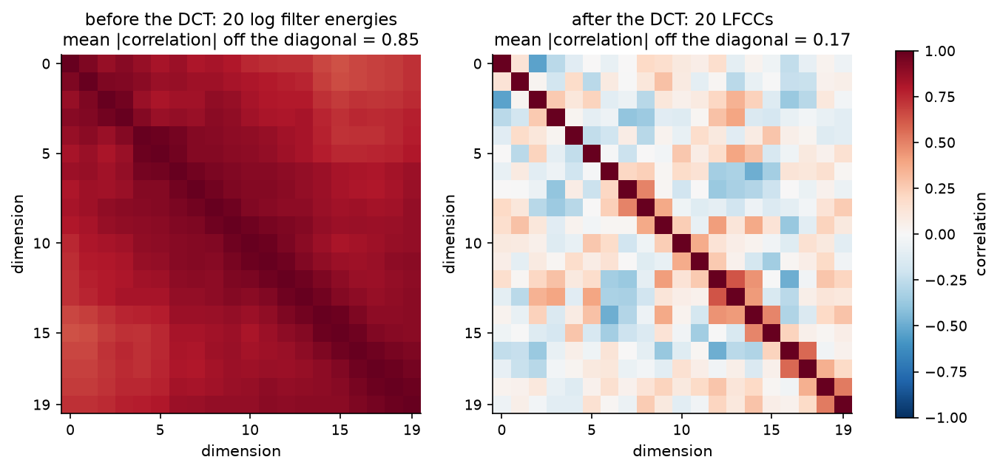
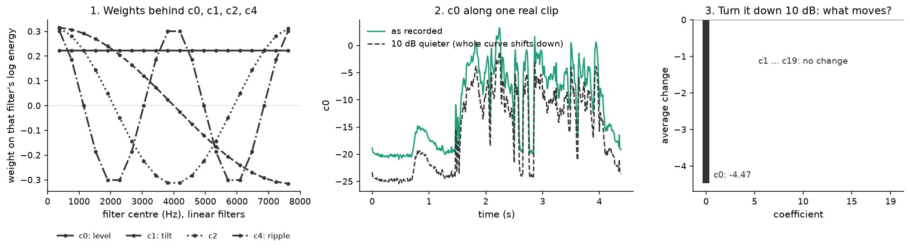

# Chapter 5 · How do you turn a sound into a few numbers?

*Notebook cell numbers count the first cell of a notebook as cell 0.*

## The goal

Chapter 4 boiled each clip down to single summaries such as bandwidth. That throws away almost
everything. Chapter 1 told us what we would like to keep: the **shape of the spectrum**, the
filter part of the voice, frame by frame.

This chapter builds the recipe our first detector, A1, uses. It is the official 2019 challenge
baseline recipe (called B02), transcribed line by line from the official code into
[`lfcc_b02.py`](../../src/audio_df/lfcc_b02.py). Its output has a name: **linear-frequency
cepstral coefficients (LFCC)**. By the end you will know what every one of those numbers
measures.

Open [notebook 09](../../notebooks/09_a1_playground.ipynb), cell 10, and keep it beside you.
Cell 9 rebuilds the recipe by hand on one real clip and checks the result is identical to the
library function ("identical to the library: True").

*Source: [notebook 09](../../notebooks/09_a1_playground.ipynb), cell 10, rendered locally (the committed notebook has no saved output). Default colours in this older notebook.*

## Step 1: cut the sound into short frames

Speech changes all the time, but over about 20 milliseconds (ms) it is roughly steady. So cut
the clip into 20 ms frames, starting a new one every 10 ms, and taper each frame's edges (a
"Hamming window") so the cut itself does not add false frequencies.

Before cutting, the recipe applies **pre-emphasis**: each sample minus 0.97 times the previous
one. This boosts high frequencies relative to low ones. The top-left panel of notebook 09,
cell 10 shows the effect on the average spectrum: the low end drops, the top lifts.

## Step 2: a spectrum for every frame

For each frame, a fast Fourier transform (FFT) measures how much energy sits at each frequency:
257 frequency "bins" from 0 to 8,000 Hz (hertz). Square the result to get power. Doing this frame
after frame is the short-time Fourier transform (STFT), and stacking the frames gives the
spectrogram from chapter 0 (bottom-left panel of notebook 09, cell 10).

## Step 3: 257 bins into 20 bands

257 numbers per frame is too many, and neighbouring bins carry nearly the same information. So
add them up in 20 overlapping triangular windows called **filters**. Each filter outputs one
number: the energy in its band.

*Source: [notebook 20](../../notebooks/20_story_figures.ipynb), cell 13 (geometry from our filterbank code, no data).*

Where should the 20 filters sit? The B02 recipe spaces them **evenly in Hz**, from 0 to
8,000 Hz. That is the "linear" in LFCC. Open [notebook 20](../../notebooks/20_story_figures.ipynb),
cell 13, top row: twenty identical triangles, each 762 Hz wide at the base, half of them above
4 kHz (kilohertz). Hold on to the bottom row for later.

## Step 4: take the logarithm

Take log10 of each band energy. Two reasons, both from earlier chapters:

- loudness differences of thousands of times become manageable differences of a few units;
- chapter 1's trick: a logarithm turns "source × filter" and "signal × gain" into sums. Any
  overall gain, such as a louder speaker or a hotter microphone, becomes **the same constant
  added to all 20 numbers**.

## Step 5: describe the shape of those 20 numbers

Now we have 20 log energies per frame, one per band. They are very redundant: if one band is
loud, its neighbours usually are too. Open [notebook 20](../../notebooks/20_story_figures.ipynb),
cell 17, left panel. Across 45 real clips, the 20 log energies are almost all strongly
correlated: the average absolute correlation (its strength, ignoring the sign) between two
different bands is 0.85 (redrawn from
[notebook 03](../../notebooks/03_cepstral_eda.ipynb), cell 11, whose printed numbers it
reproduces).

*Source: [notebook 20](../../notebooks/20_story_figures.ipynb), cell 17, recomputed for the story on notebook 03's exact 45-clip sample (it reproduces notebook 03 cell 11's printed 0.851 and 0.166).*

So instead of keeping the 20 numbers, describe their **shape** with a few questions:

- **Overall, how high is the curve?** Add all 20 up with equal weights. That is **c0**.
- **Does it slope down or up from low to high frequency?** Weigh the low bands positively and the
  high bands negatively, then add. That is **c1**, the **tilt**.
- **Does it wiggle?** Weigh the bands with a wave that goes up and down *q* times across the 20
  bands. That is **cq**, the **ripple** at that scale. Small *q* captures broad bumps
  such as formants (chapter 1); large *q* captures finer detail.

Open [notebook 20](../../notebooks/20_story_figures.ipynb), cell 15, panel 1. It draws those
weights: flat for c0, a smooth slope from +0.32 to −0.32 for c1, waves for c2 and c4.

*Source: [notebook 20](../../notebooks/20_story_figures.ipynb), cell 15. Panel 1 has no data; panels 2–3 are recomputed for the story on one real eval clip (LA_E_5849185).*

Those weighted sums are a standard transform, the **discrete cosine transform (DCT)**. Now that
you have seen the weights, here is the formula, with *L*[r] the log energy of band *r* and
*J* = 20 bands:

$$
c_q = \sqrt{\tfrac{2}{J}} \sum_{r=0}^{J-1} L[r]\,\cos\!\Big(\frac{\pi q\,(r+\tfrac12)}{J}\Big), \qquad c_0 = \sqrt{\tfrac{1}{J}}\sum_{r=0}^{J-1} L[r].
$$

In words: each coefficient is the 20 log energies, weighted by a cosine wave with *q* half-waves
across the bands, and added up. The square-root factors just keep the scale the same as the
input. The 20 outputs are the **cepstral coefficients**; on linear filters, they are the LFCCs.

Two good things happen:

1. **The outputs are much less correlated.** After the DCT the average absolute correlation
   between two different coefficients falls from 0.85 to 0.17 (cell 17, right panel). Chapter 6 needs this.
2. **Each number has a meaning.** On linear filters the bands are 381 Hz apart, so cq
   describes ripple with a period of about 15,238/*q* Hz: c4 about 3.8 kHz, c10 about 1.5 kHz
   (from the handoff §5.1.2 derivation). The same period holds at low and high frequencies.

### The level test

Here is the payoff of the logarithm. Take one real clip and turn it down by 10 decibels (dB).
Every one of the 20 log energies drops by exactly 1 (a factor of 10 in power is 1 in log10). A
constant shift has no tilt and no wiggle, so only c0 moves: by 20 × (−1) × √(1/20) = −√20 ≈ −4.47.

[Notebook 20](../../notebooks/20_story_figures.ipynb), cell 15, panels 2 and 3, checks this on a
real eval clip, **recomputed for the story**: c0 shifts by −4.472 in every frame, and the
largest change in any other coefficient is about 0.00001.

So **loudness, recording gain, and silence all live in c0**. A silent frame is just a very
quiet frame: very low c0. The B02 recipe keeps c0 and does not subtract each recording's average
(no cepstral mean and variance normalisation, CMVN; the module docstring of
[`lfcc_b02.py`](../../src/audio_df/lfcc_b02.py) notes it is absent from the official code). So
A1 can see level and silence directly. Remember chapter 3.

## Step 6: add movement

Finally, for each coefficient add how it changes from frame to frame (the "delta", Δ, the
difference between the next frame and the previous one) and how that change changes (ΔΔ),
following the official code exactly ([`official_deltas`](../../src/audio_df/lfcc_b02.py#L136)).
20 static + 20 Δ + 20 ΔΔ = **60 numbers per 10 ms frame**. That is A1's input.

## What this recipe cannot see

- **Phase.** Squaring the FFT keeps how much energy each frequency has and drops the timing of
  each wave. Some vocoder errors live in phase (our guess for some of them); LFCC is blind to
  those.
- **Pitch harmonics.** Harmonics are typically about 100–250 Hz apart in speech (a
  textbook range, not from our reading list), much finer than one 762 Hz
  filter, so the individual stripes of chapter 1 are blurred together.

## The fork in the road: linear or mel?

Most speech systems use a different filter placement: the **mel scale**, designed to mimic the
ear for speech recognition. Equal steps in mel are narrow at low frequencies and wide at high
ones. Go back to [notebook 20](../../notebooks/20_story_figures.ipynb), cell 13, and compare the
two rows. With 20 filters on 0–8 kHz, computed from our own filterbank code:

| | linear (LFCC) | mel (MFCC) |
|---|---|---|
| filters centred above 4 kHz | 10 | 5 |
| filters centred below 1 kHz | 2 | 7 |
| average width above 4 kHz | 762 Hz | 1,481 Hz |

The features built on mel filters are **mel-frequency cepstral coefficients (MFCC)**. Same
recipe, only the filter edges move ([`lfcc_b02_filterbank`](../../src/audio_df/lfcc_b02.py#L194),
`spacing="mel"`). In the top half of the spectrum, LFCC has twice the filters, each about half
as wide. And on a mel axis, cq no longer has one fixed ripple period in Hz: it is
fine at low frequency and coarse at high frequency.

Why might this matter for fakes? The literature points both ways.

- **For linear.** Sahidullah et al. compared filter placements with the same detector on the
  2015 challenge's development set, using a Gaussian mixture model as the detector (the kind A1
  uses, chapter 6). With static coefficients only, the average equal error rate (EER, chapter 2)
  was: MFCC 3.46 %, LFCC 2.46 %, and IMFCC (mel turned upside down, finest at high frequency) 1.33 %
  (from paper [28, Table 3, p.4]). Their reason, offered as intuition rather than tested: speech
  synthesis techniques "mostly focus on producing identical overall envelope of the speech
  spectrum" (from paper [28, p.2]), so the fine detail is where fakes slip.
- **For linear, again.** The WaveFake study found "subtle differences between the
  architectures, specifically among the higher frequencies" (from paper [24, abstract, p.1]),
  differences that are "generally inaudible when listening" (from paper [24, p.6]). That is
  exactly the band a perceptual, ear-like scale compresses (our reading, not a test in [24]).
- **Against.** On a different dataset, a 26-filter linear bank scored 8.91 % EER against 6.89 %
  for mel (from paper [25, Table 1, p.4]). Which bands are useful depends on the generators.

Those are other papers' numbers on other data, so they are context, not a prediction of ours.
They set up a clean question: **with everything else identical, does the filter placement
matter for A1?** There is a second, less obvious half. More filters at high frequency see more
synthesis detail, but also more detail of the **recording chain**: the microphone, the room, the
compression. Which of the two dominates may depend on where you test. Chapter 6 answers the
question on our benchmark; chapter 9 asks it again on real-world audio.

> **Checkpoint**
>
> - The recipe: frames of 20 ms → FFT power → 20 filters → log → DCT → add Δ and ΔΔ = 60 numbers
>   per frame ([notebook 09](../../notebooks/09_a1_playground.ipynb), cells 9–10;
>   [`extract_lfcc_b02`](../../src/audio_df/lfcc_b02.py#L239)).
> - The DCT turns 20 strongly correlated log energies (average absolute correlation 0.85) into 20
>   far less correlated coefficients (0.17) ([notebook 20](../../notebooks/20_story_figures.ipynb),
>   cell 17, redrawing notebook 03, cell 11).
> - c0 is level, c1 is tilt, higher cq are ripple; a 10 dB gain change moves only c0, by
>   −4.47 (notebook 20, cell 15, recomputed on one clip). A1 keeps c0 and has no CMVN, so it sees
>   loudness and silence.
> - Linear filters put 10 of 20 above 4 kHz, mel only 5 (notebook 20, cell 13). Literature on
>   other data mostly favours linear for spoofing (from papers [28, Table 3], [24]) but not
>   always (from paper [25, Table 1]).
>
> **The question this leaves us with:** we have 60 numbers per frame for a real clip and for a
> fake. How do you turn a cloud of frames into a decision, and do linear filters really beat mel
> when everything else is held fixed?

## References used in this chapter

- [24] Frank and Schönherr. *WaveFake: A Data Set to Facilitate Audio Deepfake Detection.* NeurIPS
  2021 Datasets and Benchmarks. [arXiv:2111.02813](https://arxiv.org/abs/2111.02813)
- [25] Sriskandaraja et al. *Investigation of Sub-Band Discriminative Information Between Spoofed
  and Genuine Speech.* Interspeech 2016.
  [paper](https://www.isca-archive.org/interspeech_2016/sriskandaraja16_interspeech.pdf)
- [28] Sahidullah, Kinnunen and Hanilçi. *A Comparison of Features for Synthetic Speech
  Detection.* Interspeech 2015.
  [paper](https://www.isca-archive.org/interspeech_2015/sahidullah15_interspeech.pdf)
