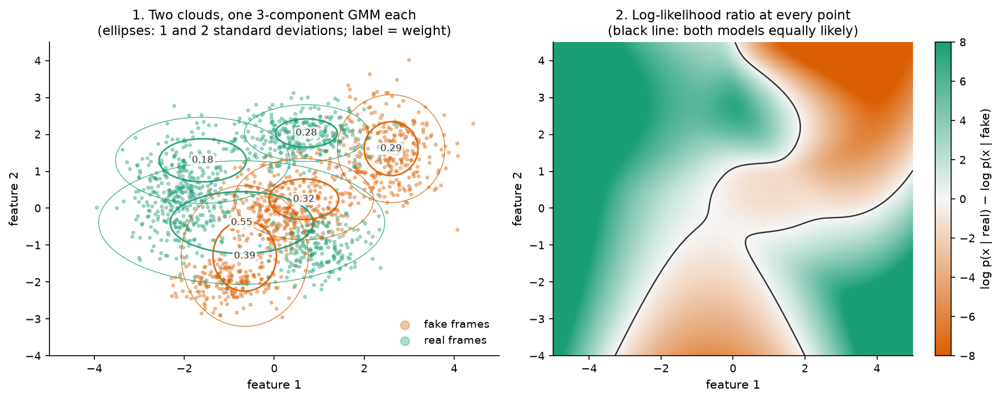
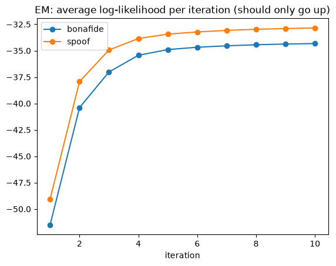
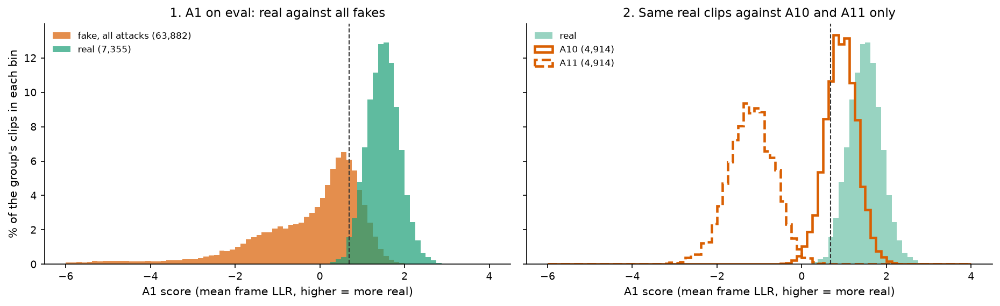

# Chapter 6 · A1: can two clouds of frames tell real from fake?

*Notebook cell numbers count the first cell of a notebook as cell 0.*

## No single number does it

Chapter 5 turned every 10 ms of audio into 60 numbers, the linear-frequency cepstral
coefficients (LFCC) plus their changes over time. Do real and fake frames differ?

Open [notebook 09](../../notebooks/09_a1_playground.ipynb), cell 13. For 150 real and 150 fake
training clips it plots, for each of the 20 static coefficients, the average over all frames
with a bar for the spread. (This older notebook uses default plot colours, not our green and
orange.) The two classes' bars overlap almost completely. As the notebook says in cell 14: no
single coefficient separates the classes.

*Source: [notebook 09](../../notebooks/09_a1_playground.ipynb), cell 13, rendered locally (the committed notebook has no saved output). Blue = bona fide, orange = spoof here (default colours).*

So stop looking at one number at a time. Each class is a **cloud** of points in a
60-dimensional space, one point per frame. The question becomes: do the two clouds have
different shapes?

## Describing a cloud: the Gaussian mixture model

A single bell curve (a **Gaussian**) describes a cloud that is one round-ish blob: a centre and
a spread along each direction. Real clouds are lumpy: silence frames in one place, vowels in
another, hissy consonants in a third. So use several bells at once, each with its own centre,
spread and weight, and add them up. That is a **Gaussian mixture model (GMM)**.

Open [notebook 20](../../notebooks/20_story_figures.ipynb), cell 19. It is a toy in two
dimensions, with made-up points:

- **Left:** a green cloud of "real frames" and an orange cloud of "fake frames". Each gets its
  own GMM with 3 components; the ellipses show each component's spread, labelled with its
  weight. The ellipses are always aligned with the axes. That is what **diagonal** means: each
  component only stores a spread per direction, not how directions lean together. It is why the
  decorrelating discrete cosine transform (DCT) step of chapter 5 matters.
- **Right:** for every point in the plane, how much better the green model explains it than the
  orange one. Green regions say "real", orange regions say "fake", and the black line is where
  both are equally likely. Notice the deep-green corners where there is no data at all: far from
  every training point, the ratio is decided by whichever model's bell curves fall off more
  slowly, and it means nothing. Our reading is that A1 has the same blind spot: audio unlike
  anything it was trained on still receives a score from the same range as familiar audio, with
  nothing to flag that it is unfamiliar (chapter 9 shows A1 on such audio). Also notice that one green component (weight
  0.55) has stretched to cover two clumps of points; a mixture does not have to find the "true"
  clusters to describe a cloud well.

*Source: [notebook 20](../../notebooks/20_story_figures.ipynb), cell 19 (toy, made-up data; fitted with the project's own DiagGMM).*

### Fitting it: expectation-maximisation

How do the ellipses find their places? Start them at random frames, then repeat two steps:

1. **Expectation:** for every point, work out how much each component is responsible for it
   (a soft share, adding up to 1).
2. **Maximisation:** move each component to the weighted average of the points it is
   responsible for, and reset its spread and weight the same way.

This is **expectation-maximisation (EM)**. Each round can only improve how well the model fits
the training points or leave it unchanged ([notebook 09](../../notebooks/09_a1_playground.ipynb),
cell 19 plots the fit rising round by round on a small version).

*Source: [notebook 09](../../notebooks/09_a1_playground.ipynb), cell 19, rendered locally (the committed notebook has no saved output); a small 32-component version, not the real A1.*

Our implementation is
[`DiagGMM.fit_em`](../../src/audio_df/models/gmm.py#L136). It keeps a floor under every spread,
so a component cannot shrink onto a single point.

## Scoring a clip: the log-likelihood ratio

Now a new clip arrives: a few hundred frames. For each frame, ask both models how likely it is,
and take the difference of the logarithms: the **log-likelihood ratio (LLR)**. Positive means
"the real model explains this frame better". A clip's score is the average over its frames:

$$
s(\text{clip}) = \frac{1}{T}\sum_{t=1}^{T}\Big[\log p(\text{frame}_t \mid \text{real}) - \log p(\text{frame}_t \mid \text{fake})\Big]
$$

In words: the average, over the clip's *T* frames, of how much better the real model explains
each frame than the fake model. Higher means more real. Averaging makes the score independent
of clip length ([`score_llr`](../../src/audio_df/models/gmm.py#L245)).

Open [notebook 20](../../notebooks/20_story_figures.ipynb), cell 21. It does this, frame by
frame, for three real eval clips, using A1's two trained models (local files, not in git). Each
grey tick is one frame; the thick line is the clip's average, which is A1's score; the cell
checks it equals the committed score.

*Source: [notebook 20](../../notebooks/20_story_figures.ipynb), cell 21, recomputed for the story with A1's local GMM files; each clip's mean equals its committed score.*

- **Real clip:** score +1.73; 75 % of its frames lean "real".
- **A10 clip** (WaveRNN vocoder): score +0.80; 65 % of frames lean "real". It sits above A1's
  decision threshold (0.687, chosen on dev): A1 accepts this fake.
- **A11 clip** (Griffin-Lim vocoder): score −1.47; only 35 % of frames lean "real". Rejected.

One more thing to notice in the real clip: its opening half-second is silence (shaded, the
quietest fifth of its frames), and almost every one of those frames leans "real". Chapter 3
warned us A1 can see silence through c0. Chapter 8 measures how much that matters.

## The real A1

The real thing is the same idea, larger:

- two GMMs, **512 components each**, over **60-dimensional** frames, 10 rounds of EM;
- trained on **873,016 real frames and 7,809,362 fake frames** from the training split
  ([notes.md](../../experiments/E-20261001-e1-a1-raw/notes.md));
- 2 × 512 × (60 + 60 + 1) = **123,904 numbers** in total: a centre and a spread per dimension,
  plus a weight, per component;
- **20.6 minutes** to train and score dev and eval, peak memory 3.8 gigabytes (GB), on a 16 GB laptop
  ([REGISTRY.md](../../experiments/REGISTRY.md), row `E-20261001-e1-a1-raw`). The EM streams frames
  from disk in chunks instead of holding a giant table in memory.

## How well does it work?

Open [notebook 20](../../notebooks/20_story_figures.ipynb), cell 23, left panel: A1's scores for
all 71,237 eval clips (from the committed
[scores/eval.csv](../../experiments/E-20261001-e1-a1-raw/scores/eval.csv)). Real clips (green)
pile up to the right of the dashed dev threshold, fakes (orange) mostly to the left, with a long
overlap.

*Source: [notebook 20](../../notebooks/20_story_figures.ipynb), cell 23, from the committed A1 eval scores. Notebook 10, cell 11 was meant to draw a score histogram, but its saved copy ran with no experiment selected, so it drew nothing.*

- **Equal error rate (EER, chapter 2) on dev: 2.62 %; on eval: 9.56 %.** Area under the curve
  (AUC) on eval: 0.968 ([metrics.json](../../experiments/E-20261001-e1-a1-raw/metrics.json)).
- **This reproduces the official baseline.** The 2019 challenge published 8.09 % for B02 on
  the same eval set (from paper [15, Table 1, p.3]). Our re-implementation lands 1.5 points
  away. Likely reasons: random starting points, and details of the original toolkit's
  initialisation and variance floor that cannot be inspected (handoff §10.1; our reading). The
  10 EM rounds are not a difference: the official recipe also stops at 10
  ([b02-lfcc-gmm.md](../../research/knowledge/methods/b02-lfcc-gmm.md)).
- **Dev is much easier than eval** because dev holds the training attacks A01–A06, eval only new
  ones (chapter 2).
- **Seeds.** Rerun with two other random starts, the eval EER is 8.67 % and 9.12 %; over 3 seeds,
  9.12 ± 0.44 % (mean ± standard deviation, from the three LFCC runs' metrics.json; cell 25
  prints it).

## A natural experiment: A10 against A11

Recall chapter 1. A10 and A11 are the **same** text-to-speech system, identical up to the
vocoder: WaveRNN, a neural vocoder, for A10; Griffin-Lim, an algorithm that needs no
training, for A11 (from paper [14, Table 1, p.6]). And recall chapter 3: both start with
essentially no silence (median leading-silence fraction exactly 0 for both,
[notebook 20](../../notebooks/20_story_figures.ipynb), cell 11). So the silence shortcut is
switched off for both, and only the vocoder differs.

A1's per-attack EER ([metrics.json](../../experiments/E-20261001-e1-a1-raw/metrics.json),
`testsets.eval.per_attack_eer`):

- **A10: 22.4 %**, A1's hardest attack;
- **A11: 0.1 %**, almost perfectly caught.

Cell 23, right panel, shows why: A11's scores sit far to the left of every real clip (median
−1.19, none above the threshold), while A10's sit almost on top of the real clips (median
+0.93; 74.5 % above the threshold).

**The vocoder alone moves A1's error by about 22 points.** That is measured, and it is the
cleanest evidence in the project that A1 detects how the waveform was generated, not just
silence. The database authors saw the same pattern with their own baselines (from paper
[14, §6.1.2, p.17], quoted in chapter 1). *Which* artefact gives Griffin-Lim away is our guess:
it rebuilds the waveform from a magnitude spectrogram by iterating, and the smearing this
leaves may show in the frame-to-frame spectra that LFCC with its Δ and ΔΔ can see. Untested.

## Linear or mel? The controlled comparison (X4)

Chapter 5 ended with a question: with everything else identical, does the filter placement
matter? We ran it (analysis "X4"). The A1 pipeline was rerun with only the filter edges moved
from linear to mel, giving mel-frequency cepstral coefficients (MFCC) ([configs/a1_mfcc_b02.yaml](../../configs/a1_mfcc_b02.yaml)), everything else
unchanged, **3 random seeds per arm**. Six runs, all committed under `experiments/`
(`E-20261001-e1-a1-raw` and `E-20261004-e2-a1-raw-{lfcc,mfcc}-s*337`).

Pooled results, mean ± standard deviation over 3 seeds (printed in
[notebook 20](../../notebooks/20_story_figures.ipynb), cell 25):

| | LFCC (linear) | MFCC (mel) |
|---|---|---|
| dev EER (A01–A06) | **2.89 ± 0.25 %** | 6.66 ± 0.30 % |
| eval EER (A07–A19) | **9.12 ± 0.44 %** | 10.61 ± 0.30 % |

**At home, linear wins**, as the literature in chapter 5 suggested. The eval gap of 1.5 points is
more than three seed standard deviations, so it is not seed noise. Before running X4 we wrote
down an expectation: an eval gap under 4 points, more likely than not in LFCC's favour
(handoff §5.1.4). That half held. The same note also predicted that both arms would sit near
chance on real-world audio; chapter 9 shows that half did not.

Now open cell 25's figure: one row per attack, blue circles for LFCC, magenta squares for MFCC,
small markers for single seeds, large for the mean.

*Source: [notebook 20](../../notebooks/20_story_figures.ipynb), cell 25, from the six committed X4 metrics.json files.*

The winner depends on the attack:

- **LFCC clearly better:** A19 (12.8 against 29.1 %), A18 (4.4 against 8.0 %), A17 (8.6 against
  10.6 %), A11 (0.1 against 1.2 %).
- **MFCC clearly better:** A13 (12.0 against 2.3 %), A12 (6.6 against 1.7 %).
- **About equal:** A10 (21.1 against 19.6 %).

Two readings, both **our guesses**:

- **A19 is the biggest LFCC win**, and its training twin A06 agrees on dev (4.9 against 16.8 %).
  Whatever gives this algorithm away sits where mel filters are coarse: at high frequency.
- **A18 is built from MFCCs.** Its vocoder turns MFCC features back into sound (from paper
  [14, Table 1, p.6]). An MFCC-based detector sees exactly the part the vocoder reconstructs
  faithfully; a linear front end also sees the high-band detail the vocoder had to invent.

The same mixed picture appears in the literature: which bands are useful depends on the
generator (from paper [25, Table 1], chapter 5).

So: **LFCC beats MFCC on the benchmark, on average and for most hard attacks.** Chapter 9 runs
the same six models somewhere else entirely, and the answer there is different.

## Why is A1 so far behind?

Our second detector, A2 (next chapter), gets 0.96 % on the same eval set. Is LFCC the weak link,
or the GMM? We have not tested it ourselves. One pointer from the literature, under a different
protocol: a discriminatively trained neural network on LFCC input reaches 2.19 %, and 1.47 %
with extra training tasks, on the same 2019 eval split (from paper [17, Tables 2 and 4];
literature, best settings chosen on eval, LFCC settings not stated). That suggests much of A1's
gap is the GMM: a model that has to describe *everything* about real frames (speaker, room,
level) rather than just what separates real from fake (our reading). A discriminative model on
our own LFCC frames would test it; not run.

> **Checkpoint**
>
> - No single LFCC coefficient separates the classes; A1 instead models each class's whole cloud
>   of frames with a 512-component diagonal GMM and scores a clip by its average frame
>   log-likelihood ratio ([notebook 09](../../notebooks/09_a1_playground.ipynb), cell 13;
>   [notebook 20](../../notebooks/20_story_figures.ipynb), cells 19 and 21;
>   [`gmm.py`](../../src/audio_df/models/gmm.py#L245)).
> - A1 gets 2.62 % EER on dev and 9.56 % on eval, against 8.09 % published for the official
>   baseline (from paper [15, Table 1]); 9.12 ± 0.44 % over 3 seeds
>   ([metrics.json](../../experiments/E-20261001-e1-a1-raw/metrics.json); notebook 20, cell 25).
> - A10 and A11 differ only in their vocoder and both lack silence, yet A1's EER is 22.4 % against
>   0.1 %: A1 detects waveform generation, not only silence (metrics.json; notebook 20, cell 23).
> - With everything else fixed, linear filters beat mel on the benchmark: eval 9.12 ± 0.44 %
>   against 10.61 ± 0.30 %, dev 2.89 against 6.66 %; the winner varies by attack (A19 favours
>   LFCC, A12 and A13 favour MFCC) (X4, notebook 20, cell 25).
> - Hint, not a measurement: in one real clip, the silent frames lean "real" (notebook 20,
>   cell 21); chapter 8 measures what silence does across all clips.
>
> **The question this leaves us with:** A1 learns everything from 25,380 clips. What if a model
> had already heard tens of thousands of hours of real speech before it ever saw a fake?

## References used in this chapter

- [14] Wang et al. *ASVspoof 2019: A Large-Scale Public Database of Synthesized, Converted and
  Replayed Speech.* Computer Speech & Language 64, 2020.
  [arXiv:1911.01601](https://arxiv.org/abs/1911.01601)
- [15] Todisco et al. *ASVspoof 2019: Future Horizons in Spoofed and Fake Audio Detection.*
  Interspeech 2019. [arXiv:1904.05441](https://arxiv.org/abs/1904.05441)
- [17] Mo and Wang. *Multi-task Learning Improves Synthetic Speech Detection.* ICASSP 2022.
  [doi:10.1109/ICASSP43922.2022.9746059](https://doi.org/10.1109/ICASSP43922.2022.9746059)
- [25] Sriskandaraja et al. *Investigation of Sub-Band Discriminative Information Between Spoofed
  and Genuine Speech.* Interspeech 2016.
  [paper](https://www.isca-archive.org/interspeech_2016/sriskandaraja16_interspeech.pdf)
