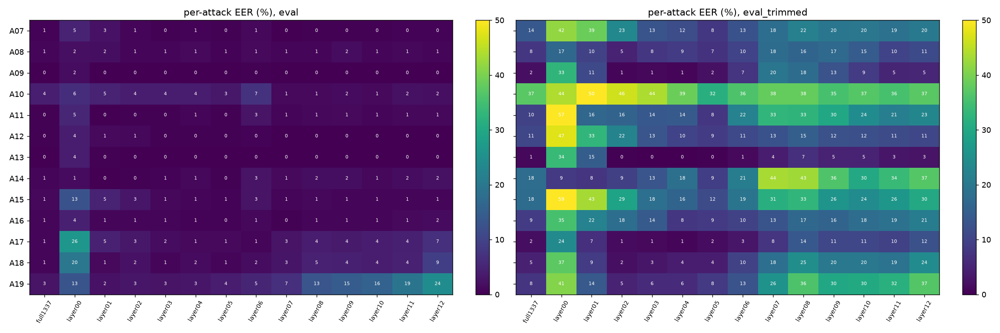

# Chapter 7 · A2: borrow a model that has already heard 94,000 hours of speech?

*Notebook cell numbers count the first cell of a notebook as cell 0.*

## A different bet

A1 learned everything it knows from 25,380 training clips. It had to discover, from scratch,
what real speech frames look like.

A2 makes a different bet. Somebody has already trained a large network on an enormous amount of
real speech, with no labels at all: the network learned by predicting hidden parts of the audio
from the parts around them. This is **self-supervised learning (SSL)**. A network trained that
way has to build an internal picture of what natural speech is like. Perhaps a fake will look
"off" against that picture.

We use **WavLM Base+**. Its authors pre-trained it on 94,000 hours of speech: 60,000 hours of
Libri-Light (audiobooks), 10,000 hours of GigaSpeech (podcasts and YouTube) and 24,000 hours of
VoxPopuli (European Parliament recordings) (from paper [26, §I, p.2, and §IV.C, p.5]). It has a
convolutional front end and 12 transformer layers, each producing 768 numbers per frame
([configs/a2_wavlm_base_plus.yaml](../../configs/a2_wavlm_base_plus.yaml)).

We **freeze** it: its weights never change. We only train a small decision layer on top. That is
what makes A2 possible on a laptop with 16 gigabytes (GB) of memory, and it is the main design choice of this chapter.

## What comes out of the network

Feed WavLM a clip and look inside:

- every clip is cut or padded to **4 seconds** from its centre (64,000 samples at 16,000 per
  second); short clips are padded by repeating themselves, never with silence (chapter 3);
- the front end turns that into **199 frames**, about 50 per second;
- the network hands back **13 versions** of those frames: the front end's output (we call it
  layer 0) and the output of each of the 12 transformer layers. Each is 199 frames × 768 numbers
  (config file above; derivation in
  [ssl-hidden-states.md](../../research/knowledge/methods/ssl-hidden-states.md)).

Which of the 13 should a detector read? The WavLM authors tested this for other tasks: "the
bottom layers contribute more to speaker-related tasks", while recognising words and meaning
leans on the top layers (from paper [26, §V, p.6, and Fig. 2, p.7]). Fake detection was not one
of their tasks. Our working guess was that fake evidence is more about *how* the voice sounds
than *what* is said, so lower layers should matter. But instead of guessing a layer, A2 learns
**one weight per layer** and mixes all 13.

## The trick that makes it cheap: pool, then mix

A2 needs, for each clip, one 768-number summary. The obvious recipe:

1. for every frame, mix the 13 layers with the learned weights;
2. average the mixed frames over time.

But the weights change during training, so this would need all 13 × 199 × 768 numbers per clip
kept on disk: about 4 MB (megabytes) per clip at 2 bytes per number, roughly 0.1 TB (terabytes)
for the 25,380 training clips alone (our arithmetic). For the larger model we planned to try
(XLS-R, 25 × 199 × 1,024 numbers per clip, not yet run) over all 121,461 ASVspoof clips (the Automatic Speaker Verification Spoofing and
Countermeasures Challenge 2019 dataset, chapter 2), the
handoff puts it at about 1.24 TB (handoff §7.2). Instead, A2 does it the other way round:

1. average each layer over time, once, and store just 13 × 768 numbers per clip;
2. mix those averages with the learned weights.

Do the two give the same answer? Think about a simpler case: if you weigh two piles of coins and
then average, or average and then weigh, you get the same number, because both steps are just
adding and scaling. Mixing with fixed weights and averaging over time are both like that: they
only add and scale, so their order does not matter.

Open [notebook 20](../../notebooks/20_story_figures.ipynb), cell 27. It checks this with A2's
actual head code ([`SSLHead.weighted_sum`](../../src/audio_df/models/ssl_head.py#L62)) on
random numbers of A2's exact shape. Left panel: the two orders agree on every number (largest
difference about 0.0000001, rounding error). Right panel: insert a step that does more than
add and scale (LayerNorm, which rescales each vector by its own spread) *before* averaging, and
the two orders disagree. That is why A2 applies LayerNorm only *after* pooling. The repo's
own test checks the same identity (`tests/test_ssl_head.py`).

*Source: [notebook 20](../../notebooks/20_story_figures.ipynb), cell 27 (random numbers, A2's real head code).*

So the time-averaged cache is **exact, not an approximation**. The price is real, though: the
head only ever sees the *average* frame. Anything that happens at one moment in time, such as a
click or a glitch, is diluted into the average.

## The head

On top of the 13 cached averages, A2 trains ([`SSLHead`](../../src/audio_df/models/ssl_head.py#L62)):

- 13 layer weights (passed through a softmax, so they are positive and add up to 1; all start
  equal at 1/13);
- LayerNorm, then a projection from 768 to 256 numbers, a small two-layer network down to 128,
  and a single output number, the score. Higher means more real.

That is about **231,000 trainable numbers**, against 94 million frozen ones in WavLM
(handoff §5). The loss gives real clips about 8.8 times the weight of fake ones, because fakes
outnumber them 22,800 to 2,580 in training; the stored value is 8.837
([training_curve.json](../../experiments/E-20261001-e1-a2-raw/training_curve.json), `pos_weight`).
The checkpoint is chosen by the lowest dev loss, which came at epoch 8 (counting from 0), and
training and scoring the head took **16.9 seconds** in all
([REGISTRY.md](../../experiments/REGISTRY.md), row `E-20261001-e1-a2-raw`).

## How well does it work?

From [metrics.json](../../experiments/E-20261001-e1-a2-raw/metrics.json):

- **equal error rate (EER, chapter 2): 0.39 % on dev, 0.96 % on eval**, against A1's 2.62 % and
  9.56 %;
- area under the curve (AUC) on eval: 0.9995;
- hardest attacks on eval: A10 at 2.0 % and A19 at 1.9 %, both well below A1's 22.4 % and
  12.7 %.

About ten times fewer errors than A1 on attacks neither system saw in training. For orientation
only (other backbone, other head, data augmentation): frozen wav2vec 2.0 models with heads
trained on the same 2019 training data report 0.74 % and 1.93 % on the same eval set (from paper
[22, Table II, p.3]). Our 0.96 % is in that range.

Caveat: this is one training run. When we retrained the same head three times on an ordinary processor (CPU) instead of the
laptop's graphics processor (for the
analysis below), eval EER was 1.32 ± 0.23 %, a little higher than 0.96 %, though the scores of the
original and the retrained head correlate at 0.99
([summary.md](../../experiments/E-20261004-e2-a2-raw-layers/summary.md),
[reproduction_check.json](../../experiments/E-20261004-e2-a2-raw-layers/reproduction_check.json)).

## What do the layer weights say?

Open [notebook 20](../../notebooks/20_story_figures.ipynb), cell 29, left panel: the 13 learned
weights ([layer_weights.json](../../experiments/E-20261001-e1-a2-raw/layer_weights.json)).

*Source: [notebook 20](../../notebooks/20_story_figures.ipynb), cell 29, from the committed layer_weights.json and X6 summary.csv.*

- They barely move from the even share of 1/13 ≈ 0.077 (dotted line).
- They tilt toward the bottom: layer 3 gets the most (0.099), layers 7–12 get 0.061–0.069.
  Largest over smallest: 1.63.

Tempting reading: "the bottom layers matter most". But a weight is not an importance. The layers
have different scales and are strongly related to each other, and LayerNorm rescales the mix
afterwards. So we asked the layers directly.

## Asking each layer on its own (X6)

Analysis "X6" reused the cached averages, with no new extraction. It trained the same head on
**one layer at a time** (13 heads), removed one layer at a time from the trained head (13 more),
retrained the full head with 3 seeds, and fitted two logistic-regression probes (on layers 0
and 12). 31 variants in about 2 minutes on a CPU, each scored
with its own dev threshold
([experiments/E-20261004-e2-a2-raw-layers](../../experiments/E-20261004-e2-a2-raw-layers/summary.md)).
Each single-layer head is one seed, so small differences between neighbouring layers are not
meaningful.

### No layer is essential

Removing any one layer from the trained head leaves eval EER between 0.91 % and 1.22 % (summary
table, rows `loo00`–`loo12`). The evidence is spread across the network.

### The best layer is not the most-weighted one

Cell 29, right panel, solid line: eval EER of each single-layer head.

- Layer 0 (the front end, before any transformer layer) alone: 11.0 %. Most of A2's skill
  comes from the transformer layers.
- Layers 1–7 alone: between 1.4 % and 2.8 %. Layer 5 is best (1.41 %); layer 3, the most
  weighted, is close behind (1.50 %).
- The top layer alone: 6.0 %.

### Different layers catch different attacks

Open [notebook 20](../../notebooks/20_story_figures.ipynb), cell 31, which displays the X6
heatmap (left half: raw eval audio; one column per single-layer head, one row per attack; darker
is better). Look at the bottom three rows, A17, A18 and A19, the attacks that convert a real
person's recording (chapter 1), and at A10, a text-to-speech attack:

*Source: `experiments/E-20261004-e2-a2-raw-layers/per_attack_heatmap.png`, committed by the X6 run, shown unchanged ([notebook 20](../../notebooks/20_story_figures.ipynb), cell 31).*

| attack | layer 1 | layer 7 | layer 12 |
|---|---|---|---|
| A19 (converts a real recording) | **2.5 %** | 6.8 % | 24.3 % |
| A18 (converts a real recording) | **1.3 %** | 2.9 % | 9.3 % |
| A17 (converts a real recording) | 4.5 % | **2.5 %** | 6.7 % |
| A10 (text-to-speech, WaveRNN) | 4.8 % | **1.2 %** | 2.1 % |

([per_attack_eval.csv](../../experiments/E-20261004-e2-a2-raw-layers/per_attack_eval.csv);
measured.)

For A19 and A18 the pattern is clear: the lower transformer layers (1–5) catch them, and the top
layers miss much of it. A17 does not follow it as neatly: it is caught best by the middle layers
(about 1 % at layers 4–6) and less well at layer 1. And layer 0, the front end before any
transformer layer, is poor for all three (13–26 %). For text-to-speech attack A10, the order is
reversed: upper layers do better. A reading that fits the WavLM paper's
picture of bottom = sound of the voice, top = content (from paper [26, Fig. 2, p.7]), and is
**our guess**, for A19 and A18 at least: voice conversion keeps a real person's words, rhythm and
phrasing, so layers that look at content see natural speech and are fooled; only the layers that
look at the sound of the voice notice the conversion. A17 suggests the split between "sound" and
"content" layers is not sharp. A fully synthetic attack may get its phrasing wrong too, so upper
layers can catch it. Each single-layer head is one seed, so treat the exact layer numbers loosely.

### A first look at silence

Cell 29, right panel, dashed line: the same single-layer heads tested on eval audio with the
leading and trailing silence trimmed (chapter 3). The middle layers suffer least: layers 3–6 stay
at 10–16 % EER, and layer 5 alone (10.1 %) beats the full head (13.7 ± 0.6 % over 3 seeds),
while layers 0–1 and 7–12 rise to about 21–39 % (20.8 % at layer 10). Our guess: the silence shortcut is carried mostly by
the bottom and top layers. A direct test, predicting each clip's silence from each layer
(analysis X8), has not been run. Chapter 8 takes trimming seriously. (The dotted line in the same panel, In-the-Wild
audio, belongs to chapter 9.)

## One more thing X6 settled

Another group froze the same WavLM Base+ model and got a much worse result on real-world audio
than A2 does. Our first guess was that they read a different layer. X6 tested that and ruled it
out: layer choice is not the explanation. Chapter 9 shows the numbers, next to A2's real-world
results.

> **Checkpoint**
>
> - A2 freezes WavLM Base+, pre-trained on 94,000 hours of real speech (from paper [26, p.5]), and
>   trains only a ~231,000-number head on time-averaged layer outputs
>   ([`SSLHead`](../../src/audio_df/models/ssl_head.py#L62)).
> - Averaging over time before mixing layers is exact, because both steps only add and scale;
>   LayerNorm must come after
>   ([notebook 20](../../notebooks/20_story_figures.ipynb), cell 27; `tests/test_ssl_head.py`).
> - A2 gets 0.39 % EER on dev and 0.96 % on eval, against A1's 9.56 %
>   ([metrics.json](../../experiments/E-20261001-e1-a2-raw/metrics.json)); 1.32 ± 0.23 % over 3 CPU
>   retrains (X6 summary).
> - The learned layer weights are near-even; no single layer is essential (leave-one-out eval EER
>   0.91–1.22 %) (notebook 20, cell 29; X6 summary).
> - The lower transformer layers catch two of the three conversions of real recordings (A19: 2.5 %
>   at layer 1 against 24.3 % at layer 12; A18 likewise); A17 is caught best by middle layers
>   (notebook 20, cell 31; per_attack_eval.csv; single seed per layer).
>
> **The question this leaves us with:** both detectors look strong on the benchmark. How much of
> that strength is chapter 3's silence, and what is left when we take it away?

## References used in this chapter

- [22] Wang Z. et al. *Mixture of Experts Fusion for Fake Audio Detection Using Frozen wav2vec
  2.0.* arXiv preprint, 2024. [arXiv:2409.11909](https://arxiv.org/abs/2409.11909)
- [26] Chen S. et al. *WavLM: Large-Scale Self-Supervised Pre-Training for Full Stack Speech
  Processing.* IEEE JSTSP 16(6), 2022. [arXiv:2110.13900](https://arxiv.org/abs/2110.13900)
