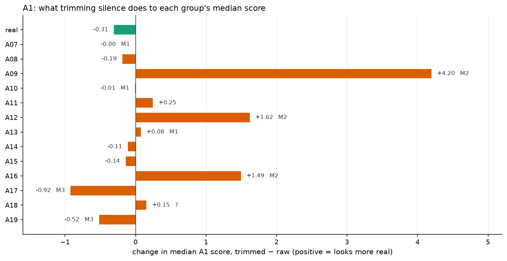

# Chapter 8 · Trim the silence: what is left of each detector?

*Notebook cell numbers count the first cell of a notebook as cell 0.*

## The experiment

Chapter 3 found that a probe using nothing but leading silence ranks real above fake about 84
times in 100. Chapters 6 and 7 built two detectors that look excellent on the benchmark:
A1 at 9.56 % equal error rate (EER, chapter 2) on eval, A2 at 0.96 %. Both were trained on raw
audio, silence and all.

So here is the stress test. Take the same trained detectors and the same eval clips, cut off the
leading and trailing silence ([`trim_silence`](../../src/audio_df/audio.py#L228), the 30 decibel (dB) rule
of chapter 3; pauses inside the clip stay), and score again. Nothing is retrained. The decision
threshold stays the one chosen on raw dev audio.

| detector | eval EER, raw | eval EER, trimmed |
|---|---|---|
| A1 | 9.56 % | **19.84 %** (about ×2) |
| A2 | 0.96 % | **13.27 %** (about ×14) |

(From the committed `metrics.json` of `E-20261001-e1-a1-raw`, `-a1-trimmed`, `-a2-raw` and
`-a2-trimmed`.)

The better detector lost far more. Why?

## A2: the real clips move, the fakes do not

*Source: [notebook 20](../../notebooks/20_story_figures.ipynb), cell 33, recomputed for the story
from the committed A2 raw and trimmed eval scores.*

Look at the two panels:

- On raw audio, real clips score around **+14.90** (median) and fakes around **−12.83**. Only
  0.2 % of real clips fall below the dev threshold.
- With the silence trimmed, the real clips' median drops to **−4.18**: a move of about 19 points.
  The fakes' median moves from −12.83 to −15.60, under 3 points. Now **62.1 %** of real clips
  fall below the threshold.

(Medians and rates printed in cell 33.) So much of what A2 treats as evidence for "real" is the
silence lead-in. Remove it and the real clips start to look like fakes, while the fakes, which
had little silence to lose, stay where they were.

Why would A2 be so sensitive? Recall chapter 7: A2 sees the **average** of each layer over the
clip's 199 frames. In a short real clip, silence can be a large share of those frames, so it
shifts every average directly. And short clips are padded by repeating themselves, which repeats
their silence too. This is our reading of the mechanism, not a measured decomposition.

## Attack by attack

*Source: [notebook 20](../../notebooks/20_story_figures.ipynb), cell 35, from the committed
per-attack EER in the four `metrics.json` files.*

**A2 (right).** Almost every attack gets harder. Chapter 3's silence map explains much of the
pattern, but not all of it:

- the biggest collapses are attacks that start with no silence, once the real clips lose theirs
  too: A10 goes from 2.0 % to **39.5 %**, A15 0.5 → 17.9 %, A14 0.4 → 17.8 %, A07 0.2 → 13.5 %;
- but not every no-silence attack collapses: A13 barely moves (0.0 → 0.7 %);
- and attacks with real-looking lead-ins still get somewhat worse (A18 0.9 → 4.6 %, A19
  1.9 → 7.4 %), except A17, which barely moves (0.9 → 1.8 %).

**A1 (left).** Most attacks get harder too, but two get *easier*: A17 (8.8 → 3.6 %) and A19
(12.7 → 11.2 %). And A12 and A16 jump the most (7.6 → 36.0 % and 7.8 → 31.5 %). A single pooled
number hides all of that.

## A1: three things happen at once

Per-attack EER always compares one attack's fakes with the **same** pool of real clips
([`per_attack_eer`](../../src/audio_df/metrics.py#L460)). So an attack's EER can change because
the real clips moved, because that attack's fakes moved, or both. To see which, look at each
group's median score before and after trimming.

*Source: [notebook 20](../../notebooks/20_story_figures.ipynb), cell 37, recomputed for the story
from the committed A1 raw and trimmed eval scores, joined on clip id.*

The shifts are **measured**. The three mechanisms below are **our guesses** that fit them
(handoff §10.3); none has been tested directly.

- **M1, the real clips move.** Real clips drop by 0.31. Chapter 6 showed that A1's silent frames
  lean "real"; trimming removes them. Attacks whose own scores do not move (A07, A10, A13, shifts
  of 0.08 or less) lose separation simply because the real pool came down to meet them. Their EER
  rises by a factor of 1.6 to 2 (A10 22.4 → 36.7 %, A07 15.4 → 27.3 %, A13 12.8 → 24.9 %).
- **M2, unnaturally quiet frames were evidence of "fake".** A09, A12 and A16 move the *other* way:
  their fakes start looking **more** real (+4.20, +1.62, +1.49). These attacks have the deepest
  quiet frames, some of them pure digital zero, and A1's fake model was trained on A01–A06, which include two attacks
  with very deep quiet frames, A03 and A04 (A16 is A04's algorithm, chapter 2). A plausible reading: A1 learned
  "very quiet frame = fake", and trimming deletes those frames. The silence-depth numbers behind
  this were recomputed on 100–150 clips per attack in a methods note
  ([lfcc-vs-mfcc-explained.md](../../research/knowledge/methods/lfcc-vs-mfcc-explained.md) §5),
  not in a committed run. A counterexample in the same note: A08 has quiet frames as deep as
  A16's, yet barely moves (−0.19), so depth alone is not the rule.
- **M3, fakes with real-looking silence get easier.** A17 and A19 convert real recordings and keep
  real-looking lead-ins (chapter 3). Their silent frames used to lean "real"; once gone, only the
  fake-looking speech remains. Their scores fall (−0.92, −0.52) and their EER improves.

**A18 does not fit.** It also converts real recordings and has a real-looking lead-in, so M3
predicts it should get easier. Instead its median rises slightly (+0.15) and its EER goes from
4.4 % to **20.0 %**. We don't know why. Looking at A1's score frame by frame at the edges of A18
clips (analysis X3) would be the place to start.

## The caveat that matters most: shortcut or mismatch?

It is tempting to say "A2 relies on silence for most of its accuracy". We cannot say that yet.

Both detectors were **trained on raw audio**. Testing on trimmed audio therefore changes two
things at once:

1. it removes the silence shortcut; and
2. it shows the detector a kind of audio it never saw in training (clips that start mid-breath).

A drop could come from either. The test that separates them: train one A2 head on trimmed
training audio and test it on trimmed eval. That needs trimmed versions of the train and dev
caches, about 50,000 clips, roughly 45 minutes of extraction at A2's speed, and seconds of
training (handoff §12, item 3). It has not been run. Until then, the honest wording is
"**removing silence at test time costs** A1 about 10 points of EER and A2 about 12", not "the
detector relies on silence for X %".

## What other papers saw (context, not comparable)

- **[27]**, the paper that measured this shortcut, did train on trimmed audio: RawNet2 went from
  3.61 % to 15.50 % EER on the 2019 evaluation set (from paper [27, Table 4, p.4]), and their
  stronger models never did better than 19.05 % EER once their access to the silence was removed,
  either by trimming or by training on random 2.4-second cuts (from paper [27, Table 2, p.4]; the
  best trimmed-training result there is 25.47 %). Training on trimmed audio sidesteps our mismatch problem, which is why their result
  is cleaner evidence of the shortcut than ours.
- **[22]** trained a frozen wav2vec 2.0 system on untrimmed 2019 data. On 2021 test tracks where
  non-speech was removed ("hidden" tracks), its EER rose from 2.96 to 10.86 % (the logical access track) and from 2.54
  to 7.32 % (the deepfake track) (from paper [22, Table II, p.3]). Those tracks also
  change codecs and channels, so silence is not the only change.
- **[18]** tested a handcrafted-feature model, trained on another corpus, zero-shot on PartialSpoof.
  When they trimmed those test clips to speech with voice-activity detection, its ranking got worse
  (area under the curve, AUC, 0.55 → 0.29) (from paper [18, p.13]). The authors call the transfer
  unexplained and suspect channel mismatch; as with our trimmed tests, the trimmed audio was not
  what the model was trained on. [18] is a preprint with AI-assisted writing disclosed.

All three point the same way as ours. None is a like-for-like comparison.

## One curious exception

A2 gets slightly *better* on In-the-Wild audio when it is trimmed: 14.70 % → 13.89 % EER
([E3 A2 trimmed metrics.json](../../experiments/E-20261001-e3-a2-trimmed/metrics.json)). Our
guess: In-the-Wild real clips are cut out of longer recordings and have no studio lead-in to lose,
so trimming removes noise rather than a cue. Untested. Chapter 9 goes there.

> **Checkpoint**
>
> - Trimming silence at test time doubles A1's eval EER (9.56 → 19.84 %) and multiplies A2's by
>   about 14 (0.96 → 13.27 %) (committed `metrics.json`, E1 raw and trimmed runs).
> - For A2, real clips' median score falls from +14.90 to −4.18 while fakes move under 3 points;
>   62.1 % of real clips then fall below the dev threshold, against 0.2 % before
>   ([notebook 20](../../notebooks/20_story_figures.ipynb), cell 33).
> - Per attack, A2's no-silence attacks collapse (A10 2.0 → 39.5 %) while A17 and A13 barely move
>   (notebook 20, cell 35).
> - A1 shows three patterns: the real pool drops (−0.31), very quiet fakes start looking real
>   (A09, A12, A16), and fakes with real-looking silence get easier (A17, A19); the mechanisms are
>   our guesses and A18 is unexplained (notebook 20, cell 37).
> - Because both detectors were trained on raw audio, "shortcut" and "train/test mismatch" are not
>   separated; a trimmed-training run would separate them and has not been done.
>
> **The question this leaves us with:** silence is one way the benchmark differs from the world.
> What happens when the detectors meet real-world audio, where everything differs at once?

## References used in this chapter

- [18] Sutharya and Sasi. *Half-Truth Audio Detection and Localisation: A Lightweight
  Cross-Attentive Architecture and a Cross-Corpus Diagnostic Study.* arXiv preprint, 2026.
  [arXiv:2605.29531](https://arxiv.org/abs/2605.29531)
- [22] Wang Z. et al. *Mixture of Experts Fusion for Fake Audio Detection Using Frozen wav2vec
  2.0.* arXiv preprint, 2024. [arXiv:2409.11909](https://arxiv.org/abs/2409.11909)
- [27] Müller, Dieckmann, Czempin, Canals, Böttinger and Williams. *Speech is Silver, Silence is
  Golden: What do ASVspoof-trained Models Really Learn?* ASVspoof 2021 Workshop.
  [arXiv:2106.12914](https://arxiv.org/abs/2106.12914)
