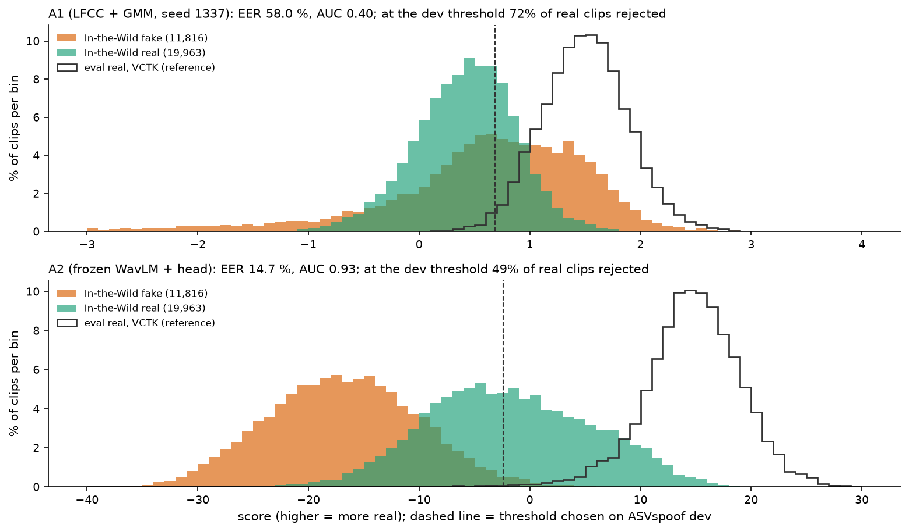
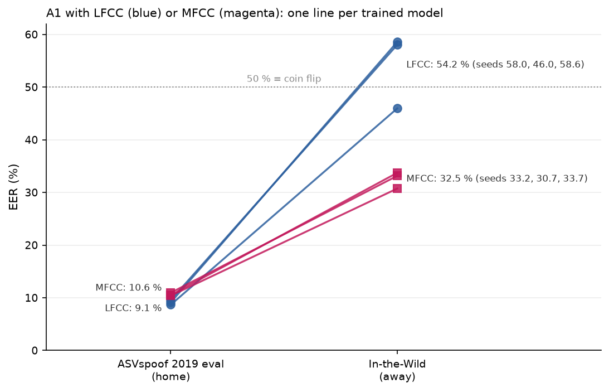

# Chapter 9 · Leaving home: what happens on real-world audio?

## A new world, all at once

So far every number comes from ASVspoof 2019 LA (the Automatic Speaker Verification Spoofing
and Countermeasures Challenge, logical access part), whose real clips share one studio chain, the
Voice Cloning Toolkit (VCTK) corpus. Chapter 8 removed one difference from the world; now we
remove all of them. **In-the-Wild** (ITW, chapter 2) brings new speakers, microphones, rooms,
compression and generators, all downsampled to 16 kHz (kilohertz), "the highest common frequency
in the original recordings" (from paper [13, §3, p.2]). We never train on it.

We ask chapter 2's two questions: **ranking** (equal error rate, EER, and area under the curve,
AUC) and **calibration** (does the dev threshold still work?). Away from home they differ.

*Source: [notebook 20](../../notebooks/20_story_figures.ipynb), cell 39, recomputed for the story
from the committed In-the-Wild scores (`E-20261001-e3-a1-raw`, `E-20261001-e3-a2-raw`), each
system's dev threshold, and its eval scores for the grey reference outline.*

## A2: the ranking survives, the threshold does not

Bottom panel. The piles are still well apart: **EER 14.70 %, AUC 0.934**
([E3 A2 metrics.json](../../experiments/E-20261001-e3-a2-raw/metrics.json)) for the original run
(its E1 head, scored in E3); the three X6 retrains (chapter 7) get 14.0 ± 0.5 %.

But VCTK real clips (grey outline) scored around +14.90; In-the-Wild real clips score around
**−2.19** (median). The dev threshold, −2.43, cuts through the real pile: **48.9 % of real
In-the-Wild clips are rejected**, while only 1.6 % of fakes are accepted (recomputed in cell 39).
Real still ranks above fake; the *number* that separates them has moved. That is a
**calibration** failure, not a **ranking** failure, and would need re-calibrating on real audio
from the new setting.

Why did the real pile move? **Our guess:** VCTK real clips carry a studio lead-in that
pushes A2's score up, and In-the-Wild real clips, cut from longer recordings, do not. Trimming VCTK eval moved its real median
to −4.18; In-the-Wild real sits at −2.19; and trimming made A2 slightly *better* on In-the-Wild
(14.70 → 13.89 %, chapter 8,
[E3 A2 trimmed metrics.json](../../experiments/E-20261001-e3-a2-trimmed/metrics.json)). The numbers
are measured; the link is not. Predicting silence from each layer (analysis X8) would test it.

For orientation only (other models and training data): the best
ASVspoof-trained model in [13] reaches 33.94 % on In-the-Wild (from paper [13, Table 1, p.3]); frozen
wav2vec 2.0 systems reach 12.48 % with a large fusion head and 23.22 % with a simple one (from paper
[22, Table II, p.3]). The sharpest comparison is Pascu et al., who froze the same WavLM Base+, fitted a logistic
regression on its top layer and report 38.6 % EER on In-the-Wild (from paper [8, Table 3, p.4];
different training data and protocol). X6 ([summary.md](../../experiments/E-20261004-e2-a2-raw-layers/summary.md))
gives our versions: a logistic regression on our cached **top layer** gets 24.75 %, our small
network on that layer 16.5 %, the full head 14.0 ± 0.5 %. So layer choice does not explain the
gap; the head matters, and an unidentified difference in set-up accounts for the rest.
Calibration is a known problem there too: [8]'s best model has an expected calibration error
(how far its probabilities are from observed frequencies) of 16.1 % on In-the-Wild (from paper
[8, Table 3, p.4]), a related measure, not our fixed-threshold rejection rate.

## A1: at chance

Top panel. The real and fake piles lie on top of each other, fakes slightly to the "more real"
side: **EER 58.04 %, AUC 0.398**
([E3 A1 metrics.json](../../experiments/E-20261001-e3-a1-raw/metrics.json)); medians real +0.44,
fake +0.69; at the home threshold, 71.8 % of real clips rejected and 50.0 % of fakes accepted.

Is the ranking *backwards* (AUC below 0.5)? That depends on the seed. The three
linear-frequency cepstral coefficient (LFCC) models of chapter 6 (X4) get AUC 0.40, 0.56 and 0.38
(EER 58.0 %, 46.0 % and 58.6 %; committed metrics.json, printed in cell 41): within a point on eval
(8.7–9.6 %), spread over 13 points here. So: **A1 is at chance on In-the-Wild**, and a single-seed
number should not be quoted alone.

This matches [13]'s central finding, qualitatively: ASVspoof-trained models fall apart on
In-the-Wild. Their spectrogram and raw-waveform models average 60.10 % EER over 28 full-length
configurations and 67.25 % over 28 four-second ones (from paper [13, Table 2, p.4]); by our count of
their Table 1, 43 of their 56 configurations reach 50 % or worse. [13] tests no LFCC or Gaussian mixture model (GMM)
system: same kind of collapse, not a replicated number. Even with every ASVspoof split added,
their RawNet2 stayed at 33.1 %; all splits are "fundamentally based on the same dataset, VCTK"
(from paper [13, §5.3, p.4]).

Why would A1 collapse? **Our guess:** level, gain and silence live in c0, which A1 keeps with
no per-recording normalisation (chapter 5). So its GMMs describe the **recording** as much as the
voice: "real" means "sounds like the VCTK studio", and real podcast audio is further from that
than many clean, studio-like web deepfakes.

## The flip: linear against mel, away from home

Chapter 6 found that LFCC beat mel-frequency cepstral coefficients (MFCC) on the benchmark. The
same six models on In-the-Wild:

*Source: [notebook 20](../../notebooks/20_story_figures.ipynb), cell 41, from the six committed
X4 metrics.json files (the seed-1337 LFCC model's In-the-Wild score is in `E-20261001-e3-a1-raw`).*

| mean ± standard deviation over 3 seeds | LFCC (linear) | MFCC (mel) |
|---|---|---|
| eval EER (home) | **9.12 ± 0.44 %** | 10.61 ± 0.30 % |
| In-the-Wild EER (away) | 54.2 ± 7.1 % | **32.5 ± 1.6 %** |
| In-the-Wild AUC | 0.45 ± 0.10 | **0.73 ± 0.03** |

(Printed in cell 41.) The ranking **flips**: at home LFCC wins by 1.5 points; away, MFCC wins by
more than 20, its seeds agreeing (30.7–33.7 %) while LFCC's scatter around chance. This is
**measured**, and unexpected: we had expected both near chance (handoff §5.1.4).

Why? LFCC spends 10 of its 20 filters above 4 kHz, mel 5 (chapter 5), and that band is where
recording chains differ most (studio audio downsampled from 96 kHz against often-compressed
podcasts and web video). The high-band detail that helps LFCC spot synthesis may also model "what
the VCTK microphone sounds like up top", which becomes noise on real-world audio. Relatedly, in speaker recognition, linear filterbanks
were less robust to white noise, which the authors attribute to the extra high-band filters
(from paper [23, §III.B, p.5]; their explanation, not a separate test).

This is **our guess**. The cheap test, not yet run (analysis X7): low-pass both arms at 4 kHz,
or normalise each recording's average coefficients, and see whether the gap closes. Either way,
"LFCC is better than MFCC" is true for ASVspoof and false on our real-world test.

> **Checkpoint**
>
> - A2 keeps a strong ranking on In-the-Wild (EER 14.70 %, AUC 0.934 for the original run;
>   14.0 ± 0.5 % over the 3 X6 retrains), but its home threshold rejects 48.9 % of real clips:
>   ranking survives, calibration does not. Layer choice does not explain why it beats [8]'s
>   frozen WavLM Base+ (their 38.6 %; our top-layer logistic regression 24.75 %)
>   ([E3 A2 metrics.json](../../experiments/E-20261001-e3-a2-raw/metrics.json); X6 summary;
>   [notebook 20](../../notebooks/20_story_figures.ipynb), cell 39; from paper [8, Table 3]).
> - A1 is at chance on In-the-Wild (EER 58.04 %, AUC 0.398 for seed 1337; AUC 0.56 and 0.38 for the
>   other two seeds), the same kind of collapse [13] reports for its models (from paper [13,
>   Tables 1–2]).
> - With everything else equal, MFCC beats LFCC on In-the-Wild (32.5 ± 1.6 % against 54.2 ± 7.1 %),
>   the reverse of the benchmark result (X4; notebook 20, cell 41).
> - Why A2's scores shift and why MFCC travels better are hypotheses (silence lead-in; high-band
>   recording-chain detail); the tests (X8, X7) have not been run.
>
> **The question this leaves us with:** A2 ranks well but cannot tell where to draw the line in a
> new setting. Is our third system, a second opinion on uncertain clips, built to fix that?

## References used in this chapter

- [8] Pascu et al. *Towards Generalisable and Calibrated Audio Deepfake Detection with
  Self-Supervised Representations.* Interspeech 2024. [arXiv:2309.05384](https://arxiv.org/abs/2309.05384)
- [13] Müller et al. *Does Audio Deepfake Detection Generalize?* Interspeech 2022.
  [arXiv:2203.16263](https://arxiv.org/abs/2203.16263)
- [22] Wang Z. et al. *Mixture of Experts Fusion for Fake Audio Detection Using Frozen wav2vec
  2.0.* arXiv preprint, 2024. [arXiv:2409.11909](https://arxiv.org/abs/2409.11909)
- [23] Zhou et al. *Linear versus Mel Frequency Cepstral Coefficients for Speaker Recognition.*
  IEEE ASRU 2011. [doi:10.1109/ASRU.2011.6163888](https://doi.org/10.1109/ASRU.2011.6163888)
