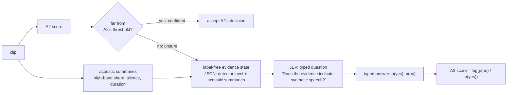

# Chapter 10 · Where does JEV fit?

*Notebook cell numbers count the first cell of a notebook as cell 0.*

**Status up front: this chapter describes a design and a scaffold. A3 has produced no results.**

## The idea: a second opinion for the hard cases

Chapter 9 left A2 in an awkward spot. Its scores rank real above fake well, even on real-world
audio, but it does not know where to draw the line. Most clips are not the problem: a clip that
scores far above or far below the threshold is probably what it looks like. The trouble is the
crowded middle, near the threshold.

So the third system, A3, follows a simple rule: **accept when confident, escalate when unsure**.
That rule is the idea of [10] (its title is "JEV-as-a-Judge: Accept When Confident, Escalate When
Unsure"). A2 handles the clips it is sure about. For the uncertain ones, a second opinion is asked,
using a small set of evidence a human could read.

A warning before the details: as configured today, A3 is **not** yet able to fix the real-world
calibration problem chapter 9 ended on. The section "What would have to change" near the end says
why, and what it would take.

## What JEV is, and what it is not

JEV is an external service with a narrow job: **a generalised classifier API** (application
programming interface: a service other programs call). You send typed
text or JSON (JavaScript Object Notation, a plain-text format for structured data) and a fixed
question; it returns **typed probabilities**, for example p(yes) and p(no) for a yes/no question
([client.py](../../src/audio_df/jev/client.py) module docstring; [9]–[12]).

- It is **text only**: it never hears the audio ([11]).
- It is **not a large language model** doing open-ended reasoning, and A3 should not be described
  that way. It answers a fixed, typed question with probabilities.

**Our sources on JEV, [9]–[12], have not been re-read for this write-up.** [9] is a community
summary that still needs checking against the official documentation. Treat everything in this
section about JEV itself as provisional.

## What A3 sends: a label-free evidence state

For each clip, A3 builds a small JSON "evidence state" with
[`build_state`](../../src/audio_df/jev/state.py#L114):

- **detector:** A2's verdict as a word (one of five levels from strongly fake to strongly real,
  depending on how far its score sits from A2's dev threshold) and how confident that is;
- **acoustic:** the share of energy above 4 kHz (kilohertz), leading, trailing and total silence,
  and duration.

Two versions exist: "numbers" passes raw values; "words" passes fixed buckets, for example
silence "little / some / a lot", with the cut-offs written in
[configs/a3_jev.yaml](../../configs/a3_jev.yaml) and applied in code, never learned.

What is deliberately **not** in the state: the label, the attack, the speaker, the file path, the
clip id. A test checks this ([`tests/test_jev_state.py`](../../tests/test_jev_state.py),
`test_no_label_leakage`). Two more design rules come from the
literature and from chapter 3 (handoff §5.4):

- no generator or attack attributes, because attributing fakes to generators does not transfer
  well across datasets (from paper [19, Table 5]; local note);
- leading silence is there as a **caution flag**, not as evidence of "fake": it is the shortcut we
  are measuring.

## What A3 asks

Three fixed, versioned questions
([questions.py](../../src/audio_df/jev/questions.py)):

1. yes/no: "Does the evidence indicate synthetic speech?"
2. a three-way choice: bona fide, spoof, or insufficient evidence;
3. a 0–3 score: how consistent the evidence is with genuine speech.

A3's score comes from the yes/no answer, as log(p(no) / p(yes))
([`noul_to_a3_score`](../../src/audio_df/jev/questions.py#L90)). Like every other score in this
project, higher means more real.

*The intended decision flow (our sketch of the design in handoff §5.4). In the current runner, every
clip of the subset is sent; the accept/escalate split is to be applied when the answers are
analysed.*

## The experiment it is built for (E5)

Experiment E5 would compare A2 and A3 on a stratified 500-clip dev subset
([configs/a3_jev.yaml](../../configs/a3_jev.yaml): `subset.n: 500`), asking whether a typed
classifier over interpretable evidence improves the uncertain middle. The runner
([run_a3.py](../../src/audio_df/experiments/run_a3.py)) writes A3 and A2 scores for the same clips,
every typed answer, and a cost summary. Answers are cached on disk, keyed by a hash of the
configuration and the clip ([cache.py](../../src/audio_df/jev/cache.py)), so a rerun never pays
twice.

## Where it stands

- **The real client is not implemented.** `TypesafeJevClient.ask` raises `NotImplementedError`
  until the JEV API documentation arrives: request format, authentication, response schema and
  pricing are all unknown ([client.py](../../src/audio_df/jev/client.py#L189)).
- **Until then, only a dry-run client exists.** Its answers are a fixed function of A2's level
  word, labelled "DRY RUN stub answer, not a real JEV result" in every output.
- **Notebook 12 runs end to end on synthetic data:** a stand-in for A2's scores and the dry-run
  client ([notebook 12](../../notebooks/12_a3_jev.ipynb), cells 3–14: setup in cells 3–6, the dry
  run itself in cells 12–14). Nothing in it is a result.
- The config still points at a placeholder A2 run (`a2_experiment:
  experiments/E-YYYYMMDD-e1-a2-raw`); it should be set to `experiments/E-20261001-e1-a2-raw`.
- A budget guard refuses real runs of more than 20 clips until the cost per call is known
  (run_a3.py docstring). The first real step is to measure latency and cost on 20 clips or fewer.

## What would have to change

Chapter 9 ended on a calibration problem: on real-world audio, A2's threshold from home rejects half
of the real clips. **A3 as configured today cannot address that.** Two reasons:

1. **The "uncertain middle" is almost empty.** The level words come from fixed margins of 0.05 and
   0.2 around A2's dev threshold ([configs/a3_jev.yaml](../../configs/a3_jev.yaml),
   `thresholds.detector.margins`), in A2's score units. But A2's scores span roughly −40 to +30
   (chapter 2). Recomputed for the story from the committed A2 scores
   ([notebook 20](../../notebooks/20_story_figures.ipynb), cell 43, which also shows that only 0.02 %
   fall within ±0.05): only **0.1 % of dev clips**
   fall within ±0.2 of the threshold, so almost every clip gets a "strong" level; and on
   In-the-Wild, **47.9 % of real clips** would be labelled "strongly spoof". The margins are
   placeholders that have not been set on A2's score scale. As set, the five levels are effectively
   two, and the "confident" side inherits exactly the calibration failure of chapter 9.
2. **E5 runs on ASVspoof dev** (the development split of the Automatic Speaker Verification
   Spoofing and Countermeasures Challenge 2019 dataset, chapter 2). The planned subset is drawn from `data/manifests/dev.csv`, so E5 can
   only test whether a second opinion helps in domain. It cannot show whether A3 fixes the
   real-world threshold shift.

So before E5 could speak to chapter 9's question, the margins would need to be set on A2's actual
score scale (or replaced by a rule based on how uncertain a score is), and an In-the-Wild subset
would need to be added to the experiment. Those are decisions for the team; we have not changed the
configuration. Beyond that, we don't know yet whether a text-only classifier over a handful of
summaries can add anything A2's own score does not already contain.

> **Checkpoint**
>
> - A3 = A2 plus a second opinion on uncertain clips: accept when confident, escalate when unsure
>   (idea of [10], not re-read).
> - JEV is a typed classifier API (text or JSON in, typed probabilities out), text only; it is not
>   a large language model ([client.py](../../src/audio_df/jev/client.py); sources [9]–[12] not
>   re-read).
> - A3 sends a label-free evidence state (A2's level and confidence plus acoustic summaries) and
>   asks three fixed questions; its score is log(p(no) / p(yes))
>   ([state.py](../../src/audio_df/jev/state.py#L114), [questions.py](../../src/audio_df/jev/questions.py#L90)).
> - As configured, A3 cannot address chapter 9's calibration problem: its level margins are
>   placeholders (0.1 % of dev clips fall in the uncertain band; 47.9 % of real In-the-Wild clips
>   would read "strongly spoof"; notebook 20, cell 43, recomputed from committed scores), and E5 is planned on ASVspoof
>   dev only.
> - Status: scaffold only; the real client raises `NotImplementedError`, notebook 12 runs on a
>   dry-run client and synthetic scores; there are no A3 results.
>
> **The question this leaves us with:** we have three systems, two of them measured. What do we
> now know, what don't we, and what would tell us?

## References used in this chapter

None of [9]–[12] was re-read for this document.

- [9] TypeSafe. *Jev — Project Knowledge Resource.* Community summary, 16 Sep 2026. To be checked
  against official documentation.
- [10] *JEV-as-a-Judge: Accept When Confident, Escalate When Unsure.*
- [11] Jev AI. *Model page.*
- [12] Jev AI. *About Jev AI* and evaluation and quality use cases.
- [19] Stan et al. *TADA: Training-free Attribution and Out-of-Domain Detection of Audio
  Deepfakes.* Interspeech 2025. [arXiv:2506.05802](https://arxiv.org/abs/2506.05802)
