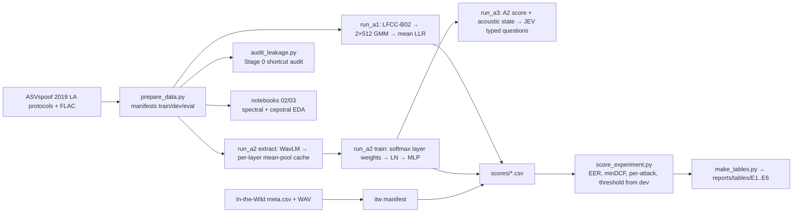

# GC2 handoff: data, training, and what the results mean

*Written 2026-10-03. Covers every run up to commit `00e12d8`, which includes the E3 and trimmed
registry rows. Every number below comes from a committed file in `experiments/` or
`reports/tables/`, or is labelled **literature** with a reference number from §15. Literature
numbers are context only. They were produced under other protocols and are never a
like-for-like comparison with our runs.*

*Revised 2026-10-04 against the papers themselves. Each paper has a note with page-referenced quotes,
kept locally in `research/knowledge/papers/` (not in git; named in §15 as "local note"). The
PDFs are on the team Google Drive linked from that folder's README. Every reference in §15 links
to the public paper. Literature citations below give
`[key, page/table]` so they can be checked. New in this revision: §5.1 now explains *what* linear-frequency cepstral coefficients (LFCC)
measure and why they might beat mel-frequency cepstral coefficients (MFCC), with the maths. §10.6 brings together why each result came
out the way it did, and §13 lists the explainability analyses that would test those reasons.
Claims are tagged by strength. **Measured** means a committed number from our runs.
**Literature** means another paper's number under another protocol. **Hypothesis** means our
reading, not yet tested.*

<b>Glossary of abbreviations and names</b> (each is also spelled out where it first appears)

| term | meaning |
|---|---|
| A1, A2, A3 | our three systems: LFCC + GMM baseline; frozen WavLM + small head; A2 + JEV |
| E1–E6 | our experiments: benchmark, ablation, generalisation, robustness, JEV, efficiency |
| X1–X8 | proposed explainability analyses (§13) |
| AASIST | Audio Anti-Spoofing using Integrated Spectro-Temporal graph attention networks: a strong neural spoof detector, an official ASVspoof baseline |
| ASVspoof | Automatic Speaker Verification Spoofing and Countermeasures Challenge; its 2019 logical access (LA) set is our main data. LA19 = 2019 LA, DF21 = 2021 deepfake (DF) track |
| AUC | area under the receiver operating characteristic (ROC) curve; 1.0 is perfect ranking, 0.5 is chance |
| B02 | the official ASVspoof 2019 baseline number 2, LFCC + GMM, which A1 reproduces |
| CI | confidence interval: the range a number would plausibly fall in if the data were resampled; we use 95 % bootstrap intervals |
| CMVN | cepstral mean and variance normalisation: subtracting each recording's average feature, which removes the channel |
| DCT | discrete cosine transform: turns log band energies into cepstral coefficients |
| EER | equal error rate: the error at the threshold where missed bona fide equals accepted spoof; lower is better |
| ECE | expected calibration error: how far predicted probabilities are from observed frequencies |
| EM | expectation-maximisation, the algorithm that fits a GMM |
| GMM | Gaussian mixture model: a weighted sum of Gaussian bell curves used as a probability density |
| In-the-Wild (ITW) | 31,779 real-world clips of celebrities and politicians, real and deepfake; our zero-training test set |
| JEV | a generalised classifier API (typed text or JSON in, typed probabilities out); not a large language model |
| LFCC / MFCC | linear- / mel-frequency cepstral coefficients: hand-made audio features that differ only in where the frequency filters sit (§5.1) |
| LLR | log-likelihood ratio: log p(x given bona fide) − log p(x given spoof) |
| minDCF | minimum detection cost function: a weighted miss and false-accept cost, ASVspoof 5 definition |
| MPS | Metal Performance Shaders: Apple's GPU backend for PyTorch |
| MUSAN | Music, Speech and Noise corpus; we use its noise clips for E4 |
| RawBoost | a raw-waveform data-augmentation method (adds filtered noise and distortions) |
| RawNet2, RawGAT-ST | neural detectors that read the raw waveform; RawGAT-ST adds graph attention over spectral and temporal features |
| RMS | root-mean-square: the square root of the mean squared sample value, i.e. overall loudness |
| RSS | resident set size: how much memory a process is actually using |
| SSL | self-supervised learning: models pre-trained on unlabelled audio |
| TTS / VC | text-to-speech / voice conversion: the two ways spoofs are made |
| VCTK | Voice Cloning Toolkit corpus: the studio recordings of 107 English speakers that all ASVspoof 2019 bona fide speech comes from |
| wav2vec 2.0, XLS-R, WavLM | self-supervised speech models. XLS-R (cross-lingual speech representations) is a multilingual wav2vec 2.0; WavLM (Microsoft) adds denoising during pre-training |
| WORLD, STRAIGHT, WaveNet, WaveRNN, Griffin-Lim, Vocaine | waveform generators (vocoders) used to build the ASVspoof attacks (§10.2) |

---

## 0. Summary

We built three detectors for spoofed speech and tested them on Automatic Speaker Verification Spoofing and Countermeasures Challenge (ASVspoof) 2019 logical access (LA). A1 is the
classical **LFCC + Gaussian mixture model (GMM)** baseline. A2 is a **frozen WavLM Base+** model with a small trained
head. A3 adds the **JEV application programming interface (API)** to A2 and is only scaffolded so far. We also check every result
against the silence shortcut, a known flaw in this dataset.

| equal error rate, EER (lower is better) | 2019 LA eval, raw | 2019 LA eval, trimmed | In-the-Wild, raw | In-the-Wild, trimmed |
|---|---|---|---|---|
| **A1** LFCC-GMM (B02 reproduction) | **9.56 %** | 19.84 % | 58.04 % | 61.36 % |
| **A2** WavLM Base+, frozen, layer-weighted head | **0.96 %** | 13.27 % | **14.70 %** | 13.89 % |
| *literature:* official B02 [15] | *8.09 %* | — | — | — |
| *literature:* raw-waveform spectro-temporal graph attention network (RawGAT-ST), best in-domain model of Müller et al. [13, Table 1] | *1.23 %* | — | *37.15 %* | — |
| *literature:* frozen wav2vec 2.0 + mixture of experts (MoE) fusion + Audio Anti-Spoofing using Integrated Spectro-Temporal graph attention networks (AASIST), RawBoost [22, Table II] | *0.74 %* | — | *12.48 %* | — |
| *literature:* frozen WavLM Base+, last layer + logistic regression [8, Table 3] | — | — | *38.6 %* | — |

The six findings, in order of importance:

1. **We reproduced the official baseline.** A1 gets 9.56 % against the published B02's 8.09 %
   [15], using the exact B02 recipe read from the official MATLAB code.
2. **Frozen self-supervised learning (SSL) beats the baseline in domain and generalises far better.** On In-the-Wild, A1
   collapses to chance (58 %) and A2 holds 14.7 %. The collapse repeats the central finding of
   [13]: models trained on ASVspoof fall apart on real-world deepfakes. That frozen SSL survives
   is less expected than it sounds. Under [8]'s protocol (last layer only, logistic regression),
   the *same* frozen WavLM Base+ gets 38.6 % [8, Table 3]. A frozen wav2vec 2.0 with a large
   fusion head gets 12.48 % [22, Table II]. Our layer-weighted head may explain part of that gap
   (**hypothesis**, test X6 in §13).
3. **Both models lean heavily on silence.** Our leakage audit shows leading silence alone
   predicts the label with area under the receiver operating characteristic curve (AUC) 0.84. Trimming silence at test time doubles A1's EER and raises
   A2's EER 14-fold. A2's median bona fide score falls from +14.9 to −4.2 while spoof scores
   barely move. Part of this may be train/test mismatch rather than the shortcut (§12).
4. **A2's threshold does not transfer.** Its In-the-Wild ranking is good (AUC 0.93), but the
   threshold fixed on dev rejects 49 % of real In-the-Wild speech. The separation survives the
   domain shift; the calibration does not.
5. **A1's In-the-Wild scores are inverted** (AUC 0.40). Its spoof model scores real-world
   bona fide audio as *more* spoof-like than real spoofs. Our reading (**hypothesis**, §10.6):
   with c0 kept and no cepstral mean and variance normalisation (CMVN), a GMM over LFCC frames models the recording channel and level as
   much as synthesis.
6. **A1's weakness is probably more the GMM than LFCC.** A discriminatively trained residual network (ResNet) on
   LFCC input reaches 1.47–2.19 % on the same 2019 LA eval split [17, Tables 2 and 4]
   (literature). Its LFCC settings are not given, and its best columns were picked on eval. So
   "LFCC + GMM is 10× worse than WavLM" is a statement about the whole pipeline, not about the
   features alone (our inference, §5.2). We have **not** run an MFCC control (§5.1).

---

## 1. The question

From the project [README](../README.md): given an utterance *x* with label
*y* ∈ {bona fide, spoof}, can we learn a detector that picks up **synthesis evidence** rather
than **dataset or generator shortcuts**? The working assumption is that for some observable
representation *Z*,

$$P(Z \mid \text{bona fide}) \neq P(Z \mid \text{spoof}),$$

and the project asks *which* Z shows that difference, and whether the difference survives
unseen generators and unseen recording conditions.

That framing shapes everything below:

- We **audit the data first**, before modelling, for differences that are not synthesis (§3).
- We compare a **hand-crafted Z** (LFCC) with a **learned Z** (SSL hidden states) (§5–7).
- We test on **unseen generators** (2019 eval A07–A19) and an **unseen domain** (In-the-Wild),
  and we check how far each result depends on **silence** (§10).

### Pipeline at a glance

Hard rule: **no metric is ever computed inside training code.** Runners write
`scores/<testset>.csv`, with higher meaning more bona fide, and
[scripts/score_experiment.py](../scripts/score_experiment.py) turns those into `metrics.json`
([experiments/README.md](../experiments/README.md)).

---

## 2. Data used

### 2.1 ASVspoof 2019 LA: the training and benchmark corpus [14, 15]

- **Source:** Edinburgh DataShare `LA.zip` (7.12 GB), unpacked under `data/raw/ASVspoof2019/LA/`
  (gitignored). The layout was checked against the official RawNet2 and AASIST loaders.
  See [research/knowledge/datasets/asvspoof-2019-la.md](../research/knowledge/datasets/asvspoof-2019-la.md).
- **Origin:** all bona fide speech is Voice Cloning Toolkit corpus (VCTK): 107 English speakers, studio-quality, one
  recording chain. Spoofs are text-to-speech (TTS) or voice conversion (VC) outputs built on the same VCTK material [14].
- **Protocol format:** `SPEAKER_ID UTT_ID - SYSTEM_ID KEY`, five whitespace-separated fields,
  parsed by [`parse_asvspoof_protocol`](../src/audio_df/data.py#L121).

Counts from our own manifest ([notebooks/01_dataset_audit.ipynb](../notebooks/01_dataset_audit.ipynb),
cells 3–6, real-data mode):

| split | bona fide | spoof | attacks | speakers |
|---|---|---|---|---|
| train | 2,580 | 22,800 (3,800 per attack) | A01–A06 | 20 |
| dev | 2,548 | 22,296 (3,716 per attack) | A01–A06 | 20 |
| eval | 7,355 | 63,882 (4,914 per attack) | **A07–A19** | 67 |
| **total** | | **121,461 clips** | | |

Two properties drive the design:

1. **The classes are imbalanced, about 1:9 bona fide to spoof.** Accuracy would be
   meaningless. A model that always says "spoof" scores 90 %. So we report EER, minimum detection cost function (minDCF) and
   per-attack EER, and the A2 loss is reweighted (§7.3).
2. **Eval attacks never appear in train or dev.** The official eval split is therefore already
   an *unseen-generator* test, at no extra cost
   (architecture decision record [ADR-001](../research/decisions/ADR-001-generalization-data-strategy.md), option C). A gap
   between dev and eval is expected. It is not a sign of ordinary overfitting.
   - **Resolved 2026-10-04: only 11 of the 13 eval attacks are unseen.** The database paper says
     so directly: "Note that A04 and A16 use same waveform concatenation TTS algorithm, and A06
     and A19 use same VC algorithm" [14, Table 1 caption, p.6]. It also says "A07 to A19 (apart
     from A16 and A19) are the eleven unknown spoofing systems" [14, §3, p.6]. So A16 and A19 are
     *known algorithms on new speakers*. Every per-attack table marks them with \*.

Integrity checks that pass:

- No speaker overlap between train and dev, enforced by
  [`assert_no_speaker_overlap`](../src/audio_df/data.py#L252) (notebook 01, NB01, cell 10).
- `split_hash` is independent of row order, so every run can prove which split it used
  (NB01 cell 12).
- Manifests are gitignored; their Secure Hash Algorithm, 256-bit (SHA-256) sums are committed under `data/manifests/`.

### 2.2 In-the-Wild: zero-training external test [13]

- Hugging Face `mueller91/In-The-Wild`, an 8.16 GB zip extracted to `data/raw/InTheWild`.
- **31,779 clips: 19,963 bona fide and 11,816 spoof**, confirmed locally on 2026-10-01. Bona fide
  is the *majority* here, the reverse of ASVspoof.
- The audio is real celebrity and politician speech from podcasts and speeches. The fakes are
  segments of videos found online that advertise themselves as deepfakes. Everything is
  resampled to 16 kHz and clips average about 4.3 s.
- There are **no attack labels and no official split**, so per-generator EER is impossible and
  we use the set only as a frozen evaluation set. `meta.csv` lists 54 speakers where the paper
  says 58; this is unresolved.
- What [13] itself reports: 37.9 h in total (17.2 h fake, 20.7 h bona fide; Fig. 1 says 20.8 h), 58 speakers, mean
  clip length 4.3 s, and fakes cut from 219 videos [13, §3, p.2]. It gives **no clip count**.
  [8, Table 1, p.2] describes the set as about 20k real and 12k fake clips, which matches our
  19,963 / 11,816.
- The licence is in conflict: the Hugging Face (HF) card says Creative Commons Attribution-ShareAlike (CC-BY-SA) 4.0 and the authors' page says
  Apache-2.0. Flag this in the report. See
  [research/knowledge/datasets/in-the-wild.md](../research/knowledge/datasets/in-the-wild.md).
- Loaded by [`build_itw_manifest`](../src/audio_df/data.py#L347).

### 2.3 E4 robustness inputs (generator ready, not yet run)

- **A 10,000-clip stratified eval subset**, seed 1337, stratified by `(label, attack_id)` with
  largest-remainder allocation ([`stratified_subset`](../src/audio_df/data.py#L433)). It
  contains 1,032 bona fide clips and 689–690 clips per attack, matching the full eval mix to
  0.01 % ([notebooks/13_e4_degradations.ipynb](../notebooks/13_e4_degradations.ipynb) cell 4).
  The clip IDs are frozen in [configs/e4_degradations.yaml](../configs/e4_degradations.yaml).
- **Four test-time degradations** in [src/audio_df/degrade.py](../src/audio_df/degrade.py):
  MP3 at 32 kbps, Opus at 16 kbps, Music, Speech and Noise corpus (MUSAN) `noise/` at 10 dB signal-to-noise ratio (SNR), and a 16→8→16 kHz resample.
  The motivation is [1]: what a detector meets in practice is speech after a channel (codecs,
  noise, narrowband audio), and ASVspoof 5 [2, 5] builds codec conditions into its evaluation
  for the same reason.
- **E4 tests the mild case, not presentation.** [1] finds that the harsh condition is
  loudspeaker *playback*, not the phone line. For WavLM-LLGF, the miss rate at 1 % false alarms
  goes from 25.2 % on pooled raw test sets to 26.7 % under direct phone injection and 57.6 %
  under real playback [1, Fig. 3 / Table 2, p.4] (literature: 8 kHz, voice activity detection (VAD) on every input,
  codec-augmented training, different data). E4 has no re-recording, so the report must not
  claim "presentation robustness". [1] gives no per-codec numbers, so it cannot predict E4's
  magnitudes. [1] also uses one pooled threshold across conditions [1, p.3]; reusing the clean
  dev threshold in E4 follows the same logic.
- MUSAN (Open Speech and Language Resources, OpenSLR, corpus 17) is fetched by [scripts/get_musan.py](../scripts/get_musan.py), which keeps
  only `noise/`, about 929 files.

### 2.4 Considered but parked

These are listed in [docs/backlog.md](backlog.md): ASVspoof 2021 LA/DF, ASVspoof 5, Multi-Language Audio Anti-Spoofing Dataset (MLAAD)
held-out architectures (ADR-001 option B), and a self-generated TTS set. ADR-001 explains why
generating our own fakes is dangerous. Pairing them with bona fide audio from another
recording chain *creates* a corpus shortcut.

---

## 3. Inspect: the Stage 0 leakage audit

**Question:** can a trivial model predict the label from **metadata alone**? If it can, a real
detector can learn that metadata instead of synthesis evidence.

**Method** ([src/audio_df/leakage.py](../src/audio_df/leakage.py),
[scripts/audit_leakage.py](../scripts/audit_leakage.py), NB01 cells 14–21):

- Features: duration, sample rate, codec, source corpus, speaker ID, root-mean-square (RMS) level (overall loudness: the square root of the mean of
  the squared sample values, $\sqrt{\tfrac1N\sum_n x[n]^2}$), and the
  fractions of leading, trailing and total silence.
- Silence is measured with framed RMS energy relative to the loudest frame, with
  `top_db = 30`, frames of 2048 and hop 512, the same convention as `librosa.effects.split`
  ([`silence_ratio`](../src/audio_df/audio.py#L142)). An earlier per-sample threshold counted
  zero-crossings as silence and was replaced. The docstring explains why.
- Classifiers: logistic regression and a depth-2 tree, scored **only out of fold** with
  5-fold stratified cross-validation (CV) ([`_cross_val_oof_scores`](../src/audio_df/leakage.py#L234)).
  Categorical features use fold-safe target encoding, and CIs come from 1,000 bootstrap
  resamples.
- A feature is flagged above AUC 0.65. **That threshold is a project convention, not a
  literature value.**

**How to read the table.**

- **AUC** is the probability that a randomly chosen spoof clip and a randomly chosen bona fide
  clip are ranked the right way round by this one feature. 0.5 means the feature carries no
  information about the label; 1.0 means it separates the classes perfectly.
- **Why AUC and not accuracy.**
  - **It summarises every threshold, not one.** The ROC curve plots the true positive rate
    against the false positive rate as the threshold sweeps through every value, and AUC is the
    area under that curve. Accuracy needs one chosen cut-off. AUC rates how well the feature
    *ranks* clips without committing to any single threshold.
  - **It does not depend on the class *ratio*.** The true positive rate is computed only within
    spoof clips and the false positive rate only within bona fide clips. Changing the 1 : 9 mix
    alone leaves both rates, the curve and the AUC unchanged. Accuracy does change with the
    mix: a useless "always spoof" rule scores 90 % accuracy here, but AUC 0.5.
- **What class balance still affects.**
  - **Precision of the estimate.** Fewer clips in the minority class make the AUC noisier and
    widen its confidence interval.
  - **Deployment.** AUC says nothing about the operating point. At 1 : 9, even a modest false
    positive rate can mean many false alarms relative to true detections. Precision, F1 and
    precision-recall curves do depend on the ratio, which is why we also report F1 at a fixed
    threshold (§9).
  - **Composition.** AUC changes if *what* is in each class changes, for example a different
    mix of attacks. That is a change in the data, not in the ratio.
- **95 % CI.** The 95 % confidence interval comes from resampling the clips with replacement
  1,000 times and recomputing AUC each time. The middle 95 % of those values is the interval.
  Narrow intervals, such as [0.835, 0.840], mean the number is stable and is not luck from this
  particular set of clips.

**Result** on all 121,461 clips ([reports/tables/leakage_audit.csv](../reports/tables/leakage_audit.csv)):

| feature | AUC [95 % confidence interval (CI)] | EER | flagged |
|---|---|---|---|
| silence_leading | **0.837** [0.835, 0.840] | 24.7 % | ⚠ yes |
| silence_total | **0.825** [0.822, 0.827] | 25.5 % | ⚠ yes |
| rms | 0.664 [0.660, 0.669] | 38.3 % | ⚠ yes |
| speaker_id | 0.649 | 41.4 % | no (borderline) |
| duration_s | 0.624 | 48.6 % | no |
| silence_trailing | 0.611 | 43.7 % | no |
| sample_rate / codec / source_corpus | 0.500 | — | no (constant) |
| **all combined** | **0.876** | 22.9 % | ⚠ yes |

**Reasoning.** This is a direct local replication of Müller et al. [27], *Speech is Silver, Silence is
Golden*, the paper that first measured this shortcut in ASVspoof 2019. They found that a
single leading-silence feature reaches 15.1 % EER on 2019 LA eval, and that RawNet2's EER rises
from 3.61 % to 15.50 % when it is trained on trimmed audio. The cause is how the corpus was
assembled. VCTK recordings keep their natural room-noise lead-in, and TTS/VC systems are trained
on trimmed data, so they output speech that starts immediately. Silence is therefore a fact about
*how the classes were sourced*, not about synthesis.

**Decision.** The audit's verdict says "do not model as-is". Instead of re-cutting the corpus,
the 2026-09-30 plan kept **raw audio as the main condition** and made **trimmed audio a
mandatory diagnostic** on every test set
([`preprocess(silence_mode=...)`](../src/audio_df/audio.py#L289),
[`trim_silence`](../src/audio_df/audio.py#L228)). That makes the shortcut *measured* in every
headline number instead of hidden. Notebook [09](../notebooks/09_a1_playground.ipynb) §5 plots
the median leading-silence fraction per attack. A07–A16 sit between 0.00 and 0.06, while A17,
A18 and A19 sit at 0.32, 0.30 and 0.27, against bona fide's 0.29 (recomputed on 150 clips per
attack; [lfcc-vs-mfcc-explained.md](../research/knowledge/methods/lfcc-vs-mfcc-explained.md) §5).
The database paper explains the split. A17–A19 are the three voice-conversion systems that
convert **human** source recordings, so they keep the source's lead-in. A13–A15 convert TTS
output, which starts immediately [14, Table 1, p.6]. The silence shortcut is therefore
*attack-specific*, and the per-attack results in §10.3 follow this split.

One more protection: `preprocess` **repeat-pads, never zero-pads**, short clips. Zero padding
would add the very silence we are trying to control.

---

## 4. Analyze: where do the classes differ?

### 4.1 Spectral exploratory data analysis (EDA) ([notebooks/02_spectral_eda.ipynb](../notebooks/02_spectral_eda.ipynb), real data, 240-clip stratified sample)

We report **effect sizes**, not p-values. An effect size says *how far apart* the two classes
are on one feature. A p-value only says whether *some* difference exists, and on a corpus of
121k clips even a trivial difference comes out "significant". Two effect sizes are used, both
computed as spoof against bona fide ([`cohens_d`, `cliffs_delta`](../src/audio_df/stats.py#L78)):

- **Cohen's *d*: the gap between the class means, in units of spread.**

  $$
  d = \frac{\bar{x}_\text{spoof} - \bar{x}_\text{bona}}{s_\text{pooled}},\qquad
  s_\text{pooled} = \sqrt{\frac{(n_s-1)s_s^2 + (n_b-1)s_b^2}{n_s+n_b-2}}
  $$

  A negative *d* means spoof is lower on average. Cohen's rough scale: 0.2 small, 0.5 medium,
  0.8 large. Because it uses means and standard deviations, skew and outliers can distort it.
  Leading silence is an example: many spoofs sit at exactly 0.
- **Cliff's δ: how often one class beats the other.**

  $$
  \delta = P(\text{spoof} > \text{bona}) - P(\text{spoof} < \text{bona})
  $$

  It is taken over every (spoof, bona fide) pair and ranges from −1 to +1. 0 means neither class
  tends to be higher. It uses only the order of the values, so outliers and skew do not affect
  it. Romano et al.'s rough scale: |δ| 0.15 small, 0.33 medium, 0.47 large.
- **Link to AUC.** Cliff's δ and AUC carry the same information: δ = 2·AUC − 1, with AUC
  measured in the direction of δ. Bandwidth's AUC of 0.824 below therefore corresponds to
  δ ≈ −0.65.
- **Why both.** If *d* and δ agree, the difference is real and not driven by a few extreme
  clips. If they disagree, look at the distribution itself.

The 95 % CI on *d* comes from 500 bootstrap resamples of the clips (notebook 02, `n_boot=500`); the
idea is the same as the AUC intervals in §3, which use 1,000.

| feature | Cohen's d | 95 % CI | single-feature AUC (best direction) |
|---|---|---|---|
| silence_leading | −1.42 | [−1.73, −1.16] | 0.818 |
| **spectral bandwidth** | **−1.32** | [−1.61, −1.08] | **0.824** |
| silence_total | −1.28 | [−1.56, −0.99] | 0.802 |
| **spectral rolloff** | **−0.93** | [−1.21, −0.69] | 0.749 |
| rms | +0.36 | [0.11, 0.58] | 0.582 |
| zcr | +0.33 | [0.08, 0.60] | 0.604 |
| duration | +0.09 | [−0.16, 0.34] | 0.525 |

**Reading.** Apart from silence, the strongest signals are **spectral shape across the full
band**: spoofs have lower bandwidth and lower rolloff. That points to how energy is spread at
high frequencies. The per-attack centroid table (cell 19) also shows **opposite directions by
generator**. A11 has a centroid of about 1,400 Hz and A18 about 2,290 Hz, either side of bona
fide's 1,733 Hz. So no single scalar is "the fake artifact". Each cue belongs to a generator,
which is why per-attack EER is required.

**What the EDA does *not* show: a large high-band energy deficit.** The obvious version of
"spoofs lack high frequencies" fails on our data. The committed share of energy at ≥ 4 kHz
(`band_high_ratio`) has d = −0.13 [−0.37, 0.09] and AUC 0.53 (notebook 02, NB02, cells 9 and 12), so the
interval includes zero. A finer check (**recomputed** on 600 clips through the exact B02
pipeline, not committed output) does find a small *gain-free* tilt. Compared with the 1.1–4.2 kHz
channels, the 4.9–7.6 kHz channels sit 1.5 dB lower in spoof (d = −0.33 [−0.50, −0.17], louder
half of frames). The tilt is the same sign in train, dev and eval. But it correlates 0.57 with
the silence fraction, and the largest per-channel difference is at the *lowest* channel
(d = +0.94), which is what a level and silence difference looks like. Bandwidth and rolloff
are whole-spectrum measures, and silent frames have flat, wide noise-floor spectra. Part of
their effect is probably silence too (**hypothesis**: recompute d on clips with < 20 % silence).
Details:
[lfcc-vs-mfcc-explained.md](../research/knowledge/methods/lfcc-vs-mfcc-explained.md) §4.2–4.3.

### 4.2 Cepstral EDA ([notebooks/03_cepstral_eda.ipynb](../notebooks/03_cepstral_eda.ipynb), 90-clip sample)

This compares six representations from [configs/features.yaml](../configs/features.yaml):
linear vs mel filters, with or without the discrete cosine transform (DCT), truncated or not, with or without deltas.
The key measured fact (cell 11):

| representation (bona fide only) | mean \|off-diagonal correlation\| |
|---|---|
| `feat_a` linear log-filterbank (no DCT) | **0.851** |
| `feat_b` LFCC, full orthonormal DCT | **0.166** |

The DCT cuts inter-dimension correlation about five-fold. That is the mathematical reason a
**diagonal**-covariance GMM is usable on LFCC but would be badly mis-specified on raw
log-filterbanks (§6.3).

---

## 5. Reasoning: why these three models

| | A1 LFCC + GMM | A2 frozen SSL + head | A3 A2 + JEV |
|---|---|---|---|
| role | the **anchor**: an official, fully specified baseline we can reproduce exactly [15] | the **modern front end** the field has moved to [3, 6, 7, 8] | a **decision layer**: accept when confident, escalate when unsure [10] |
| Z | hand-designed: linear cepstra plus dynamics | learned: hidden states of a model pre-trained on 94k h of real speech [26, p.5] | A2's score plus a few interpretable acoustic summaries, as JavaScript Object Notation (JSON) |
| what is trained | two density models, no discriminative training | ~231k head parameters; the 94M-parameter backbone is frozen | nothing (typed questions to an API) |
| fits a 16 GB fanless Mac? | yes (peak memory, resident set size (RSS), 3.8 GB) | yes, *because* we freeze and pool-cache | yes, network-bound |

### 5.1 Why LFCC and not MFCC

**Status up front.** We use LFCC because it is the official B02 recipe, and A1 exists to
reproduce B02. We have **not** run a controlled LFCC-vs-MFCC comparison. Everything below that
says "linear beats mel" is **literature**; the maths explains *why it could*. Test X4 (§13)
would turn it into a measurement. The full derivation, with a per-filter table, is in
[lfcc-vs-mfcc-explained.md](../research/knowledge/methods/lfcc-vs-mfcc-explained.md).

#### 5.1.1 The only difference is where the filters sit

LFCC and MFCC share every step (pre-emphasis → window → fast Fourier transform (FFT) power |·|² → triangular filterbank → log →
DCT) except the placement of the filter edges. LFCC spaces them equally in Hz. MFCC spaces them
equally on the mel scale, $m(f) = 2595\,\log_{10}(1+f/700)$, which was designed for *speech
recognition* to mimic the ear. Its slope tells you the resolution:

$$
\frac{dm}{df} = \frac{2595}{\ln 10}\cdot\frac{1}{700+f} \approx \frac{1127}{700+f}\ \text{mel/Hz}
= 1.61 \text{ at } 0\text{ Hz},\ 0.24 \text{ at } 4\text{ kHz},\ 0.13 \text{ at } 8\text{ kHz}.
$$

Hz per mel grows like $(700+f)$. So a mel filter at 8 kHz is about **12× wider** than one near
0 Hz, and 75.6 % of the mel axis (2,146 of 2,840 mel) lies below 4 kHz. Equal mel steps therefore
put 15 of 20 filters below 4 kHz. Computed from our two filterbank functions
(`lfcc_b02_filterbank` and `features.filterbank(spacing="mel")`, 20 filters, 16 kHz, 512-point
FFT):

| | linear (LFCC) | mel (MFCC) |
|---|---|---|
| filters centred above 4 kHz | **10** | **5** |
| filters centred above 6 kHz | 5 | 2 |
| filters centred below 1 kHz | 2 | 7 |
| lowest filter width | 762 Hz | 190 Hz |
| top filter width (span) | 762 Hz (7,238–8,000) | 1,856 Hz (6,144–8,000) |
| mean width of filters centred above 4 kHz | 762 Hz | 1,481 Hz |
| FFT bins per filter | 24–25 | 6 to 60 |

So in the 4–8 kHz half of the spectrum, LFCC has **twice the filters**, each **about 1.9× narrower
on average** (2.4× at the very top). Mel spends that budget below 1 kHz, where its two lowest
filters (190 and 214 Hz) are about the width of the Hamming window's own 201 Hz main lobe. That
suggests they add little independent detail (**hypothesis**).

#### 5.1.2 What an LFCC frame actually encodes

The orthonormal DCT turns the 20 log band energies $L[r]$ into 20 coefficients. Each one is a
fixed weighted sum, so each has a direct physical reading:

- **c0 is level.** $c_0 = \sqrt{1/J}\sum_r L[r]$ is √J times the log of the *geometric mean* band energy,
  not the log of total energy. A gain $g$ adds the same constant $2\log_{10} g$ to every $L[r]$,
  and the DCT of a constant vector is zero for every $q \ge 1$. **So loudness, recording gain and
  silence move only c0.** A 10 dB drop moves c0 by −4.47. B02 keeps c0 and has no CMVN, so A1
  can use level directly.
- **c1 is spectral tilt.** Its weights, $\sqrt{2/J}\cos(\pi(r-\tfrac12)/J)$, run from +0.315 on the lowest channel to
  −0.315 on the highest, so c1 is roughly "low band minus high band".
- **$c_q$ is spectral ripple** with $q$ half-periods across the filter axis. On a *linear* axis
  the 20 channels are 381 Hz apart, so $q$ half-periods span 20 × 381 Hz and the ripple period is
  $2 \cdot 20 \cdot 381/q \approx 15{,}238/q$ Hz: c4 ≈ 3.8 kHz, c10 ≈ 1.5 kHz, c19 ≈ 800 Hz.
  Low orders carry the envelope (formant-scale shape), high orders carry finer detail.
- **On a mel axis the same $c_q$ has no fixed period in Hz.** It is fine at low frequency and
  coarse at high frequency. This is the core of the argument: an LFCC coefficient describes
  high-band detail as precisely as low-band detail, and an MFCC coefficient does not.
- **Δ and ΔΔ are band-pass filters over time.** At 100 frames/s, $\Delta c[t] = c[t+1]-c[t-1]$
  has gain $2|\sin(2\pi f_m/100)|$ and ΔΔ has $4\sin^2(2\pi f_m/100)$. Both peak at modulation
  frequency $f_m$ = 25 Hz and are weak at the ~4 Hz syllable rate. They capture *fast* spectral
  change across ±2 frames (60 ms).
- **What LFCC cannot see:** phase (dropped by |·|²), detail finer than one 762 Hz filter
  (including pitch harmonics, 100–250 Hz apart), and any pattern longer than 60 ms.

#### 5.1.3 Why high-band resolution should matter for spoofing (literature)

- **Same GMM, LFCC vs MFCC, ASVspoof 2015 dev** [28, Table 3, p.4]. Static features:
  MFCC **3.46 %**, LFCC **2.46 %**, IMFCC (mel turned upside down, finest at high frequency)
  **1.33 %**. With Δ+ΔΔ: 1.09, 0.66 and 0.48 %. For static and static+Δ features,
  EER falls in the same order as high-band resolution rises. That ordering does not hold
  everywhere: with Δ+ΔΔ only, LFCC (0.12 %) beats IMFCC (0.20 %). The authors' reason (p.2): synthesis "mostly focus[es] on producing identical
  overall envelope of the speech spectrum", so finer details are not preserved. They state this as
  an intuition; the experiment shows the ordering, not the cause. On their unknown-attack eval:
  LFCC 1.67 % vs MFCC 3.84 % (Table 4).
- **WaveFake** [24, Tables 2 and 6]. A GMM on LFCC beat the same GMM on MFCC in all seven
  training conditions on average (aEER 0.129 vs 0.295), though not on every test set: MelGAN-trained
  models did better with MFCC on the two JSUT (Japanese speech corpus of Saruwatari-lab, University of Tokyo) test sets. WaveFake also removed silences over 2 s. Vocoder spectrograms differ "especially in the
  higher frequencies", differences that are "generally inaudible when listening" (p.6). That is
  exactly the band a perceptual (mel) scale compresses.
- **Counter-evidence** [25, Table 1, p.4]. On the Spoofing and Anti-Spoofing (SAS) corpus a 26-filter linear bank scored
  8.91 % against 6.89 % for mel. The most discriminative regions were 0–1, 2.5–5.5 and 7–8 kHz,
  not only the top. Linear spacing is not uniformly better. The useful bands depend on the
  generators.
- **Weak support only:** one CNN-LSTM run on 2019 LA gives LFCC 4.80 % vs MFCC 5.79 % [21,
  Table 7] (single run, low-confidence paper). Zhou et al. [23] make the same filter-count
  argument for *speaker* recognition on a 300–3400 Hz telephone band. That supports the geometry,
  not spoofing.

ASVspoof made LFCC-GMM the official baseline in 2019 [15] and kept an LFCC baseline in 2021
with a finer 70-filter recipe
([b02-lfcc-gmm.md](../research/knowledge/methods/b02-lfcc-gmm.md)).

#### 5.1.4 What our own data adds, and what it does not

- **Supports, weakly:** after removing level, spoof's 4.9–7.6 kHz channels sit 1.5 dB lower
  relative to mid band (§4.1, **recomputed**). Spoof also has smaller frame-to-frame change in
  the high-order coefficients c11–c19 (mean |Δc| d between −0.12 and −0.57). Both fit "finer
  detail is smoother in synthetic speech" and [28]'s finding that dynamics help.
- **Does not support:** there is no large high-band *energy* gap (`band_high_ratio` d = −0.13,
  interval includes zero), and the tilt is partly silence (ρ = 0.57).
- **Playground only:** in [notebook 09](../notebooks/09_a1_playground.ipynb) §7d, going from 20
  to 40 linear filters cut a mini-A1's eval EER from 16.6 % to 9.1 % (300 clips per class,
  32 components, 650 eval clips, single run, not registered). It points the same way, but it is
  confounded: doubling the filters also doubles the feature dimension (60 → 120).
- **The big caveat:** A1's per-attack behaviour under trimming tracks **c0 and silence**, not
  high-band shape (§10.3). Changing the filter spacing would not obviously remove that. Our
  expectation, written *before* running X4: pooled eval EER differs by under 4 points, about 65 %
  likely in LFCC's favour, and both arms are near chance on In-the-Wild.

**Why the other B02 choices:** each is pinned to a line of the official MATLAB in
[src/audio_df/lfcc_b02.py](../src/audio_df/lfcc_b02.py) and
[configs/a1_lfcc_gmm.yaml](../configs/a1_lfcc_gmm.yaml).

| choice | reason |
|---|---|
| pre-emphasis $y[n] = x[n] - 0.97\,x[n-1]$ | high-pass: $\lvert H(f)\rvert^2 = 1 + 0.97^2 - 2(0.97)\cos(2\pi f/f_s)$, i.e. −30.5 dB at 0 Hz, −8.3 dB at 1 kHz, +2.9 dB at 4 kHz, +5.9 dB at 8 kHz. About +6 dB/octave up to ~4 kHz, then flatter (+3 dB from 4 to 8 kHz). It flattens speech's natural roll-off so high-band detail is not swamped |
| 20 ms Hamming window, 10 ms hop | speech is roughly stationary over ~20 ms; Hamming limits spectral leakage |
| log10 | turns multiplicative gains (channel, loudness) into additive offsets |
| DCT-II, orthonormal | decorrelates the log-filterbank (0.85 → 0.17 measured), as a diagonal GMM needs |
| keep all 20 coefficients (including c0) | c0 is overall log-energy, so B02 *keeps* loudness information |
| Δ, ΔΔ with w = 3, no ÷2 | adds how the spectrum moves over time, transcribed exactly from `deltas.m` |
| **no CMVN** | the official code has none. This keeps channel information, which helps in domain and hurts across domains (§10.4) |
| whole utterance, no crop | B02 scores the full file. This is the one place we depart from the project's 4 s crop |

The 0 Hz lower edge is not the 30 Hz some summaries quote. Our research note corrected that by
reading the code itself.

### 5.2 Why a GMM

The GMM is the official B02 back end, which made it a faithful anchor. It is generative and
needs no negative-class balancing, and it is cheap. Its built-in limits are the reason we also
need A2: it treats a clip as a **bag of frames** with no temporal context beyond Δ and ΔΔ, and
it models *everything* about the frames, recording channel included.

The back end costs a lot. Mo and Wang train a ResNet34 with one-class softmax (OC-softmax) on LFCC and reach
2.19 % on the same 2019 LA eval split. Adding three auxiliary tasks brings it to 1.47 %
[17, Tables 2 and 4] (literature: best column per loss chosen on eval, single runs). [17] does not state its LFCC settings,
so this is not a same-features comparison. Still, against A1's 9.56 %, it suggests that most of
A1's gap to A2 comes from the *generative, frame-independent* GMM rather than from LFCC (our
inference). A density model has to spend capacity on every source of variation in the
frames (speaker, level, room). A discriminative model only has to find what separates the
classes.

### 5.3 Why a frozen SSL model, and why WavLM Base+

- **Pre-training on real speech.** WavLM Base+ was pre-trained on 94k hours of real speech:
  Libri-Light 60k, GigaSpeech 10k and VoxPopuli 24k [26, "Pre-Training Data", p.5]. [8, Table 3] prints 84k,
  which the WavLM paper contradicts. Its representations encode what natural speech looks like
  at several levels, and a classifier can measure deviations from that.
- **What the SSL literature does and does not show.**
  - Tak et al. [7] *fine-tune* cross-lingual speech representations model (XLS-R) 0.3B jointly with AASIST on 2019 LA. Pooled EER on 2021 LA
    falls from 11.47 % (sinc front end) to 6.15 %, and to 0.82 % with RawBoost and a
    self-attentive layer [7, Table 2, p.5]. The backbone is fine-tuned, only the last layer is
    used, and they test on 2021 LA/DF, not In-the-Wild. So [7] supports "SSL front ends help",
    not our frozen design.
  - Pascu et al. [8] use frozen last-layer features with logistic regression. This generalises
    only for a *large* backbone: XLS-R 2B gets 7.2 % on In-the-Wild, while the 94M-parameter
    models get 37.6–45.9 %, WavLM Base+ 38.6 % [8, Table 3, p.4].
  - The closest match to our protocol is Wang et al. [22]: a frozen wav2vec 2.0 trained on 2019
    LA, tested on 2019 LA eval and In-the-Wild. With a 25.9M-parameter fusion head it gets
    0.74 % and 12.48 %; with a 0.44M simple head, 1.93 % and 23.22 % [22, Table II, p.3]
    (RawBoost on every run). Fine-tuning instead reached 9.17 % on In-the-Wild, so fine-tuning
    beat freezing there.
- **Why frozen.** Fine-tuning a 94–300M-parameter model on a fanless 16 GB machine is not
  practical (the A2-alt variant, which needs a graphics processing unit (GPU), is parked in [backlog.md](backlog.md)). Freezing
  also means **one** forward pass per clip, cached, after which head training takes seconds:
  16.9 s for the whole run. The literature puts this on the "cheaper, probably not best" side.
  Stourbe et al. got 6.78 % with a frozen encoder against 6.41 % fine-tuned. Only the fine-tuned
  model with noise, room impulse response (RIR) and codec augmentation reached 2.18 % [3, Table 2 row 6, p.4], and they
  conclude fine-tuning is needed. [22] found the same on In-the-Wild.
- **Why WavLM first.** WavLM's pre-training adds denoising and utterance mixing to masked
  prediction, so it is built to be robust to overlapped and noisy audio, which matters for
  In-the-Wild and E4. Stourbe et al. [3] use WavLM for spoofing on ASVspoof 5. Two caveats:
  they use WavLM *Base* (960 h), not Base+, and they fine-tune it. One of their back ends is a
  layer-weighted average, then a time mean, then one linear layer (about 1.5k parameters)
  [3, §4.2.1, p.3]. That is the same pooling structure as our A2 head. Base+ (12 layers,
  768 dimensions) runs at about 53 ms per clip on Metal Performance Shaders (MPS), Apple's GPU backend. **XLS-R 300M** (24 layers, 1,024
  dimensions, 128 languages) is the second backbone. It is the one most papers fine-tune [7];
  we run it raw-only and overnight.
- **Why a learned weight per layer.** Different transformer layers carry different information.
  The WavLM paper measures this for its own Base models: "the bottom layers contribute more to
  speaker-related tasks… content and semantic information are encoded in the top layers"
  [26, Fig. 2, p.7]. Our working hypothesis is that spoof evidence is more acoustic and
  speaker-like than linguistic. Instead of guessing a layer, the head learns a **softmax weight
  per layer**, the weighted sum used by the SUPERB benchmark (Speech processing Universal PERformance Benchmark). Merging multiple wav2vec2 layers is also the
  approach of [16] for deepfake detection. **No paper we read reports which layers carry spoof
  evidence for frozen WavLM.** [3] states the low and mid-layer motivation without reporting
  learned weights. [7] uses only the last layer. [22] repeats a "layer 5 beats the last layer"
  result second-hand. Richer aggregations such as Sensitive Layer Selection (SLS) [29] or MSLA [30] (another multi-layer aggregation method) exist, but our research note could
  not read their mechanisms from primary sources, so they are not scheduled
  ([multi-layer-ssl-aggregation.md](../research/knowledge/methods/multi-layer-ssl-aggregation.md)).
- **Time-averaged SSL states carry generator identity.** A plain 21-nearest-neighbour classifier
  on time-averaged hidden states of a frozen SSL model names the generator checkpoint of a fake
  clip with macro F1 0.93 across 243 checkpoints [19, pp.1, 4]. That supports our time-mean cache
  holding real synthesis evidence. But [19] uses fake clips only, and its one cross-corpus test transfers poorly (F1 0.30 from an
  xTTS-dominated MLAAD support set to ASVspoof 5 and Texas Instruments / Massachusetts Institute of Technology speech corpus (TIMIT) [19, Table 5, p.4]).
- **Spectral and SSL views together.** El Kheir et al. [6] fuse MFCC, LFCC or constant-Q cepstral coefficients (CQCC) frames with
  XLS-R-53 in front of AASIST. It helps on 2021 deepfake (DF), In-the-Wild (LFCC: 14.03 → 6.87 %) and
  ASVspoof 5, but **not on 2019 LA**, where LFCC fusion only ties the baseline [6, Table 1, p.3].
  "Complementary" is their interpretation of aggregate gains. They give no per-attack or
  error-overlap analysis, and their 4 s inputs are zero-padded with no silence control. Our
  A1-vs-A2 comparison changes front end *and* back end together, so it is **not** an ablation
  of their claim.

### 5.4 Why A3 (JEV)

JEV [9, 11, 12] is a **generalised classifier API: typed text or JSON in, typed probabilities
out**. It is text-only [11], and **it is not a large language model (LLM) doing open-ended reasoning**; do not describe
A3 that way. A3 gives it a small, **label-free** JSON *evidence state* per clip: A2's score and
confidence level, high-band energy share, leading silence, duration. It then asks three fixed,
versioned questions: yes/no "synthetic?", a three-way choice, and a 0–3 consistency score. The
idea follows [10]: **accept when confident, escalate when unsure**. A2 handles clips far from the
threshold, and the question is whether a typed classifier over interpretable evidence improves
the uncertain middle. E5 compares A2 and A3 on a stratified 500-clip dev subset.

Two design rules come from the literature.

- **No generator or attack attributes in the state.** Attribution does not transfer across
  corpora [19, Table 5], and source-tracing heads need attribute labels for every attack [20,
  §III-A, p.3], which the unseen eval attacks do not have.
- **Treat leading silence as a caution flag, not a spoof cue.** It is the shortcut we are
  measuring (§3).

A label-free *novelty* cue would fit the state. This is a **design option, not built**: the mean
distance of the clip's pooled embedding to its k nearest training embeddings, which is [19]'s
out-of-domain score [19, §3.3, p.3]. [19] tested it only fake-against-fake.

---

## 6. A1 in detail: LFCC + GMM

Code: [src/audio_df/lfcc_b02.py](../src/audio_df/lfcc_b02.py),
[src/audio_df/models/gmm.py](../src/audio_df/models/gmm.py),
[src/audio_df/experiments/run_a1.py](../src/audio_df/experiments/run_a1.py). For a hands-on
walk-through on real clips, read [notebooks/09_a1_playground.ipynb](../notebooks/09_a1_playground.ipynb)
first. Cell 9 rebuilds the front end by hand and asserts it matches the library exactly.

### 6.1 Front end ([`extract_lfcc_b02`](../src/audio_df/lfcc_b02.py#L217))

For frame *m*, FFT bin *k*, filter *r* (J = 20) and coefficient *q*:

$$
\begin{aligned}
y[n] &= x[n] - 0.97\,x[n-1] \\
P[m,k] &= \Big|\sum_{n=0}^{319} y[mH+n]\,w[n]\,e^{-j2\pi kn/512}\Big|^2,\quad H=160,\ k=0..256 \\
E[m,r] &= \sum_k P[m,k]\,\Psi_r[k]\qquad(\Psi_r \text{ = linear triangles on } 0\text{–}8\text{ kHz}) \\
L[m,r] &= \log_{10}\!\big(E[m,r]+\epsilon\big) \\
c[m,0] &= \sqrt{1/J}\,\textstyle\sum_r L[m,r],\qquad c[m,q] = \sqrt{2/J}\,\sum_r L[m,r]\cos\!\big(\tfrac{\pi q}{J}(r+\tfrac12)\big) \\
\Delta c[m] &= c[m+1]-c[m-1]\ \ (\text{edges replicated}),\qquad \Delta^2 c = \Delta(\Delta c)
\end{aligned}
$$

The output is $[c, \Delta c, \Delta^2 c] \in \mathbb{R}^{T\times 60}$. The orthonormal scaling
$\sqrt{1/J}$, $\sqrt{2/J}$ is derived in
[lfcc-mfcc-dct.md](../research/knowledge/methods/lfcc-mfcc-dct.md). Without it the DCT is not
orthonormal.

**What each step throws away:** power discards phase; the filterbank discards detail finer than a
filter; the log only rescales; DCT truncation would discard fine filterbank shape, but B02 keeps
all 20 coefficients. The phase loss matters because some vocoder artifacts are phase artifacts,
which LFCC cannot see. That is one reason the waveform-level SSL model can do better.

### 6.2 Back end: two diagonal GMMs ([`DiagGMM`](../src/audio_df/models/gmm.py#L47))

Each class $c \in \{\text{bona}, \text{spoof}\}$ gets a density over frames:

$$
p(\mathbf{x}\mid c) = \sum_{k=1}^{512} \pi_k^{c}\ \mathcal{N}\big(\mathbf{x};\boldsymbol\mu_k^{c},\operatorname{diag}(\boldsymbol\sigma_k^{2,c})\big),
\qquad
\log\mathcal N = -\tfrac12\Big[D\log 2\pi + \sum_d \log\sigma_{kd}^2 + \sum_d \tfrac{(x_d-\mu_{kd})^2}{\sigma_{kd}^2}\Big].
$$

**expectation-maximisation (EM)** with 10 iterations, random-frame initialisation, a global-variance start and equal
weights ([`fit_em`](../src/audio_df/models/gmm.py#L136)):

- E-step: $\gamma_{tk} = \dfrac{\pi_k \mathcal N(\mathbf x_t;\mu_k,\sigma_k^2)}{\sum_j \pi_j \mathcal N(\mathbf x_t;\mu_j,\sigma_j^2)}$,
  computed in log space with log-sum-exp ([`_e_step_chunk`](../src/audio_df/models/gmm.py#L101)).
- M-step: $N_k=\sum_t\gamma_{tk}$, $\pi_k = N_k/N$, $\mu_k = \tfrac{1}{N_k}\sum_t \gamma_{tk}\mathbf x_t$,
  $\sigma_k^2 = \max\!\big(\tfrac{1}{N_k}\sum_t\gamma_{tk}\mathbf x_t^2 - \mu_k^2,\ 10^{-3}\big)$.

EM never decreases the training log-likelihood. The variance floor stops a component collapsing
onto a single frame, which would send its likelihood to infinity.

**An engineering change from the reference, not a recipe change.** `sklearn.GaussianMixture`
would allocate a full $N\times K$ responsibility matrix: 7.8M spoof frames × 512 × 8 bytes, about
32 GB. Our EM **streams frames from an on-disk memmap in 50k-frame chunks**, keeps only the
sufficient statistics $(N_k, \sum\gamma x, \sum\gamma x^2)$ in float64, and peaked at **3.8 GB**
RSS. The extraction stage is resumable through `ChunkedJob`.

**Run facts** ([experiments/E-20261001-e1-a1-raw/notes.md](../experiments/E-20261001-e1-a1-raw/notes.md)):
873,016 bona fide frames and 7,809,362 spoof frames, 60 dimensions each. Final mean per-frame
log-likelihood: −31.81 for the bona fide GMM and −29.12 for the spoof GMM. Total parameters:
2 × 512 × (60 + 60 + 1) = **123,904**.

### 6.3 Why a diagonal covariance is acceptable here

A diagonal Gaussian assumes the 60 dimensions are uncorrelated within a component. On raw
log-filterbanks that is badly wrong (mean |ρ| = 0.85). After the DCT it is roughly right
(0.17). A mixture of 512 diagonal components can still model correlation *between* components.
Full covariances would need 512 × 1,830 parameters per class, which is fragile and slow.

### 6.4 Score: mean log-likelihood ratio ([`score_llr`](../src/audio_df/models/gmm.py#L245))

$$
s(X) = \frac{1}{T}\sum_{t=1}^{T}\Big[\log p(\mathbf x_t\mid\text{bona}) - \log p(\mathbf x_t\mid\text{spoof})\Big].
$$

If frames were independent given the class, $T\cdot s(X)$ would be the exact log-likelihood
ratio of the whole clip. By the Neyman–Pearson lemma, thresholding a likelihood ratio is the
most powerful test at any fixed false-alarm rate. Dividing by *T* makes the score independent of
clip length. Frames are of course *not* independent, so in practice this is a well-motivated
heuristic. Higher means more bona fide.

**Mechanism for the silence shortcut in A1** (our reading, consistent with §10.3). Low-energy
silence frames (low c0) are common in bona fide training clips and rare in spoof ones. They earn
a large positive per-frame log-likelihood ratio (LLR), so a clip's score rises with its silence fraction. When silence
is trimmed, the A1 eval median bona fide score falls from 1.50 to 1.19, and the share of bona
fide clips rejected at the dev threshold rises from 1.6 % to 11.5 %.

**The score can be broken down exactly, which makes A1 explainable.** Two exact decompositions
apply.

- **Over frames.** $s(X)$ is a plain mean over frames, so every frame's contribution is known.
  The question "how much of this clip's score comes from its first 30 frames of silence?" has an
  exact answer. This is test X3 in §13, the GMM equivalent of a saliency map.
- **Over dimensions.** With responsibilities $\gamma_k = \pi_k\mathcal N_k/p$, the identity
  $\log p = \sum_k\gamma_k(\log\pi_k + \log\mathcal N_k) - \sum_k\gamma_k\log\gamma_k$ holds
  exactly. So each frame's LLR splits into **60 per-dimension shares**,
  $s_d = \sum_k\gamma_k^{\text{bona}}\ell_{kd}^{\text{bona}} - \sum_k\gamma_k^{\text{spoof}}\ell_{kd}^{\text{spoof}}$,
  plus a mixing remainder. The shares are exact but not independent causes, because $\gamma$
  depends on all 60 dimensions (test X2).

**Digital silence is an extreme point.** A frame of exact zeros has $L[r] = \log_{10}\epsilon$ in
all 20 channels. That gives $c_0 = \sqrt{20}\,\log_{10}(2.2\times10^{-16}) \approx -70$ and
$c_q = 0$ for every $q \ge 1$: one isolated point, far below speech (louder-half median
c0 ≈ −4.4) and below bona fide room noise (quietest-decile c0 ≈ −20). A component with floored
variance can sit right on it and give it a very large likelihood under whichever class has such
frames (**hypothesis**). Attack A09 has 5 % exact-zero frames, and A12 has 1.7 %
(**recomputed**). §10.3 shows these are the attacks whose scores move most under trimming.

---

## 7. A2 in detail: frozen SSL with a layer-weighted head

Code: [src/audio_df/ssl_cache.py](../src/audio_df/ssl_cache.py),
[src/audio_df/models/ssl_head.py](../src/audio_df/models/ssl_head.py),
[src/audio_df/experiments/run_a2.py](../src/audio_df/experiments/run_a2.py). Notebook:
[notebooks/11_a2_ssl_head.ipynb](../notebooks/11_a2_ssl_head.ipynb). Configs:
[configs/a2_wavlm_base_plus.yaml](../configs/a2_wavlm_base_plus.yaml) and
[configs/a2_xlsr_300m.yaml](../configs/a2_xlsr_300m.yaml).

### 7.1 Input and backbone

- A **4 s centre crop** (64,000 samples) for every split, train included. Shorter clips are
  repeat-padded. The cache is fixed, so per-epoch random-crop augmentation is not possible; that
  is an accepted loss.
- The seven-layer convolutional encoder has total stride 320, giving **199 frames** at about
  50 Hz for both backbones, as derived in
  [ssl-hidden-states.md](../research/knowledge/methods/ssl-hidden-states.md).
- With `output_hidden_states=True` we get **13** tensors for WavLM Base+ (embedding plus 12
  layers, each 199 × 768) and 25 for XLS-R (199 × 1,024).
- **Input normalisation differs by model:** WavLM Base+ uses `do_normalize=false` and XLS-R uses
  `true`. We always load each model's own feature extractor
  ([`load_backbone`](../src/audio_df/ssl_cache.py#L80)).

### 7.2 Why pooling before caching loses nothing ([`extract_pooled_hidden_states`](../src/audio_df/ssl_cache.py#L105))

Caching every frame of every layer would take 25 × 199 × 1,024 × 2 bytes ≈ 10 MB per clip, about
1.24 TB in total. Instead we cache only the **time mean of each layer**,
$\bar{\mathbf h}^{(l)} = \frac1T\sum_t \mathbf h_t^{(l)}$, an fp16 array of shape [L, D] per clip:
about 2.4 GB for WavLM per silence mode.

This is **exact, not an approximation**, because the head's first operation is also linear, and
linear operators commute:

$$
\sum_l w_l\,\Big(\frac1T\sum_t \mathbf h^{(l)}_t\Big) \;=\; \frac1T\sum_t\Big(\sum_l w_l\,\mathbf h^{(l)}_t\Big).
$$

Two tests check this numerically: `tests/test_ssl_cache.py` and `tests/test_ssl_head.py`. That is
also why LayerNorm comes **after** pooling: LayerNorm is nonlinear and would break the identity.

The price is that the head sees only the **average** frame. Timing information is gone, along
with any artifact that is local in time. Frame-level heads (Transformer, convolutional neural network (CNN) or Emphasized Channel Attention, Propagation and Aggregation (ECAPA) over the
weighted sequence) would need about 37 GB of cache and are parked. Frame-level augmentation is
ruled out for the same reason. [4]'s MaskedFeature masks frame-level latents [4, §2.2.2, p.7],
which a time-mean cache cannot do, and frame-level spectral-SSL fusion as in [6] needs frames
too.

### 7.3 Head and loss ([`SSLHead`](../src/audio_df/models/ssl_head.py#L62), [`train_head`](../src/audio_df/experiments/run_a2.py#L209))

$$
\begin{aligned}
w_l &= \operatorname{softmax}(\mathbf a)_l,\quad \mathbf a\in\mathbb R^{13}\ (\text{init } 0 \Rightarrow w_l = 1/13) \\
\mathbf z &= \textstyle\sum_l w_l\,\bar{\mathbf h}^{(l)} \in\mathbb R^{768} \\
s &= \mathrm{Linear}_{128\to1}\Big(\mathrm{Dropout}_{0.1}\big(\mathrm{GELU}(\mathrm{Linear}_{256\to128}(\mathrm{Linear}_{768\to256}(\mathrm{LN}(\mathbf z))))\big)\Big)
\end{aligned}
$$

The logit *s* is oriented so that $\sigma(s)\approx P(\text{bona fide})$. **The head has
≈231k trainable parameters**: layer normalisation (LN) 1,536 + projection 196,864 + multilayer perceptron (MLP) 33,025 + 13 layer logits.

**Loss: binary cross-entropy (BCE) with a positive-class weight**, where the target is $y = 1$ for bona fide:

$$
\mathcal L = -\big[\,w_p\,y\log\sigma(s) + (1-y)\log(1-\sigma(s))\,\big],\qquad
w_p = \frac{N_\text{spoof}}{N_\text{bona}} = \frac{22{,}800}{2{,}580} = 8.837.
$$

That equals the recorded `pos_weight` in
[training_curve.json](../experiments/E-20261001-e1-a2-raw/training_curve.json). Weighting the
*minority* class this way makes the two classes contribute equally to the expected gradient. If
the target were "is spoof", the same weight would land on the majority class and make the
imbalance worse; the module docstring explains this.

**Optimisation:** Adam at lr 1e-3, batch 256, at most 60 epochs, patience 8. **The checkpoint is
chosen by dev loss, not dev EER.** Dev contains only A01–A06, so dev EER saturates almost at once
and cannot tell good checkpoints apart.

### 7.4 What training did ([training_curve.json](../experiments/E-20261001-e1-a2-raw/training_curve.json))

- Train loss falls steadily, from 0.244 to 1.6 × 10⁻⁴. Dev loss is noisy (0.026–0.14) and is
  lowest at **epoch 8 (0.0259, 0-indexed)**. Early stopping ended the run after 17 epochs. The head can
  memorise the training set, so selecting on dev matters.
- **Learned layer weights** ([layer_weights.json](../experiments/E-20261001-e1-a2-raw/layer_weights.json)):
  they stay close to uniform (1/13 ≈ 0.077) but tilt clearly toward **lower layers**. Index 0
  (the CNN embedding) gets 0.094 and layers 1–3 get 0.081–0.099, while layers 7–12 get
  0.061–0.069. The highest weight is on layer 3; max/min = 1.63. The WavLM paper finds the same
  split for other tasks: bottom layers matter most for speaker tasks and top layers for content
  [26, Fig. 2, p.7]. So the head leans on the *acoustic and speaker* end of the network, which
  fits "spoof evidence is acoustic rather than linguistic".
- **These weights are not importances.** They multiply layer states of different scale that are
  highly correlated. LayerNorm after the sum partly renormalises scale, and the checkpoint
  comes from epoch 8 of a uniform start, which does not move softmax logits far. The test is X6 (§13): 13 single-layer heads and
  leave-one-layer-out, seconds each. If layer 3 is not near the best single layer, the weights
  are not tracking usefulness.
- **Why this may matter beyond A2.** [8] reports 38.6 % In-the-Wild dataset (ITW) EER for the same frozen WavLM Base+
  using the **last layer only**. A2 gets 14.70 % with a mixture tilted toward the bottom layers.
  The training data also differ (theirs is train+dev), so the comparison is not clean. But if a
  layer-12-only head on our cache lands near [8]'s figure, then layer choice is a large part of
  why A2 generalises. That would be a finding of this project (**hypothesis**, X6).

---

## 8. A3: A2 + JEV (scaffold only)

Code: [src/audio_df/jev/](../src/audio_df/jev/), [run_a3.py](../src/audio_df/experiments/run_a3.py),
config [configs/a3_jev.yaml](../configs/a3_jev.yaml), notebook
[notebooks/12_a3_jev.ipynb](../notebooks/12_a3_jev.ipynb).

- **State** ([`build_state`](../src/audio_df/jev/state.py#L114)) comes in two variants. "numbers"
  passes raw floats. "words" passes fixed threshold buckets, for example detector level and
  confidence from the margin to A2's dev EER threshold, and `silence: little/some/a lot`. The
  state never contains the label, attack, speaker, path or clip ID.
- **Score** ([`noul_to_a3_score`](../src/audio_df/jev/questions.py#L90)) is
  $s_{A3} = \log\frac{p(\text{no})}{p(\text{yes})}$, oriented the same way as every other score
  file.
- Responses are cached on disk and keyed by a hash of the configuration and clip
  ([jev/cache.py](../src/audio_df/jev/cache.py)), and that cache is committed.
- **Status:** `TypesafeJevClient.ask` raises `NotImplementedError` until the JEV API docs arrive.
  Notebook 12 runs end to end on a **dry-run client with synthetic fake A2 scores**, so nothing
  in it is a real result. `a2_experiment` in the config is still a placeholder. Set it to
  `experiments/E-20261001-e1-a2-raw`.
- [9] is a community summary. Check it against TypeSafe's official documentation before
  submission.

---

## 9. How we score

All of this lives in [src/audio_df/metrics.py](../src/audio_df/metrics.py) and
[src/audio_df/scoring.py](../src/audio_df/scoring.py), with parameters in
[configs/scoring.yaml](../configs/scoring.yaml). It is documented in
[eer-and-metrics.md](../research/knowledge/methods/eer-and-metrics.md) and
[min-dcf.md](../research/knowledge/methods/min-dcf.md).

**Convention:** higher score means bona fide. A *miss* is a bona fide clip rejected; a *false
alarm* is a spoof clip accepted.

**EER** ([`compute_eer`](../src/audio_df/metrics.py#L217)), the official ASVspoof
nearest-neighbour version with no interpolation, matched bit-for-bit against the official package:

$$
P_\text{miss}(\theta)=\frac{|\{b_i\le\theta\}|}{|B|},\quad
P_\text{fa}(\theta)=\frac{|\{s_j>\theta\}|}{|S|},\quad
\theta^*=\arg\min_\theta|P_\text{miss}-P_\text{fa}|,\quad
\text{EER}=\tfrac12\big(P_\text{miss}(\theta^*)+P_\text{fa}(\theta^*)\big).
$$

**minDCF** ([`min_dcf`](../src/audio_df/metrics.py#L381)) uses the ASVspoof 5 Track 1
definition [2]:

$$
\text{DCF}(\theta)=\beta\,P_\text{miss}(\theta)+P_\text{fa}(\theta),\qquad
\beta=\frac{C_\text{miss}(1-\pi_\text{spf})}{C_\text{fa}\,\pi_\text{spf}}=\frac{1\cdot0.95}{10\cdot0.05}=1.90,
\qquad \text{minDCF}=\min_\theta \text{DCF}(\theta).
$$

**This is not the 2019 tandem detection cost function (t-DCF).** t-DCF needs a fixed automatic speaker verification (ASV) system's scores, which we do not have, so
B02's published t-DCF of 0.2116 cannot sit in the same column as our minDCF.

**Per-attack EER** ([`per_attack_eer`](../src/audio_df/metrics.py#L460)) scores each attack's
spoofs against the **whole** shared bona fide pool, following AASIST's `evaluation.py`. We report
it next to the pooled number because a pooled EER can hide a generator that reverses.

**Thresholds** ([`_dev_threshold`](../src/audio_df/scoring.py#L139)) are set to the EER threshold
on the *raw* dev set and reused unchanged on eval, trimmed sets, In-the-Wild and E4. F1,
precision and recall at that threshold are reported with spoof as the positive class. EER and
minDCF choose their own thresholds, so they measure **separability**. F1 and the rejection rates
in §10.4 measure **calibration transfer**.

---

## 10. Results and interpretation

Source: [reports/tables/E1.md](../reports/tables/E1.md),
[E3_itw.md](../reports/tables/E3_itw.md), [E3_per_attack.md](../reports/tables/E3_per_attack.md),
and the `metrics.json` in each run folder. Every run is listed in
[experiments/REGISTRY.md](../experiments/REGISTRY.md).

### 10.1 E1: in-domain benchmark (2019 LA, raw)

| system | dev EER | eval EER | eval minDCF | eval ROC-AUC | eval F1 (spoof) | train cost |
|---|---|---|---|---|---|---|
| A1 LFCC-GMM | 2.62 % | **9.56 %** | 0.228 | 0.968 | 0.875 | 20.6 min, RSS 3.8 GB |
| A2 WavLM Base+ | 0.39 % | **0.96 %** | 0.025 | 0.9995 | 0.978 | head 16.9 s (plus about 2 h one-off extraction, extrapolated from 53 ms/clip) |

- **A1 replicates B02.** We get 9.56 % against the published 8.09 % [15] (literature). The gap of
  about 1.5 points is within what we would expect from re-implementation differences: VLFeat's
  internal initialisation and variance floor (not inspectable; our floor is a project choice),
  random EM initialisation, and only 10 iterations. For scale, B02 ranked 28th of 50 in 2019
  and the other official baseline, CQCC-GMM (B01), got 9.57 % (33rd) [15]. We land in the same
  band as both official baselines, which is what a faithful re-implementation should do.
- **A2 is about 10 times better on eval** (0.96 % against 9.56 %), and its dev-to-eval gap is
  small (0.39 → 0.96), so it carries over to unseen generators far better. For orientation only:
  frozen wav2vec 2.0 heads trained on 2019 LA train reach 0.74 % and 1.93 % on the same eval
  [22, Table II] (literature: different backbone and head, RawBoost). Our 0.96 % sits in that
  range.
- **Most of the A1–A2 gap is the back end.** An LFCC ResNet gets 1.47–2.19 % on this split
  [17] (§5.2).
- **Single runs.** [7] reports gaps of up to 2.9 EER points (1.7 for the wav2vec 2.0
  rows) between best-of-3 and mean-of-3 seeds [7, Table 2, p.5]. Our numbers are single seeds, so differences that small
  between configurations should not be read as effects (§12).

### 10.2 Per-attack EER on unseen attacks (eval, raw)

| attack | A07 | A08 | A09 | A10 | A11 | A12 | A13 | A14 | A15 | A16* | A17 | A18 | A19* |
|---|---|---|---|---|---|---|---|---|---|---|---|---|---|
| A1 | 15.4 | 0.3 | 0.0 | **22.4** | 0.1 | 7.6 | 12.8 | 1.1 | 2.8 | 7.8 | 8.8 | 4.4 | 12.7 |
| A2 | 0.2 | 0.6 | 0.0 | **2.0** | 0.2 | 0.1 | 0.0 | 0.4 | 0.5 | 0.4 | 0.9 | 0.9 | **1.9** |

\*A16 uses the same algorithm as the training attack A04, and A19 the same as A06 [14, Table 1]
(§2.1).

Waveform generators per [14, Table 1, p.6]:

| attack | generator |
|---|---|
| A07 | WORLD with a generative adversarial network (GAN) |
| A08 | neural source-filter |
| A09 | Vocaine |
| A10 | WaveRNN |
| A11 | Griffin-Lim |
| A12, A15 | WaveNet |
| A13 | waveform filtering |
| A14 | Speech Transformation and Representation using Adaptive Interpolation of weiGHTed spectrum (STRAIGHT) |
| A16 | waveform concatenation |
| A17 | waveform filtering |
| A18 | MFCC vocoder |
| A19 | spectral filtering + overlap-add |

- **A10 is the hardest for both systems.** One plausible reason: A10 is a neural (WaveRNN) TTS
  system [14] whose output is close to natural speech. For A1 there is a second reason: A10 has
  essentially no leading silence (median 0.00), so it has none of the deep-quiet frames that
  make A09, A12 and A16 easy for A1 (§10.3).
- **A10 vs A11 is a natural controlled experiment on the vocoder.** In [14, Table 1] the two
  attacks share the input processor (CNN + bi-RNN), duration model (attention), acoustic model
  (autoregressive (AR) recurrent neural network (RNN) + CNN), speaker encoder (d-vector) and output (mel-spectrograms). They differ **only**
  in the waveform generator: WaveRNN (neural) for A10, Griffin-Lim (iterative phase
  reconstruction) for A11. Both have zero leading silence, so the silence cue is held fixed too.
  Yet A1 gets 22.4 % on A10 and 0.1 % on A11, and A2 gets 2.0 % and 0.2 %. So **the vocoder
  alone moves A1's EER by 22 points.** Both systems are detecting waveform-generation artifacts,
  not the text or acoustic model. Griffin-Lim estimates phase iteratively from a magnitude
  spectrogram, and its known smearing and phasiness show up in the magnitude spectrum frame to
  frame, which LFCC with Δ/ΔΔ can see. A neural vocoder trained on natural waveforms leaves less
  of that (**hypothesis** for the specific artifact; the 22-point gap is **measured**). This is
  the cleanest single piece of evidence in the project for "A1 detects synthesis, not only
  silence".
- **A19 is the training algorithm A06 on new speakers,** yet it is A2's second-hardest attack,
  and on A1 it is as bad as A13. "Seen algorithm" does not mean "easy". A19 converts human
  source speech and keeps a bona-fide-like lead-in (median 0.27), so the silence cue that helps
  on other attacks is missing for it (§3). Worth a sentence in the report.
- **Grouping attacks by generator type is for generating hypotheses only.** There is one attack
  per cell, and A12 and A15 share WaveNet yet differ for A1 (7.6 % vs 2.8 %). Source-tracing
  work [20] reprints the same attribute table [20, Table I, p.2]. We use those attributes to
  *describe* results, never as a target.
- A1's macro EER (7.4 %) is lower than its pooled EER (9.6 %). A few hard attacks spread the
  spoof scores into the bona fide range and dominate the pooled curve.

### 10.3 The silence diagnostic (raw-trained models, trimmed test audio)

| system | eval raw → trimmed | ITW raw → trimmed |
|---|---|---|
| A1 | 9.56 % → **19.84 %** (×2.1) | 58.0 % → 61.4 % |
| A2 | 0.96 % → **13.27 %** (×13.8) | 14.7 % → **13.9 %** (slightly better) |

The per-attack view tells the story. For A2:

- **Attacks that trim their own silence collapse once bona fide is trimmed too:** A10 2.0 → 39.5 %,
  A15 0.5 → 17.9 %, A14 0.4 → 17.8 %, A07 0.2 → 13.5 %.
- **A17**, whose silence already looks like bona fide, barely moves (0.9 → 1.8 %), and neither
  does **A13** (0.0 → 0.7 %).
- Score medians from the score comma-separated values (CSV) files (a read-only check run for this document):

| A2, eval | median bona fide score | median spoof score | bona fide rejected at the raw dev threshold |
|---|---|---|---|
| raw | **+14.90** | −12.83 | 0.2 % |
| trimmed | **−4.18** | −15.60 | **62.1 %** |

Trimming moves **the bona fide scores** by about 19 logits and the spoof scores by under 3. Much
of what A2 counts as evidence for "real" is the silence lead-in.

**Mechanism.** In A2 the head sees the *time mean* over 199 frames. Silence frames make up a
large share of a short bona fide clip, so they shift $\bar{\mathbf h}^{(l)}$ directly. Repeat
padding makes this worse, because the clip's own silence is repeated to fill 4 s. In A1, the
mean LLR includes silence frames with a large positive LLR (§6.4).

Note that `trim_silence` removes only **leading and trailing** frames more than 30 dB below the
loudest frame. Pauses inside the clip stay.

**A1 per attack: three mechanisms explain most of the pattern.** Median A1 scores are
**measured**, from the committed score CSVs joined on clip ID. Silence depth is **recomputed**
(100–150 clips per attack). The *why* in each row is a **hypothesis**.

| attack | lead. silence | quietest-10 % c0 | EER raw → trimmed | median score shift | mechanism |
|---|---|---|---|---|---|
| bona fide | 0.29 | −20.4 | — | **−0.31** | its silence frames carried positive LLR |
| A07, A10, A13 | 0.00–0.01 | −17.6, −17.0, −14.8 | 15.4→27.3, 22.4→36.7, 12.8→24.9 | ≈ 0 | **M1**: bona fide moved, they did not |
| A12 | 0.00 | **−30.9** (1.7 % exact zeros) | 7.6→**36.0** | **+1.62** | **M2**: deep-quiet frames read as spoof were removed |
| A16 (= A04) | 0.01 | **−24.4** | 7.8→**31.5** | **+1.49** | **M2**, inherited from A04 (−30.2) in training |
| A09 | 0.01 | −33.8 (**5 %** exact zeros) | 0.0→0.2 | **+4.20** | M2, but its raw gap was so large (9.9) it stays easy |
| A17, A19 (= A06) | 0.32, 0.27 | −19.9, −19.3 | 8.8→**3.6**, 12.7→11.2 | −0.92, −0.52 | **M3**: bona-fide-like silence removed, spoof-like speech remains |
| A18 | 0.30 | −18.3 | 4.4→**20.0** | +0.15 | **unexplained** |

- **M1, the shared bona fide pool moves.** Per-attack EER compares each attack with the *same*
  bona fide scores (§9). Trimming drops that pool's median by 0.31. Attacks whose own scores do
  not move lose separation, and those with the smallest raw gaps (A07 0.78, A10 0.57, A13 0.96)
  see their EER rise 1.6–1.9×.
- **M2, unnaturally quiet frames are spoof evidence for A1.** The two largest EER jumps (A12 +28
  points, A16 +24) come from the spoof scores **rising**, not from bona fide falling. These two
  attacks have the deepest quiet frames, and the spoof GMM was trained on A04 (−30.2) and A03
  (−25.8), which have them too. A16 *is* A04's algorithm. A plausible reading: A1 learned "very
  low c0 means spoof", and trimming deletes those frames.
  - **Counterexample:** A08's quietest decile (−23.8) is as deep as A16's, yet its score moves
    only −0.19, so depth alone is not the rule.
- **M3, spoofs with bona-fide-like silence get easier.** A17 and A19 convert human recordings
  (§3). Their silence frames earned bona-fide-like LLR, and once those frames are gone only
  spoof-like speech remains.
- **A18 is the honest exception.** It has bona-fide-like silence, so M3 predicts it should get
  easier. Instead its score *rises* and EER goes 4.4 → 20.0 %. No explanation is supported; its
  edge frames are the place to look (X3).
- Not yet tested: whether the deep and zero frames sit at clip *ends*, where trimming removes
  them, rather than inside the clip. X3 settles this.

Full table and method:
[lfcc-vs-mfcc-explained.md](../research/knowledge/methods/lfcc-vs-mfcc-explained.md) §5.

This **replicates Müller et al. [27]**. Their strong models never did better than 19 % EER once
silence access was removed, and RawNet2 went from 3.61 % to 15.50 %. Our A2 degrades *relatively*
more than A1 because it had more to lose: a large share of its near-perfect raw separation came
from silence.

Others see the same direction (literature, not comparable):

- A frozen wav2vec 2.0 + fusion + AASIST system trained on untrimmed 2019 LA goes from 2.96 to
  10.86 % on the 2021 LA "hidden" track (non-speech removed), and from 2.54 to 7.32 % on 2021 DF
  [22, Table II, p.3]. Those hidden tracks also change codec and channel.
- A handcrafted-feature model (MFCC + LFCC + Chroma) fell from AUC 0.55 to 0.29 when its
  PartialSpoof test clips were VAD-trimmed [18, p.13]. The authors call it "unexplained" and
  suspect channel mismatch.
- Neither [6] nor [4] nor [13] runs any silence control, so their gains say nothing either way.

**Important caveat:** our models were **trained on raw audio only**, so a trimmed test is also a
**train/test mismatch**. Müller et al. *trained* on trimmed audio. We cannot yet split "the
shortcut" from "the mismatch" (§12, item 3). [18]'s result has the same ambiguity, so it does not
resolve ours.

Why In-the-Wild gets slightly *better* for A2 when trimmed: ITW bona fide clips are segments of
longer recordings and do not have VCTK's lead-in. Trimming removes some irrelevant variation
rather than a cue. This is our interpretation and has not been tested.

### 10.4 E3: cross-domain (In-the-Wild, zero training)

| system | EER | minDCF | ROC-AUC | bona fide rejected at the dev threshold | spoof accepted |
|---|---|---|---|---|---|
| A1 raw | **58.0 %** | 0.898 | **0.398** | 71.8 % | 50.0 % |
| A2 raw | **14.7 %** | 0.388 | 0.934 | 48.9 % | 1.6 % |

- **A1 collapses to chance and is in fact inverted** (AUC < 0.5). Median scores are 0.44 for
  bona fide and 0.69 for spoof, so ITW spoofs look *more* like VCTK than ITW bona fide does.
  Our explanation: with no CMVN and c0 kept, the GMMs model the **recording channel** as much as
  the speech. "Bona fide" has come to mean "VCTK's microphone and room". Real podcast audio is
  further from that than many web deepfakes, which are often clean, studio-like TTS. §5.1.2
  gives the maths behind this: level, gain and silence all live in c0, and B02 keeps c0 with no
  CMVN.
- **This matches [13] qualitatively, not numerically.** [13] tests no LFCC or GMM system. Its
  spectrogram and raw-waveform models average 60.10 % (full length) and 67.25 % (4 s) EER over
  28 configurations each, and 43 of 56 configurations reach 50 % or worse [13, Tables 1–2,
  pp.3–4] (literature). **A1 shows the same collapse with the official baseline.** Retraining
  RawNet2 with the 2019 eval split added still gives 33.1 % on In-the-Wild [13, §5.3]. The
  authors blame all ASVspoof splits being VCTK-based, which is the same "VCTK channel" story.
- **A2 generalises, better than the comparable literature predicts.** 14.7 % beats every model
  in [13]. The lowest In-the-Wild EER there is RawNet2 4 s at 33.94 %. RawGAT-ST, the best
  in-domain model, gets 37.15 % [13, Table 1]. It also sits between the two frozen-wav2vec 2.0
  heads in [22] (12.48 % and 23.22 %, RawBoost-augmented). The surprise is [8]: frozen WavLM
  Base+, last layer, logistic regression, 38.6 % [8, Table 3]. A2 uses the same backbone with a
  layer-weighted head and different training data, and gets less than half that EER. Explaining
  this needs X6. It is **not** state of the art: fine-tuned XLS-R with SLS reports 7.46 % ITW EER
  in its repository [29] (literature, different training protocol). We freeze the backbone and train
  about 231k parameters on a laptop.
- **Ranking survives; calibration does not.** AUC is 0.93, but the raw dev threshold rejects
  49 % of real ITW bona fide speech while accepting only 1.6 % of spoofs. ITW bona fide scores
  are centred at −2.2, against +14.9 for VCTK bona fide. A deployed A2 would need
  re-calibration on in-domain bona fide audio. [8] measures a related problem: expected calibration error (ECE) rises on ITW
  even for its best model, from 1.8 % on ASVspoof to 16.1 % [8, Table 3]. Its ECE is
  probability calibration; our rejection rate at a fixed threshold measures *threshold transfer*.
  These are related but not the same metric. [8]'s argument also assumes unweighted cross-entropy,
  and A2 uses pos_weight 8.84, so it should not be assumed to carry over. Spoof-class F1 on ITW
  (0.70) is pulled down by the threshold shift and by ITW's reversed class balance.
- A **plausible cause** of the threshold shift, consistent with §10.3: VCTK bona fide clips carry
  a silence lead-in that pushes A2's score up, and ITW bona fide clips, cut from longer
  recordings, do not. That fits the bona fide centre falling from +14.9 to about −2 to −4 both
  when VCTK is trimmed (−4.18) and on ITW (−2.2) (**hypothesis**: the numbers are measured, the
  link is not).

### 10.5 Efficiency so far (E6 itself is not built)

| | A1 | A2 (WavLM Base+) |
|---|---|---|
| trainable parameters | 123,904 | ~231k (backbone 94M, frozen) |
| feature cost | 2.25 ms per clip (median, LFCC) | 53 ms per clip (median, WavLM forward on MPS) |
| training wall time | 20.6 min (train GMMs and score dev+eval) | 16.9 s (head only, from cache) |
| peak memory | RSS 3.8 GB | RSS 4.9 GB, **MPS 8.3 GB**, swap +1.8 GB ⚠ |

That MPS peak is far more than a 231k-parameter head needs. The likely cause is loading the whole
train cache (25k × 13 × 768) plus all of dev onto the device at once, in float32. Check this
before training XLS-R's head, whose cache is twice as large.

### 10.6 Why the results look like this: the explanation, by strength of evidence

This section collects the *why* behind each headline result. Each line says what kind of
evidence it rests on. "Test" names the §13 analysis that would confirm or kill it.

| result | explanation | evidence | test |
|---|---|---|---|
| A1 gets 9.56 %, near B02's 8.09 % | exact B02 recipe; gap from EM init, variance floor, 10 iterations | measured + official code | seeds |
| A1 is 10× worse than A2 in domain | probably mostly the generative, frame-independent GMM back end: an LFCC ResNet gets 1.47–2.19 % [17] | literature + our inference | X4, or a discriminative head on LFCC |
| LFCC (not MFCC) for A1 | twice the filters and ~1.9× finer resolution in 4–8 kHz (§5.1.1); linear beat mel with the same GMM on 2015 and WaveFake [24, 28]; not on SAS [25] | maths + literature; **no control of ours** | **X4** |
| A1 detects real synthesis cues, not only silence | A10 vs A11 differ only in vocoder, both silence-free, and A1's EER differs by 22 points (0.1 vs 22.4 %) | **measured**, natural experiment | X1, X2 on A10/A11 |
| A1 trimmed: EER ×2.1 | M1 (bona fide pool moves −0.31), M2 (deep-quiet frames = spoof evidence for A12, A16), M3 (A17, A19 get easier) | measured shifts; mechanisms are hypotheses | **X3**, X2 |
| A1 inverted on ITW (AUC 0.40) | c0 carries level and silence, no CMVN, so the GMMs model the VCTK channel; [13] blames the VCTK origin for the same collapse | maths + literature; hypothesis for A1 | band-limit/CMVN counterfactual (X7) |
| A2 0.96 % in domain, small dev→eval gap | 94k h real-speech prior; frozen features are not overfit to A01–A06 | literature context [22] | seeds |
| A2 trimmed: EER ×13.8 | time mean over 199 frames; silence frames shift every layer's mean; repeat padding amplifies; bona fide median moves 19 logits, spoof < 3 | measured shifts; mechanism hypothesis; mismatch not separated | X8 (probe silence), trimmed-train head (§12.3) |
| A2 ITW 14.7 %, vs [8]'s 38.6 % for the same backbone | layer mixture tilted toward bottom (speaker/acoustic) layers [26] instead of last layer only | **hypothesis** | **X6** |
| A2's dev threshold fails on ITW (49 % bona fide rejected) | VCTK bona fide is pushed up by its lead-in; ITW bona fide has none | hypothesis | X8 |

**What we can already say with confidence.**

1. Silence is a measured shortcut, and it is attack-specific: it explains A17–A19 versus the rest
   via how [14] built them.
2. A1 also detects genuine waveform-generation artifacts (A10 vs A11).
3. A2's ranking survives a domain shift that destroys A1, but its calibration does not.

**What we cannot yet say.**

- That LFCC beats MFCC *on our data*.
- Which A2 layers carry the evidence.
- How much of the trimmed-test drop is shortcut versus train/test mismatch.

Each has a cheap test in §13.

---

## 11. What we replicate and what we add

| claim | prior work | ours |
|---|---|---|
| LFCC-GMM B02 gets about 8 % EER on 2019 LA eval | 8.09 % [15] | **replicated:** 9.56 % |
| ASVspoof-trained detectors collapse on real-world deepfakes | 60.10 / 67.25 % mean over 28 configs each, 33.94 % best [13, Tables 1–2] | **same qualitative collapse, different model family:** A1 58 % (AUC < 0.5) |
| leading/trailing silence is a label shortcut in 2019 LA | 15.1 % EER from silence alone; RawNet2 ×4 when trimmed [27] | **replicated on new systems:** AUC 0.84 in our audit; A1 ×2.1, A2 ×13.8 when trimmed; **new:** per-attack mechanisms M1–M3, tied to how [14] built each attack |
| linear filterbanks beat mel for spoof detection | same GMM, 2015 and WaveFake [24, 28]; reversed on SAS [25] | **not tested** (X4); maths in §5.1 |
| vocoder, not acoustic model, drives detectability | — | **new, measured:** A10 vs A11 (same pipeline, different vocoder): A1 22.4 vs 0.1 % |
| SSL front ends generalise better than spectral features | [7] (fine-tuned), [22] (frozen) | **consistent:** frozen WavLM 14.7 % ITW against A1 58 % |
| frozen SSL plus a simple back end generalises | only for a large backbone: XLS-R 2B 7.2 %, WavLM Base+ last layer 38.6 % ITW [8, Table 3] | **extended, unexplained:** same WavLM Base+ at 14.7 % with a ≈231k layer-weighted head trained in 17 s from an exact pooled cache; weights tilt toward the bottom layers; X6 tests why |
| spectral + SSL fusion helps out of domain | ITW 14.03 → 6.87 %, ASVspoof 2019 LA (LA19) unchanged [6, Table 1] | **not tested**; A1 is inverted on ITW, so naive fusion with A1 is not expected to help |
| auxiliary tasks improve unseen-attack EER | LFCC ResNet 2.19 → 1.47 % [17, Table 4] | **not tested** |
| "SSL is robust" | — | **qualified:** robust in *ranking* (AUC 0.93), but a dev threshold is badly mis-calibrated in a new domain (49 % of bona fide rejected), and much of its in-domain margin is silence |
| method discipline | in-domain choices should be checked cross-corpus [18, p.16] | official-exact EER; per-attack EER with a shared bona fide pool; thresholds only from dev; leakage audit before modelling; trimmed diagnostic on every test set; a registry with resource accounting on a 16 GB fanless machine |

---

## 12. Caveats and open questions

1. **A16 and A19 are not unseen (resolved).** [14, Table 1 caption] confirms that A16 = A04 and
   A19 = A06. E3's wording must say 11 unseen attacks plus 2 known algorithms on new speakers.
2. **A2 head memory:** 8.3 GB MPS and +1.8 GB swap (§10.5). Fix before XLS-R.
3. **Shortcut or mismatch?** Training one extra A2 head on a *trimmed* train cache would separate
   the two, at the cost of extracting trimmed train and dev (about 50k clips, roughly 45 min at
   53 ms/clip) and a training run of seconds. The current plan rules out trimmed training, so
   this needs a team decision. Without it, phrase §10.3 as "removing silence at test time
   costs…", not "the model relies on silence for X %".
4. **Single seed** (1337) for every run, with no confidence intervals on model EERs. A2's dev loss
   is noisy, so a few seeds of the head (seconds each) would give error bars cheaply. [7] saw
   gaps of up to 2.9 EER points between seeds (1.7 for wav2vec 2.0 rows) [7, Table 2].
5. **4 s centre crop for A2 against whole utterances for A1.** The two systems see different
   amounts of audio. In [13], truncating to 4 s raised mean ASVspoof EER from 9.85 % to 18.89 %
   and mean ITW EER from 60.10 % to 67.25 % [13, Table 2]. Their crops are random at training
   time; ours is a fixed centre crop. This favours A1, so it does not weaken A2's lead, but say
   it.
6. **No MFCC control.** "LFCC rather than MFCC" rests on literature plus maths (§5.1). X4 is
   the measurement.
7. **Augmentation is an experiment, not a presumed fix.**
   - In [3], noise + RIR on a *frozen* encoder raised EER from 6.78 to 8.78 %, and RawBoost on a
     fine-tuned model gave 28.91 % [3, Table 2].
   - [7]'s gains need fine-tuning and a matching recipe. The wrong recipe cost 3.8 points on DF
     [7, p.6].
   - [4]'s gains are on ASVspoof 5 with end-to-end fine-tuning [4, Tables 2 and 5].
   - No source shows augmentation helping a frozen, pooled-cache head, or fixing the silence
     shortcut.
8. **Literature quality.** [21] has internal inconsistencies (dataset counts in Table 2 vs
   §4.1; non-standard false acceptance and false rejection rates (FAR/FRR) in Eq. 13–14), so we use it only as a pointer to methods. [18] is a
   preprint with AI-assisted writing disclosed. [6]'s baseline (ASVspoof 2021 DF, DF21: 5.29 %, ITW 14.03 %) is
   numerically identical to the Tak et al. row of its own Table 2, and its provenance is unstated. It is not stated whether [6]'s XLS-R is frozen.
9. **WavLM's revision is not pinned** (`revision: null`). The cached commit is noted in the
   config. Pin it.
10. **Licences:** WavLM is CC-BY-SA-3.0 (repo level); ITW's HF card and author page disagree.
11. **Housekeeping:** `experiments/*/score_jobs/` is resume bookkeeping and probably belongs in
   `.gitignore`. The edit to notebook 01 is uncommitted.

## 13. What is left

| item | status | next step |
|---|---|---|
| A2 with XLS-R 300M | config ready | `run_a2 --config configs/a2_xlsr_300m.yaml timing`, then a resumable overnight `extract --testsets train,dev,eval,itw` |
| E4 robustness | generator ready | `scripts/get_musan.py` → `scripts/make_degraded.py timing/generate` → score A1 and A2 on the four sets |
| A3 / E5 | scaffold, dry run | needs JEV API docs; then measure latency and cost on ≤20 clips before choosing the subset size |
| E2 ablation | "later" | needs a team decision. The candidates that also explain results are X4 (LFCC vs MFCC) and X6 (layers). If E2 is a fusion, it must be **score-level** A1+A2 with weights fitted on dev only, because frame-level fusion as in [6] needs the ~37 GB frame cache. First check complementarity on the existing score CSVs (score correlation, oracle selection, per-attack error overlap): no new runs needed, and [6] gives no such analysis. A multi-task arm [17] could only add a speaker-ID head to A2's pooled vector. Attack-ID heads stay out of scope |
| E6 efficiency | not built | code to measure parameters, ms/clip and real-time factor (RTF) on 1,000 eval clips |

**Explainability analyses (proposed, none run, all need team approval).** Each uses existing
models or caches. Expectations are written down *before* running, so surprises stay visible.
The full specs are in
[lfcc-vs-mfcc-explained.md](../research/knowledge/methods/lfcc-vs-mfcc-explained.md) §6 and the
Cheng note ([paper](https://doi.org/10.3389/fnins.2025.1692122) · local note `cheng-2025-xai-forensic-speech-authentication.md`). [21]
shows why controls matter: its saliency maps are single examples with no faithfulness test, so
each analysis here has a control.

| id | analysis | system | cost | tests |
|---|---|---|---|---|
| X1 | band occlusion: replace filterbank channel groups (0–1.5 … 6.1–8 kHz) with train means, rescore | A1 | minutes | does the high band matter, and for which attacks? |
| X2 | exact per-dimension LLR shares (§6.4), grouped static/Δ/ΔΔ and by coefficient | A1 | minutes | is c0 the trimmed-shift driver for A09, A12, A16? |
| X3 | frame LLR by c0 decile and by position (first/last 10 frames, interior, exact zeros) | A1 | minutes | M2, and the A18 exception |
| X4 | controlled MFCC arm: identical B02 pipeline, only `spacing="mel"`, 3 EM seeds per arm (optional IMFCC) | A1 | ~2 h | LFCC vs MFCC on our data |
| X5 | drop Δ/ΔΔ; drop pre-emphasis | A1 | ~20 min each | dynamics and high-band weighting |
| X6 | 13 single-layer heads, leave-one-layer-out, per-attack × layer heatmap raw and trimmed | A2 | seconds each | which layers carry evidence; explains the gap to [8] |
| X7 | counterfactuals: low-pass at 4 and 6 kHz; CMVN at scoring | A1 (A2 needs re-extraction, ~9 min per 10k clips) | minutes | bandwidth and channel reliance; the ITW inversion |
| X8 | concept probes: regress leading silence, duration, high-band share on each layer's pooled vector and on A2's logit | A2 | seconds | where silence is encoded; the threshold shift |

To check the explanations themselves: a deletion test against random removals, and a
randomised-weights sanity check (our addition; no paper here supplies one).

---

## 14. Where each step lives

| step | run | code | notebook |
|---|---|---|---|
| manifests | `uv run python scripts/prepare_data.py` | [data.py](../src/audio_df/data.py) | [01](../notebooks/01_dataset_audit.ipynb) |
| leakage audit | `uv run python scripts/audit_leakage.py` | [leakage.py](../src/audio_df/leakage.py), [audio.py](../src/audio_df/audio.py) | [01](../notebooks/01_dataset_audit.ipynb) cells 14–21 |
| spectral and cepstral EDA | — | [features.py](../src/audio_df/features.py), [stats.py](../src/audio_df/stats.py) | [02](../notebooks/02_spectral_eda.ipynb), [03](../notebooks/03_cepstral_eda.ipynb) |
| learn A1 by hand | — | [lfcc_b02.py](../src/audio_df/lfcc_b02.py), [gmm.py](../src/audio_df/models/gmm.py) | [09](../notebooks/09_a1_playground.ipynb) |
| A1 train and score | `run_a1 train --exp e1`; `run_a1 score --model-from … --silence-mode trimmed --testsets eval,itw` | [run_a1.py](../src/audio_df/experiments/run_a1.py) ([`cmd_train`](../src/audio_df/experiments/run_a1.py#L345), [`score_manifest`](../src/audio_df/experiments/run_a1.py#L241)) | [10](../notebooks/10_a1_lfcc_gmm.ipynb) |
| A2 extract, train, score | `run_a2 timing / extract / train / score` | [ssl_cache.py](../src/audio_df/ssl_cache.py), [ssl_head.py](../src/audio_df/models/ssl_head.py), [run_a2.py](../src/audio_df/experiments/run_a2.py) | [11](../notebooks/11_a2_ssl_head.ipynb) |
| A3 | `run_a3` (dry run) | [jev/](../src/audio_df/jev/), [run_a3.py](../src/audio_df/experiments/run_a3.py) | [12](../notebooks/12_a3_jev.ipynb) |
| E4 degradations | `scripts/get_musan.py`, `scripts/make_degraded.py` | [degrade.py](../src/audio_df/degrade.py) | [13](../notebooks/13_e4_degradations.ipynb) |
| metrics | `uv run python scripts/score_experiment.py experiments/<id> [--threshold-from <raw id>]` | [scoring.py](../src/audio_df/scoring.py), [metrics.py](../src/audio_df/metrics.py) | — |
| tables | `uv run python scripts/make_tables.py` | [make_tables.py](../scripts/make_tables.py) | — |
| run lifecycle and resource guard | (used by every runner) | [lifecycle.py](../src/audio_df/experiments/lifecycle.py), [resources.py](../src/audio_df/resources.py), [exp_io.py](../src/audio_df/exp_io.py) | — |

Every heavy runner applies the limits in [configs/resources.yaml](../configs/resources.yaml):
MPS watermark 0.3, 4 threads, one heavy job at a time, a memory-pressure guard between chunks,
resumable chunks, and a 200-clip timing run first. Every run writes `config.yaml`, `env.json`,
`notes.md`, `scores/` and `run_summary.json`, and adds a registry row.

---

## 15. References

Every citation in this document is a number in square brackets, optionally followed by where in
the paper: `[n]`, `[n, Table 2, p.4]`, `[n, §3]`, `[n, Fig. 2, p.7]`. Authors are named in prose
as "Author et al. [n]". Each entry below reads: authors. *Title.* Venue, year. Identifier. What
we use it for. Link to the paper, and the name of the local note where one exists (notes are not
in git; see `research/knowledge/papers/README.md`).

**Reading list provided with the project**

- [1] Delgado et al. *On Deepfake Voice Detection – It's All in the Presentation.* ICASSP 2026. arXiv:2509.26471. Used for: E4 motivation, playback vs phone injection. [paper](https://arxiv.org/abs/2509.26471) · local note `delgado-2025-deepfake-voice-presentation.md`
- [2] Wang et al. *ASVspoof 5: Evaluation of Spoofing, Deepfake, and Adversarial Attack Detection Using Crowdsourced Speech.* 2026. arXiv:2601.03944. Used for: minDCF definition (Eq. 1, β = 1.90). [paper](https://arxiv.org/abs/2601.03944)
- [3] Stourbe et al. *Exploring WavLM Back-ends for Speech Spoofing and Deepfake Detection.* ASVspoof 2024 Workshop, pp. 72–78. DOI 10.21437/ASVspoof.2024-11. Used for: WavLM Base (not Base+) fine-tuned on ASVspoof 5; layer-weighted back end. [paper](https://arxiv.org/abs/2409.05032) · local note `stourbe-2024-wavlm-backends.md`
- [4] Rimon et al. *Unmasking Deepfakes: Leveraging Augmentations and Features Variability for Deepfake Speech Detection.* arXiv preprint, 2025 (no venue stated). arXiv:2501.05545. Used for: augmentation with end-to-end fine-tuning on ASVspoof 5; no frozen or ITW experiment. [paper](https://arxiv.org/abs/2501.05545) · local note `rimon-2025-unmasking-deepfakes.md`
- [5] Wang et al. *ASVspoof 5: Design, Collection and Validation of Resources for Spoofing, Deepfake, and Adversarial Attack Detection Using Crowdsourced Speech.* 2025. arXiv:2502.08857. Used for: codec conditions in the next-generation benchmark. [paper](https://arxiv.org/abs/2502.08857)
- [6] El Kheir et al. *Two Views, One Truth: Spectral and Self-Supervised Features Fusion for Robust Speech Deepfake Detection.* WASPAA 2025. arXiv:2507.20417. Used for: spectral + SSL fusion (helps out of domain, not on LA19). [paper](https://arxiv.org/abs/2507.20417) · local note `el-kheir-2025-two-views-spectral-ssl-fusion.md`
- [7] Tak et al. *Automatic Speaker Verification Spoofing and Deepfake Detection Using wav2vec 2.0 and Data Augmentation.* Odyssey 2022. arXiv:2202.12233. Used for: fine-tuned XLS-R + AASIST, last layer only, tested on 2021 LA/DF. [paper](https://arxiv.org/abs/2202.12233) · local note `tak-2022-wav2vec2-data-augmentation.md`
- [8] Pascu et al. *Towards Generalisable and Calibrated Audio Deepfake Detection with Self-Supervised Representations.* Interspeech 2024. arXiv:2309.05384. Used for: frozen last layer + logistic regression; ECE. [paper](https://arxiv.org/abs/2309.05384) · local note `pascu-2024-generalisable-calibrated-ssl.md`
- [9] TypeSafe. *Jev — Project Knowledge Resource.* Community summary, 16 Sep 2026. Used for: JEV interface. **Check against official docs.**
- [10] *JEV-as-a-Judge: Accept When Confident, Escalate When Unsure.* Used for: A3 decision rule.
- [11] Jev AI. *Model page.* Used for: Jev is text-only.
- [12] Jev AI. *About Jev AI* and evaluation and quality use cases. Used for: JEV scope.
- [13] Müller et al. *Does Audio Deepfake Detection Generalize?* Interspeech 2022. arXiv:2203.16263. Used for: In-the-Wild dataset and the collapse of ASVspoof-trained models. [paper](https://arxiv.org/abs/2203.16263) · local note `muller-2022-does-audio-deepfake-detection-generalize.md`
- [14] Wang et al. *ASVspoof 2019: A Large-Scale Public Database of Synthesized, Converted and Replayed Speech.* Computer Speech & Language 64, 2020. arXiv:1911.01601. Used for: attack generators (Table 1, p.6); A16 = A04, A19 = A06. [paper](https://arxiv.org/abs/1911.01601)
- [15] Todisco et al. *ASVspoof 2019: Future Horizons in Spoofed and Fake Audio Detection.* Interspeech 2019. arXiv:1904.05441. Used for: B02 8.09 % EER / t-DCF 0.2116, B01 9.57 % (Table 1). [paper](https://arxiv.org/abs/1904.05441)
- [16] Chen F. et al. *Deepfake Speech Detection Method Based on Wav2Vec2.0 Feature Merging and Joint Loss.* Journal of Signal Processing 41(9):1547–1557, 2025. DOI 10.12466/xhcl.2025.09.008. Used for: merging multiple SSL layers.

**Further sources (read for this document)**

- [17] Mo and Wang. *Multi-task Learning Improves Synthetic Speech Detection.* ICASSP 2022, pp. 6392–6396. DOI 10.1109/ICASSP43922.2022.9746059. Used for: LFCC ResNet on LA19 eval; auxiliary tasks. [paper](https://doi.org/10.1109/ICASSP43922.2022.9746059) · local note `mo-2022-multi-task-learning-synthetic-speech-detection.md`
- [18] Sutharya and Sasi. *Half-Truth Audio Detection and Localisation: A Lightweight Cross-Attentive Architecture and a Cross-Corpus Diagnostic Study.* arXiv preprint, 2026 (AI-assisted writing disclosed). arXiv:2605.29531. Used for: cross-corpus collapse of a handcrafted-feature model. [paper](https://arxiv.org/abs/2605.29531) · local note `sutharya-2026-half-truth-cafnet-cross-corpus.md`
- [19] Stan et al. *TADA: Training-free Attribution and Out-of-Domain Detection of Audio Deepfakes.* Interspeech 2025. DOI 10.21437/Interspeech.2025-472. Used for: generator attribution from time-averaged frozen SSL states (fake clips only). [paper](https://arxiv.org/abs/2506.05802) · local note `stan-2025-tada-attribution-ood.md`
- [20] Zhu et al. *Source Tracing: Detecting Voice Spoofing.* APSIPA ASC 2022. arXiv:2212.08601. Used for: attack attribute table; attribute heads as an auxiliary technique. [paper](https://arxiv.org/abs/2212.08601) · local note `zhu-2022-source-tracing-voice-spoofing.md`
- [21] Cheng et al. *Explainable AI for Forensic Speech Authentication within Cognitive and Computational Neuroscience.* Frontiers in Neuroscience 19:1692122, 2025. DOI 10.3389/fnins.2025.1692122. Used for: pointer to XAI methods only (**low confidence**). [paper](https://doi.org/10.3389/fnins.2025.1692122) · local note `cheng-2025-xai-forensic-speech-authentication.md`
- [22] Wang Z. et al. *Mixture of Experts Fusion for Fake Audio Detection Using Frozen wav2vec 2.0.* arXiv preprint, 2024 (submitted to ICASSP 2025). arXiv:2409.11909. Used for: the closest protocol to ours (frozen SSL, train 2019 LA, test LA19 eval and ITW). [paper](https://arxiv.org/abs/2409.11909) · local note `wang-2024-moe-fusion-frozen-wav2vec2.md`
- [23] Zhou et al. *Linear versus Mel Frequency Cepstral Coefficients for Speaker Recognition.* IEEE ASRU 2011, pp. 559–564. DOI 10.1109/ASRU.2011.6163888. Used for: filter-count geometry only (speaker recognition, not spoofing). [paper](https://doi.org/10.1109/ASRU.2011.6163888) · local note `linear-vs-mel-cepstral-speaker-recognition.md`
- [24] Frank and Schönherr. *WaveFake: A Data Set to Facilitate Audio Deepfake Detection.* NeurIPS 2021 Datasets and Benchmarks. arXiv:2111.02813. Used for: LFCC vs MFCC with the same GMM (Tables 2 and 6). [paper](https://arxiv.org/abs/2111.02813) · read in `research/knowledge/methods/lfcc-vs-mfcc-explained.md`
- [25] Sriskandaraja et al. *Investigation of Sub-Band Discriminative Information Between Spoofed and Genuine Speech.* Interspeech 2016. Used for: counter-evidence, mel beat linear on SAS (Table 1). [paper](https://www.isca-archive.org/interspeech_2016/sriskandaraja16_interspeech.pdf) · read in `research/knowledge/methods/lfcc-vs-mfcc-explained.md`
- [26] Chen S. et al. *WavLM: Large-Scale Self-Supervised Pre-Training for Full Stack Speech Processing.* IEEE Journal of Selected Topics in Signal Processing 16(6), 2022. arXiv:2110.13900. Used for: 94k h pre-training data (p.5); layer roles (Fig. 2, p.7). [paper](https://arxiv.org/abs/2110.13900)
- [27] Müller, Dieckmann, Czempin, Canals, Böttinger and Williams. *Speech is Silver, Silence is Golden: What do ASVspoof-trained Models Really Learn?* ASVspoof 2021 Workshop. arXiv:2106.12914. Used for: the silence shortcut (silence-only classifier 15.12 % EER; RawNet2 3.61 → 15.50 % when trained on trimmed audio). [paper](https://arxiv.org/abs/2106.12914) · read in `research/knowledge/methods/leakage-audit.md`
- [28] Sahidullah, Kinnunen and Hanilçi. *A Comparison of Features for Synthetic Speech Detection.* Interspeech 2015. Used for: the LFCC recipe B02 follows; LFCC vs MFCC vs IMFCC with the same GMM (Tables 3–4). [paper](https://www.isca-archive.org/interspeech_2015/sahidullah15_interspeech.pdf)
- [29] Zhang, Wen and Hu. *Audio Deepfake Detection with Self-Supervised XLS-R and SLS Classifier.* ACM Multimedia 2024. DOI 10.1145/3664647.3681345. Used for: the 7.46 % ITW EER from its official repository README (paper text not reachable). [paper](https://dl.acm.org/doi/10.1145/3664647.3681345) · read in `research/knowledge/methods/multi-layer-ssl-aggregation.md`
- [30] Meng et al. *MSLA-XLS-R: Enhancing Hierarchical SSL Representations for Audio Deepfake Detection.* Computer Speech & Language, 2026 (in press). DOI 10.1016/j.csl.2026.102044. Used for: existence of richer layer aggregation only (paper text not reachable). [paper](https://doi.org/10.1016/j.csl.2026.102044)

**Code**

- Official ASVspoof 2019 baseline code, `ASVspoof_2019_baseline_CM_v1.zip`, read line by line for A1 (`research/knowledge/methods/b02-lfcc-gmm.md`).

**How confident each claim is.** Every number from our runs comes from committed files, and the
A1 per-attack score shifts in §10.3 were re-derived from the score CSVs for this revision.
Numbers marked *recomputed* come from light re-analysis described in the methods note's appendix
and are not committed outputs. On 2026-10-04 the descriptions of [1], [3], [4], [6]–[8], [13],
[14] and [17]–[26] were checked against the papers, and the headline numbers were spot-checked
against the PDF text by the integrating author. Each paper note quotes the page it relies on.
[27] and [28] were re-read on 2026-10-04 (PDF text). Still **not** re-read: [2], [5], [9]–[12], [16], and the full texts of [29] and [30], which were not reachable. [9]–[12] are JEV sources to confirm against
official docs.
